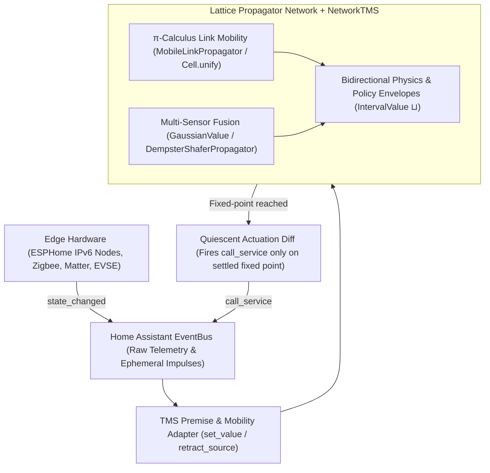

# Applications in Building & Home Automation

Modern smart homes and commercial buildings are distributed, safety-critical cyber-physical systems. Unlike traditional CRUD web apps, a building automation system must continuously:

1. **Fuse noisy, asynchronous sensor streams** (ESPHome BLE proxies, mmWave radar, Zigbee/Matter climate sensors) and degrade gracefully when battery-powered nodes drop offline.
2. **Arbitrate competing multi-objective policies** (occupant thermal comfort, freeze/over-current safety limits, solar self-consumption, and peak-tariff demand response) without race conditions or "last-automation-wins" clobbering.
3. **Adapt to a dynamically changing physical topology** as mobile entities—occupants, electric vehicles (EVs), and portable appliances—move between rooms, thermal zones, and electrical circuits.
4. **Explain every decision and diagnose faults** with causal provenance (`cell.explain()`) and automatic rollback when temporary overrides or defeasible assumptions expire.

---

## Why Lattice Propagators for Smart Buildings?

In `lattice-propagator`, every physical quantity, room setpoint envelope, and device state is modeled as a reactive [`Cell`](../api/primitives.md) holding partial information in a join-semilattice ($\sqcup$), connected by multidirectional [`Propagator`](../api/primitives.md) constraints and backed by a [`TruthMaintenanceSystem`](../api/tms.md).



---

## Quick Taste: Multi-Policy HVAC Envelope Arbitration

Instead of three separate automations overwriting a thermostat setpoint (`climate.set_temperature`), each policy asserts an [`IntervalValue`](../api/lattice.md) premise into the zone's target [`Cell`](../api/primitives.md). The cell computes their monotonic intersection ($\sqcup$) and automatically relaxes when a temporary policy retracts:

```python
from lattice_propagator import IntervalValue, PropagatorNetwork

net = PropagatorNetwork("ZoneArbitration")
living_room_target = net.add_cell("zone.living_room_temp", unit="°C")

# 1. Base building safety envelope: [16.0°C, 28.0°C]
living_room_target.set_value(IntervalValue(16.0, 28.0), source="policy.building_safety")

# 2. Occupant comfort policy: [20.0°C, 24.0°C]
living_room_target.set_value(IntervalValue(20.0, 24.0), source="policy.occupant_comfort")

# 3. Solar thermal pre-heating opportunism: [21.5°C, 25.0°C]
living_room_target.set_value(IntervalValue(21.5, 25.0), source="policy.solar_gain")
net.run()

print(f"Fused Operating Envelope: {living_room_target.value}")
# [21.500, 24.000]
print(living_room_target.explain())
# Intersecting policy.building_safety [16.0, 28.0]°C, policy.occupant_comfort [20.0, 24.0]°C, policy.solar_gain [21.5, 25.0]°C into [21.5, 24.0]°C.

# When clouds roll in and solar gain ends, retracting the premise restores [20.0°C, 24.0°C]:
living_room_target.retract_source("policy.solar_gain", reason="clouds")
net.run()
print(f"Envelope after Solar Retraction: {living_room_target.value}")
# [20.000, 24.000]
```

---

## Documents in This Section

1. **[Event Buses, Node-RED, $\pi$-Calculus & Propagators](paradigms_and_pi_calculus.md)**
   A deep architectural comparison of **Home Assistant Core (`EventBus` / `StateMachine`)**, **Node-RED (Flow-Based Programming)**, **$\pi$-Calculus process mobility (Microsoft BizTalk XLANG)**, and **Lattice Propagator Networks**—including executable patterns for $\pi$-calculus occupant room handoff, ambiguous BLE presence pre-conditioning with [`NetworkTMS`](../api/tms.md), and dynamic $(\nu x)$ EV charging session spawning with [`MobileLinkPropagator`](../api/primitives.md).
