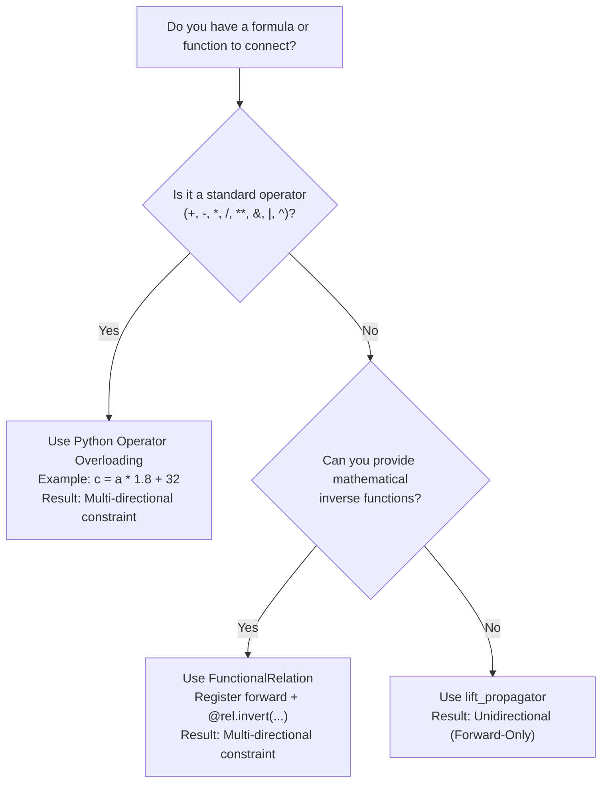

# Design Guidelines: When to Use What

This guide provides an architectural decision tree and cheatsheet for designing systems with `lattice-propagator`.

---

## 1. Architectural Decision Matrix

| What you want to accomplish | Recommended Pattern | Why & Underlying Mechanism |
| :--- | :--- | :--- |
| **Write standard formulas over cells** | **Python built-in operators** (`+`, `-`, `*`, `/`, `**`, `&`, `\|`, `^`) | Operator overloading (`Cell.__add__`, etc.) synthesizes intermediate cells and automatically wires **multi-directional constraints** ($F \to C$ and $C \to F$ simultaneously). |
| **Integrate an existing Python function or library** | **`lift_propagator`** / `FunctionalPropagator` | Lifts any pure Python callable over lattice values. **Direction:** Strictly forward ($I \to O$). Use when you don't need or cannot symbolically invert the calculation. |
| **Build custom multi-directional formulas** | **`FunctionalRelation`** | When your logic is mathematically invertible, write the forward function and decorate inverse directions with `@rel.invert(...)`. |
| **Combine multiple calculations to narrow a range** | **Lattice Merge on a single `Cell`** | **Do not write arbitration code or if-statements.** Have all independent estimators write to the **same target cell**. The cell's join-semilattice automatically computes the intersection (`IntervalValue`) or precision-weighted fusion (`GaussianValue`). |
| **Route data to a destination that changes dynamically** | **`MobileLinkPropagator`** | When the target cell depends on runtime conditions (e.g. which EV is plugged in). When the destination changes, the vacated cell automatically relaxes back to baseline. |
| **Prevent infinite graph expansion in recursion/loops** | **`DelayedPropagator`** | Defers sub-network instantiation until trigger input cells contain non-$\bot$ values (e.g. Heron's iterative square root). |
| **Enforce mutual exclusion (lightweight)** | **`AllDifferentPropagator`** | Forward elimination (eliminates values once a cell resolves to a single candidate) + hidden singles. Fast with low overhead. |
| **Enforce mutual exclusion (strong / Arc Consistency)** | **`AllDistinctPropagator`** | Full Generalized Arc Consistency via Régin's bipartite matching algorithm. Prunes unassigned candidate domains (naked pairs/triples) *before* search and detects contradictions earlier (like Prolog CLP(Z) `all_distinct/1`). |
| **Aggregate collections of cells** | **Balanced Tree Reductions (`tree_sum`)** | Standard `sum(cells)` creates a degenerate $O(N)$ linear chain. Tree reductions build an $O(\log N)$ balanced binary tree, minimizing worklist queue churn. |
| **Transform collections of cells element-wise** | **Python comprehensions** (`[x * 2 for x in cells]`) | Do not write custom `map` helpers. Python list and dict comprehensions naturally compose with `Cell` operator overloading. |

---

## 2. Choosing Between Functional Styles

### When to use Python Operators vs. `lift_propagator` vs. `FunctionalRelation`



### Pattern A: Operator Overloading (Multi-directional)
Use when composing standard algebraic or boolean expressions:
```python
from lattice_propagator import PropagatorNetwork, IntervalValue

net = PropagatorNetwork()
a = net.add_cell("a")
b = net.add_cell("b")

# Automatically creates output cell and wires AdderPropagator(a, b, c)
c = a + b

# Forward deduction:
a.value = 10
b.value = 25
net.run()
assert c.val == 35

# Or backward deduction on the same network:
c.value = 50
net.run()
```

### Pattern B: `lift_propagator` (Unidirectional)
Use when invoking black-box functions, statistical libraries, or external formatters:
```python
import math
from lattice_propagator import Cell, FlatValue, lift_propagator, PropagatorNetwork

net = PropagatorNetwork()
angle_cell = net.add_cell("angle")
sin_cell = net.add_cell("sin")

# Forward-only: cannot invert arbitrary Python bytecode
lift_propagator("sin_calc", lambda v: FlatValue(math.sin(v.val)), [angle_cell], sin_cell)
```

### Pattern C: `FunctionalRelation` (Custom Invertible)
Use when you have domain-specific formulas that can be inverted mathematically:
```python
from lattice_propagator import FunctionalRelation, PropagatorNetwork

net = PropagatorNetwork()
# Forward: Volume = Length * Width * Height
rel = FunctionalRelation(lambda l, w, h: l * w * h, inputs=["l", "w", "h"], outputs=["v"])


@rel.invert(inputs=["v", "w", "h"], outputs=["l"])
def inv_l(v, w, h):
    return v / (w * h)


rel.attach(net)
```

---

## 3. The Redundant Estimation Pattern (Sensor Fusion & Narrowing Ranges)

In traditional imperative programming, combining multiple estimates requires writing arbitration code, weighted averages, or branching logic:

```text
# Anti-pattern in propagator networks: imperative arbitration
if sensor_a_available and sensor_b_available:
    temp = (sensor_a + sensor_b) / 2
elif sensor_a_available:
    temp = sensor_a
```

In a propagator network, **information accumulates monotonically**. The idiomatic design pattern is:

1. Create a single `Cell` representing the true physical state.
2. Connect all independent calculations, sensors, or estimators to write into that **same cell**.
3. Let the lattice merge operator ($\sqcup$) calculate the precision-weighted fusion or bounding intersection automatically.

```python
from lattice_propagator import PropagatorNetwork, IntervalValue

net = PropagatorNetwork()
room_temp = net.add_cell("room_temp")

# Physical sensor reading: [20.0, 24.0]°C
room_temp.set_value(IntervalValue(20.0, 24.0), source="hardware_sensor")

# Thermal model estimation: [21.5, 26.0]°C
room_temp.set_value(IntervalValue(21.5, 26.0), source="thermal_model")

# The cell automatically computes the intersection: [21.5, 24.0]°C
print(room_temp.value)  # [21.500, 24.000]
assert room_temp.value == IntervalValue(21.5, 24.0)
```

---

## 4. Group Mutual Exclusion: `AllDifferentPropagator` vs. `AllDistinctPropagator`

When modeling combinatorial problems where all variables in a unit must take distinct values (such as Sudoku units, N-Queens columns, or assignment problems), you can choose between two levels of filtering:

| Feature | `AllDifferentPropagator` | `AllDistinctPropagator` |
| :--- | :--- | :--- |
| **Prolog Analogue** | `library(clpz): all_different/1` | `library(clpz): all_distinct/1` |
| **Consistency Level** | Forward Checking + Hidden Singles | Generalized Arc Consistency (GAC) |
| **Underlying Algorithm** | Singleton value peer elimination | Régin's Maximum Bipartite Matching (1994) |
| **Naked Tuple Pruning** | No (only prunes when a cell becomes ground) | **Yes** (prunes pairs/triples without any search) |
| **Contradiction Detection** | When duplicate values are assigned | **Early** (detects Hall condition violations before assignment) |
| **Performance Profile** | Very fast per iteration ($O(N)$) | Deeper pruning, higher per-iteration overhead ($O(N^2 \cdot D)$) |

### When to choose which:
* Choose **`AllDifferentPropagator`** for loose or easy constraint problems where variables resolve quickly and lightweight forward checking keeps overhead to a minimum.
* Choose **`AllDistinctPropagator`** for tight or highly constrained search problems where pruning unassigned candidate domains (naked pairs/triples) dramatically reduces branch-and-bound search trees.

