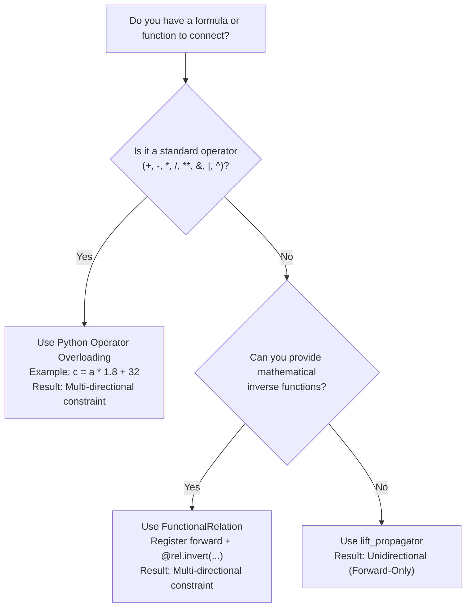

# Design Guidelines: When to Use What

This guide provides an architectural decision tree and cheatsheet for designing systems with `lattice-propagator`.

---

## 1. Architectural Decision Matrix

| What you want to accomplish | Recommended Pattern | Why & Underlying Mechanism |
| :--- | :--- | :--- |
| **Write standard formulas over cells** | **Python built-in operators** (`+`, `-`, `*`, `/`, `**`, `&`, `\|`, `^`) | Operator overloading (`Cell.__add__`, etc.) synthesizes intermediate cells and automatically wires **multi-directional constraints** ($F \to C$ and $C \to F$ simultaneously). |
| **Integrate an existing Python function or library** | **`lift_propagator`** / `FunctionalPropagator` | Lifts any pure Python callable over lattice values. **Direction:** Strictly forward ($I \to O$). Use when you don't need or cannot symbolically invert the calculation. |
| **Build custom multi-directional formulas** | **`FunctionalRelation`** | When your logic is mathematically invertible, write the forward function and decorate inverse directions with `@rel.invert(...)`. |
| **Combine multiple calculations to narrow a range** | **Lattice Merge on a single `Cell`** | **Do not write arbitration code or if-statements.** Have all independent estimators write to the **same target cell**. The cell's join-semilattice automatically computes the intersection (`IntervalValue`) or precision-weighted fusion (`GaussianValue`). |
| **Route data to a destination that changes dynamically** | **`MobileLinkPropagator`** | When the target cell depends on runtime conditions (e.g. which EV is plugged in). When the destination changes, the vacated cell automatically relaxes back to baseline. |
| **Prevent infinite graph expansion in recursion/loops** | **`DelayedPropagator`** | Defers sub-network instantiation until trigger input cells contain non-$\bot$ values (e.g. Heron's iterative square root). |
| **Enforce mutual exclusion (lightweight)** | **`AllDifferentPropagator`** | Forward elimination (eliminates values once a cell resolves to a single candidate) + hidden singles. Fast with low overhead. |
| **Enforce mutual exclusion (strong / Arc Consistency)** | **`AllDistinctPropagator`** | Full Generalized Arc Consistency via Régin's bipartite matching algorithm. Prunes unassigned candidate domains (naked pairs/triples) *before* search and detects contradictions earlier (like Prolog CLP(Z) `all_distinct/1`). |
| **Solve remaining ambiguity after propagation stalls (labeling)** | **`ChoiceEngine`** (or **`NetworkTMS`**) | External search driver (Prolog `labeling/2` analogue): interleaves MRV (First-Fail) branching with `network.run()` after *every* candidate guess, rolling back on `Contradiction` (or learning nogoods via `NetworkTMS`). |
| **Aggregate collections of cells** | **Balanced Tree Reductions (`tree_sum`)** | Standard `sum(cells)` creates a degenerate $O(N)$ linear chain. Tree reductions build an $O(\log N)$ balanced binary tree, minimizing worklist queue churn. |
| **Transform collections of cells element-wise** | **Python comprehensions** (`[x * 2 for x in cells]`) | Do not write custom `map` helpers. Python list and dict comprehensions naturally compose with `Cell` operator overloading. |
| **Integrate with `asyncio` / event-driven I/O** | **Hybrid pattern** (async boundary + sync `network.run()`) | Keep core lattice math synchronous and deterministic; batch async events, call `network.run()` to quiescence, then `await` I/O on settled deltas. |

---

## 2. Choosing Between Functional Styles

### When to use Python Operators vs. `lift_propagator` vs. `FunctionalRelation`



### Pattern A: Operator Overloading (Multi-directional)
Use when composing standard algebraic or boolean expressions:
```python
from lattice_propagator import PropagatorNetwork, IntervalValue

net = PropagatorNetwork()
a = net.add_cell("a")
b = net.add_cell("b")

# Automatically creates output cell and wires AdderPropagator(a, b, c)
c = a + b

# Forward deduction:
a.value = 10
b.value = 25
net.run()
assert c.val == 35

# Or backward deduction on the same network:
c.value = 50
net.run()
```

### Pattern B: `lift_propagator` (Unidirectional)
Use when invoking black-box functions, statistical libraries, or external formatters:
```python
import math
from lattice_propagator import Cell, FlatValue, lift_propagator, PropagatorNetwork

net = PropagatorNetwork()
angle_cell = net.add_cell("angle")
sin_cell = net.add_cell("sin")

# Forward-only: cannot invert arbitrary Python bytecode
lift_propagator("sin_calc", lambda v: FlatValue(math.sin(v.val)), [angle_cell], sin_cell)
```

### Pattern C: `FunctionalRelation` (Custom Invertible)
Use when you have domain-specific formulas that can be inverted mathematically:
```python
from lattice_propagator import FunctionalRelation, PropagatorNetwork

net = PropagatorNetwork()
# Forward: Volume = Length * Width * Height
rel = FunctionalRelation(lambda l, w, h: l * w * h, inputs=["l", "w", "h"], outputs=["v"])


@rel.invert(inputs=["v", "w", "h"], outputs=["l"])
def inv_l(v, w, h):
    return v / (w * h)


rel.attach(net)
```

---

## 3. The Redundant Estimation Pattern (Sensor Fusion & Narrowing Ranges)

In traditional imperative programming, combining multiple estimates requires writing arbitration code, weighted averages, or branching logic:

```text
# Anti-pattern in propagator networks: imperative arbitration
if sensor_a_available and sensor_b_available:
    temp = (sensor_a + sensor_b) / 2
elif sensor_a_available:
    temp = sensor_a
```

In a propagator network, **information accumulates monotonically**. The idiomatic design pattern is:

1. Create a single `Cell` representing the true physical state.
2. Connect all independent calculations, sensors, or estimators to write into that **same cell**.
3. Let the lattice merge operator ($\sqcup$) calculate the precision-weighted fusion or bounding intersection automatically.

```python
from lattice_propagator import PropagatorNetwork, IntervalValue

net = PropagatorNetwork()
room_temp = net.add_cell("room_temp")

# Physical sensor reading: [20.0, 24.0]°C
room_temp.set_value(IntervalValue(20.0, 24.0), source="hardware_sensor")

# Thermal model estimation: [21.5, 26.0]°C
room_temp.set_value(IntervalValue(21.5, 26.0), source="thermal_model")

# The cell automatically computes the intersection: [21.5, 24.0]°C
print(room_temp.value)  # [21.500, 24.000]
assert room_temp.value == IntervalValue(21.5, 24.0)
```

---

## 4. Group Mutual Exclusion: `AllDifferentPropagator` vs. `AllDistinctPropagator`

When modeling combinatorial problems where all variables in a unit must take distinct values (such as Sudoku units, N-Queens columns, or assignment problems), you can choose between two levels of filtering:

| Feature | `AllDifferentPropagator` | `AllDistinctPropagator` |
| :--- | :--- | :--- |
| **Prolog Analogue** | `library(clpz): all_different/1` | `library(clpz): all_distinct/1` |
| **Consistency Level** | Forward Checking + Hidden Singles | Generalized Arc Consistency (GAC) |
| **Underlying Algorithm** | Singleton value peer elimination | Régin's Maximum Bipartite Matching (1994) |
| **Naked Tuple Pruning** | No (only prunes when a cell becomes ground) | **Yes** (prunes pairs/triples without any search) |
| **Contradiction Detection** | When duplicate values are assigned | **Early** (detects Hall condition violations before assignment) |
| **Performance Profile** | Very fast per iteration ($O(N)$) | Deeper pruning, higher per-iteration overhead ($O(N^2 \cdot D)$) |

### When to choose which:
* Choose **`AllDifferentPropagator`** for loose or easy constraint problems where variables resolve quickly and lightweight forward checking keeps overhead to a minimum.
* Choose **`AllDistinctPropagator`** for tight or highly constrained search problems where pruning unassigned candidate domains (naked pairs/triples) dramatically reduces branch-and-bound search trees.

---

## 5. Non-Monotonic Search & Belief Revision: `ChoiceEngine` vs. `NetworkTMS`

Core propagators are strictly monotonic—once a `Contradiction` ($\top$) is reached, propagation cannot undo it on its own. When a problem requires branching, fallback, or retraction, choose between two complementary non-monotonic mechanisms:

| Feature | `ChoiceEngine` | `NetworkTMS` |
| :--- | :--- | :--- |
| **Primary Goal** | Find *any* valid assignment across finite or integer domains | Maintain consistent beliefs under defeasible assumptions |
| **Prolog / AI Analogue** | CLP(Z) `labeling([ff], Vars)` | Truth Maintenance System / CDCL Nogood Learning |
| **Backtracking Strategy** | Chronological state snapshots & rollback on `Contradiction` | Dependency-directed backtracking (DDB) via causal `support` sets |
| **Confidence / Priority** | None (all candidate branches are equal) | Yes (`confidence` decides which assumption yields to a conflict) |
| **Granularity of Rollback** | Entire network snapshot restored on failure | Retracts *only* the weakest assumption and premises derived from it |
| **Setup Overhead** | Zero setup (`ChoiceEngine(net).first_solution()`) | Opt-in (`NetworkTMS(net)`, cell TMS registration, `assume()` / `is_assumption=True`) |

### When to choose which:
* Choose **`ChoiceEngine`** for closed constraint-satisfaction and CLP(Z) puzzles (e.g., [Map Colouring](../examples/map_colouring.md), [Sudoku](../examples/sudoku.md), [N-Queens](../examples/n_queens.md)) where you just need a consistent assignment over `DiscreteDomain` or `IntegerDomain` cells. Propagation still runs to a full fixed point after every candidate branch.
* Choose **`NetworkTMS`** when hypotheses have **confidence/priority** or you need **surgical retraction and nogood learning**:
  * **Overridable defaults / sensor conflicts:** Retracting a low-confidence forecast while preserving ground facts ([Truth Maintenance & Backtracking](tms.md)).
  * **Model-based fault diagnosis:** Isolating which component health assumption caused a probe contradiction ([Circuit Fault Diagnosis](../examples/circuit_diagnosis.md)).
  * **Conflict-driven search & live systems:** Learning minimal nogood sets to prune repeated dead ends ([CDCL SAT Solver](../examples/sat_solver.md)), or retracting a stale assumption in a running network without resetting unrelated cells.

---

## 6. How to Use with `asyncio` (Hybrid Architecture)

`lattice-propagator` executes purely in memory using synchronous Python (zero network sockets, disk I/O, or `await` points inside propagators — see [Requirements §5 (`REQ-HAC-1`)](../requirements.md#5-home-assistant-core-import-compliance-req-hac)). When embedding a `PropagatorNetwork` inside an `asyncio` application (such as Home Assistant, an MQTT bridge, or a WebSocket server), use the **Hybrid Pattern**: keep the inner lattice settling synchronous, and keep `asyncio` I/O at the boundaries.

### Recommended Pattern: Async Boundaries, Synchronous Core

1. **Ingest & batch:** Collect incoming async events (sensor updates, RPC payloads) and write them into cells via `cell.set_value(...)`. Updating a cell only enqueues watching propagators into `_queue` if the cell's value actually changed (`merged ≠ current`).
2. **Settle atomically:** Call `network.run()` once to drive the network to fixed-point quiescence. Because `run()` contains no `await` points, no other coroutine can interleave and mutate cells mid-propagation.
3. **Emit I/O on settled deltas:** Compare the settled output cell(s) against their prior values and `await` external I/O only *after* `network.run()` returns — never from inside `Propagator.alert()`.

```python
import asyncio
from lattice_propagator import IntervalValue, PropagatorNetwork


async def run_async_gateway() -> None:
    net = PropagatorNetwork("hvac")
    temp = net.add_cell("temp")
    target = net.add_cell("target")

    # Wire multi-directional constraint: target = temp + 2.0°C
    target << (temp + 2.0)

    async def on_sensor_batch(readings: list[IntervalValue]) -> None:
        prev = target.value
        changed = False
        for i, reading in enumerate(readings):
            changed |= temp.set_value(reading, source=f"sensor_{i}")
        if changed:
            net.run()  # Synchronous, deterministic settling to least fixed point
            if target.value != prev:
                # Perform async I/O only after reaching quiescence
                await asyncio.sleep(0)

    await on_sensor_batch([IntervalValue(20.0, 23.0), IntervalValue(21.0, 24.0)])
    assert target.value == IntervalValue(23.0, 25.0)


asyncio.run(run_async_gateway())
```

### Practical Guardrails in `asyncio` Apps

* **Heavy searches (`ChoiceEngine.first_solution` / `all_solutions`):** Typical sensor-fusion and arithmetic networks settle in microseconds and will not stall the event loop. For large combinatorial searches or high `max_iterations` loops, run an isolated network off-loop via `await asyncio.to_thread(engine.first_solution)`.
* **Async I/O bridges:** If a computation itself requires async I/O (e.g., querying an HTTP API or LLM), bridge two cells with an external `asyncio.Task` that reads a settled input cell, awaits the I/O, writes the result to an output cell, and calls `network.run()`.
* **Single-thread ownership:** Although lattice values are immutable, `PropagatorNetwork._queue`, `Cell._value`, and TMS state have no locks. Keep mutations to a given `PropagatorNetwork` on the event-loop thread (use `loop.call_soon_threadsafe(...)` when feeding updates from worker threads).

### Architectural Decision: Why Cells Are Not `asyncio` Awaitables

An alternative design would make every `Cell` an `asyncio` awaitable (`await cell`) and schedule each `Propagator` as an `asyncio.Task` driven by the event loop. `lattice-propagator` intentionally uses a synchronous FIFO worklist (`collections.deque`) instead of native `asyncio` task scheduling for five reasons:

1. **Explicit quiescence barrier:** `network.run()` provides an exact, synchronous fixed-point guarantee when it returns. Scheduling propagators as independent `asyncio` tasks leaves callers without a built-in settled state unless every edge maintains pending-task reference counts.
2. **Speculative search & TMS rollback safety:** `ChoiceEngine.first_solution()` and `MobileLinkPropagator` assert speculative values, hit `Contradiction`, and retract them. Keeping settling synchronous prevents external `asyncio` awaiters from waking up on transient, unrolled speculative states.
3. **Union-Find unification (`Cell.unify`):** Merging two cells via `cell_a.unify(cell_b)` re-parents aliases and transfers subscribers. Migrating suspended coroutine waiters/futures across merged equivalence classes adds subtle lifecycle and cancellation edge cases.
4. **Iteration bounds & loop starvation:** `network.run(max_iterations=...)` cleanly caps cyclic or slowly converging interval loops. Unbounded `call_soon` / task-resumption chains in `asyncio` risk starving I/O callbacks on the event loop.
5. **Overhead in tight constraint loops:** `deque.popleft()` + `alert()` executes in tens to hundreds of nanoseconds; allocating `Future`s and resuming coroutine frames per cell refinement would be orders of magnitude slower for tight constraint problems (Sudoku, N-Queens, resistor networks).


