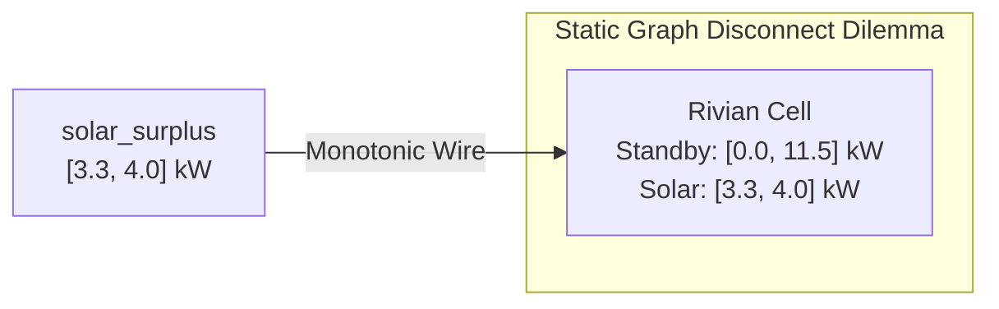

# Dynamic Topology & π-Calculus Mobility: Architectural Trade-Offs

A central design choice in `lattice-propagator` is the inclusion of **$\pi$-calculus link mobility** ([`MobileLinkPropagator`](file:///home/doug/code/lattice-propagator/docs/api/primitives.md)). 

This introduces an essential architectural question:

> *"Is $\pi$-calculus link mobility genuinely beneficial, or is it merely added conceptual complexity? Couldn't dynamic routing be accomplished with simple switches, multiplexers, or imperative control scripts?"*

The short answer: **For small, closed, static graphs (such as toggling a single relay between two lights), $\pi$-calculus mobility is indeed overkill. However, for open-world physical systems governed by join-semilattices, link mobility solves a fundamental mathematical dilemma that static graphs cannot resolve without violating monotonicity or discarding network state.**

---

## 1. The Monotonicity Dilemma: You Cannot "Disconnect" a Pure Lattice Wire

In classical imperative code (Python, C++, JavaScript), routing is achieved through destructive variable reassignment:

```text
# Imperative paradigm: destructive mutation
car_a.charging_power = 0.0
car_b.charging_power = available_surplus
```

In Gerald Jay Sussman and Alexey Radul's propagator model, execution is strictly **monotonic refinement** ($\sqsubseteq$). A cell's value represents accumulated partial knowledge; information only increases ($x \sqcup y \ge x$).

This creates a fundamental dilemma for constraint networks: **How do you disconnect a wire in a monotonic lattice?**



In a static graph, once `solar_surplus` ($[3.3, 4.0]\,\text{kW}$) flows into `CarA`, that information is fused into the cell. When solar priorities shift to `CarB`, how do you "turn off" `CarA`?

### Failure Mode 1: Clamping to Zero via a Static Switch

If you insert a static switch that asserts $[0.0, 0.0]\,\text{kW}$ when disabled:

$$[0.0, 11.5] \sqcap [0.0, 0.0] = [0.0, 0.0]\,\text{kW}$$

- **The Problem:** $[0.0, 0.0]$ is an **active, restrictive constraint**, not an *unconstrained standby state*.
- If `CarA` has an auxiliary source (e.g., its own portable solar panel, a secondary Level 1 wall plug, or an internal vehicle battery schedule demanding $[1.0, 2.0]\,\text{kW}$), clamping the cell to zero causes an immediate, artificial `Contradiction` ($\top$):
  $$[1.0, 2.0] \sqcap [0.0, 0.0] = \top\quad (\text{Contradiction})$$
- You intended `CarA` to be *unconstrained by the garage solar splitter*, but instead you locked it to zero.

### Failure Mode 2: Resetting the Network (`net.reset()`)

If you imperatively clear the cell or reset the network:
- You discard all integrated state (such as accumulated battery energy $\int P\,dt$).
- You wipe out multi-sensor fused estimates (Kalman filter states, thermal envelopes).
- You erase learned nogood sets and Truth Maintenance dependency histories across the entire home.

### The $\pi$-Calculus + TMS Resolution

In Robin Milner's $\pi$-calculus ($c?(y).\, y!\langle v \rangle$), communication channels are first-class values. 

`MobileLinkPropagator` bridges $\pi$-calculus with Truth Maintenance:

1. When the mobile link connects `solar_surplus` to `rivian`, it asserts the bound under a **defeasible premise**:
   $$\text{Premise: } \texttt{dispatcher@rivian} \implies [3.3, 4.0]\,\text{kW}$$
2. When the channel moves to `"tesla"`, `MobileLinkPropagator` calls `Cell.retract_source("dispatcher@rivian")`.
3. The Rivian cell’s internal TMS immediately re-evaluates all remaining active premises (its baseline `hardware_envelope`).
4. The cell cleanly **relaxes** back to $[0.0, 11.5]\,\text{kW}$ without any manual zeroing command or network reset!

---

## 2. Static Multiplexers vs. $\pi$-Calculus Link Mobility

Why not build a static multiplexer cell instead? The table below highlights the architectural trade-offs:

| Architectural Metric | Static Multiplexer / Switch Network | $\pi$-Calculus Link Mobility (`MobileLinkPropagator`) |
| :--- | :--- | :--- |
| **Wiring Complexity** | **$O(M \times N)$ permanent wires.** If $M$ energy sources can route to $N$ sinks, the network must instantiate $M \times N$ switch propagators and cells permanently resident in memory. | **$O(M)$ mobile dispatchers.** A single dispatcher dynamically addresses whichever target is named in the channel cell. |
| **The "Open World" Problem** | **Closed World Only.** Cannot route power to a device that did not exist when `net = PropagatorNetwork(...)` was constructed. | **Open World (Scope Extrusion $(\nu y)$).** Setting `spawn_missing=True` allows guest EVs, new battery packs, or discovered Zigbee plugs to allocate fresh cells dynamically at runtime. |
| **Reasoning Over Routing** | Routing is an external control flag outside the constraint algebra. | The destination identifier itself is a first-class lattice value (`DiscreteDomain`, `FlatValue`, `SetLattice`). The network can reason about *which route is feasible* using ordinary constraints. |
| **Speculative Pruning (DDB)** | Cannot easily project hypothetical bounds down uncommitted branches. | Setting `propagate_ambiguous=True` projects defeasible `Assumption`s across candidate targets. If downstream breaker limits trigger a contradiction, Dependency-Directed Backtracking (DDB) automatically prunes the invalid target. |

---

## 3. Deep Dive: Speculative Routing & Constraint Backtracking

The most compelling technical advantage of $\pi$-calculus link mobility appears when routing decisions are **uncertain or under-constrained**.

Consider a smart home where available solar surplus is $[3.0, 3.5]\,\text{kW}$, and the energy manager has not yet committed between charging the Rivian or the Tesla:

```python
from lattice_propagator import (
    Contradiction,
    DiscreteDomain,
    IntervalValue,
    MobileLinkPropagator,
    NetworkTMS,
    PropagatorNetwork,
)

net = PropagatorNetwork("SpeculativeRouter")
ntms = NetworkTMS(net)

surplus = net.add_cell("surplus", IntervalValue(3.0, 3.5))
channel = net.add_cell("channel")

rivian = net.add_cell("rivian_power")
tesla = net.add_cell("tesla_power")
ntms.get_or_create_cell_tms("rivian_power")
ntms.get_or_create_cell_tms("tesla_power")

# Baseline hardware capability limits:
rivian.set_value(IntervalValue(0.0, 11.5), source="hardware_limit")
tesla.set_value(IntervalValue(0.0, 7.6), source="hardware_limit")

net.add_propagator(
    MobileLinkPropagator(
        "ev_dispatcher",
        channel_cell=channel,
        payload_cell=surplus,
        targets={"rivian": rivian, "tesla": tesla},
        propagate_ambiguous=True,  # Enables speculative branching
    )
)

# 1. Routing is in a superposition of candidates:
channel.set_value(DiscreteDomain({"rivian", "tesla"}))
net.run()

# Both vehicles simultaneously receive speculative bounds as TMS assumptions:
assert rivian.value == IntervalValue(3.0, 3.5)
assert tesla.value == IntervalValue(3.0, 3.5)
assert rivian.tms.premises["ev_dispatcher@rivian"].is_assumption is True
assert tesla.tms.premises["ev_dispatcher@tesla"].is_assumption is True

# 2. Suppose Rivian's BMS suddenly asserts a minimum pilot threshold [5.0, 11.5] kW:
rivian.set_value(IntervalValue(5.0, 11.5), source="bms_thermal_min")

# Immediate contradiction detected: [3.0, 3.5] ⊓ [5.0, 11.5] = ⊤
assert isinstance(rivian.value, Contradiction)

# 3. Dependency-Directed Backtracking (DDB) traces the contradiction to the assumption:
retracted = ntms.resolve_contradiction(rivian.tms.active_sources)
assert retracted == "ev_dispatcher@rivian"

# Rivian relaxes back to its thermal window; Tesla retains the budget!
assert rivian.value == IntervalValue(5.0, 11.5)
assert tesla.value == IntervalValue(3.0, 3.5)
```

In a traditional imperative or static switch architecture, implementing this behavior requires complex procedural logic:
1. Attempt routing to Rivian.
2. Check for faults.
3. Catch exceptions.
4. Issue imperative cancel commands.
5. Attempt routing to Tesla.

With `MobileLinkPropagator` and `NetworkTMS`, **speculation and fault pruning fall out naturally from the algebra of lattices and Truth Maintenance**.

---

## 4. Pragmatic Boundaries: When Is Link Mobility Overkill?

To maintain engineering discipline, $\pi$-calculus link mobility should not be applied everywhere. It introduces indirection and requires Truth Maintenance tracking.

### Do NOT Use Link Mobility When:

1. **The Topology Is Closed and Static:**
   If a home has one solar inverter and one water heater with a physical on/off contactor, a simple `SwitchPropagator` or `AdderPropagator` is far simpler and easier to audit.
2. **Devices Never Leave, Arrive, or Reconfigure:**
   If all consumers are permanent, hardwired electrical circuits with fixed roles, static graph wiring is optimal.
3. **Execution Is Strictly Feed-Forward:**
   If data flows strictly from sensors to actuators without any need for bidirectional inference, hypothetical branching, or diagnostic backtracking.

---

## 5. Architectural Decision Matrix

Use the matrix below to select the appropriate topological mechanism in `lattice-propagator`:

| Mechanism | Representative Use Case | Retracts on Change? | Creates New Cells? |
| :--- | :--- | :---: | :---: |
| **Direct Propagator Wiring** (`AdderPropagator`, `MultiplierPropagator`) | Fixed mathematical physics ($P = V \times I$, energy balance $P_{\text{base}} + P_{\text{surplus}} = P_{\text{solar}}$) | No (Permanent) | No |
| **Cell Unification** (`cell_a.unify(cell_b)`) | Discovered identity (discovering that two sensor probes measure the same physical water pipe) | No (Monotonic DSU) | No |
| **Static Gated Wire** (`SwitchPropagator`) | Gated binary actuators with fixed wiring (furnace enable switch) | No | No |
| **$\pi$-Calculus Mobile Link** (`MobileLinkPropagator`) | Dynamic resource routing, priority scheduling, EV fleets, open-world device discovery, speculative CSP branch pruning | **Yes (via TMS)** | **Yes (via $(\nu y)$)** |

---

## Summary

Robin Milner’s $\pi$-calculus is not academic decoration in `lattice-propagator`. It is the mathematical mechanism that allows **monotonic constraint networks** to operate in **dynamically changing physical worlds**. 

By pairing channel mobility ($c?(y).\, y!\langle v \rangle$) with defeasible Truth Maintenance retraction, the network gains the ability to dynamically reconfigure physical connections without mutating state, risking dangling wires, or violating semilattice monotonicity.
