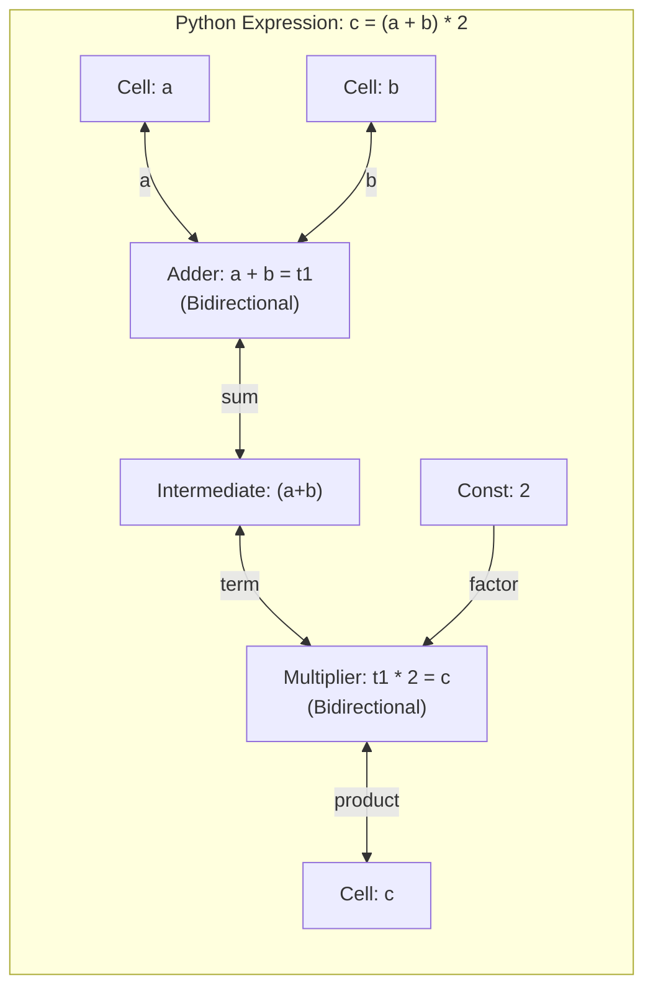

# Reactive Cells & Propagator Networks

Propagator networks compute by reaching a **fixed point** across interconnected reactive cells.

> [!TIP] Hands-On Tutorial
> If you are new to the library, begin with the step-by-step [Getting Started Guide](../getting_started.md) to install the package and wire your first network.

---

## 1. The `Cell`

A `Cell` is the communication channel and memory unit of a propagator network:

- It holds a single `LatticeValue` (initially `Bottom`).
- When `set_value(new_val)` is called, the cell merges `new_val` with its existing content.
- If the merged value represents a strict information gain ($x_{\text{old}} \sqsubset x_{\text{new}}$), all connected propagators are enqueued for execution.
- If the merged value is identical to what the cell already knows, no propagators are triggered (**idempotence preventing infinite loops**).

```python
from lattice_propagator import Cell, FlatValue

temp_cell = Cell("living_room_temp")
print(temp_cell.value)  # ⊥(Bottom)

temp_cell.set_value(FlatValue(21.5))
print(temp_cell.value)  # Flat(21.5)
```

### Cell Unification (`cell_a.unify(cell_b)`)

In complex constraint networks, intermediate computations may produce two cells that are discovered to refer to the exact same physical quantity. 

`Cell.unify()` permanently binds two cells together using a Disjoint Set Union (DSU / Union-Find) algorithm:
- Their values are merged ($v_a \sqcup v_b$).
- Their neighbor propagator lists are unified.
- Subsequent updates to either cell notify all connected propagators across both original cells.

---

## 2. Propagators

A `Propagator` is an autonomous computational unit. It:
1. Observes a set of input cells.
2. When triggered, examines their values.
3. Computes deductions.
4. Writes results to one or more output cells.

### Directed Propagators vs. Multi-directional Constraints

A common point of confusion is whether propagators are "directional" or "multi-directional":

* **Primitive Function Lifts are Directional ($I \to O$):** An individual `FunctionalPropagator` created via `lift_propagator(name, fn, inputs, output)` is strictly unidirectional. Because arbitrary Python callables cannot be symbolically inverted at runtime, information only propagates forward from inputs to output.
* **Compound Constraints are Multi-directional Bundles:** What we often call an "arithmetic propagator" (like `AdderPropagator`) is actually a compound device bundling multiple directional deduction rules together ($c = a + b$, $a = c - b$, and $b = c - a$), allowing information to flow in any direction.
* **`FunctionalRelation` Inversions:** To make arbitrary Python functions multi-directional without handcrafting custom classes, use `FunctionalRelation` with registered `.invert(...)` handler functions for reverse deduction paths.

### Expression Functionalization & Operator Overloading

Manually allocating intermediate cells and wiring arithmetic propagators for complex mathematical formulas quickly becomes cumbersome. `lattice-propagator` supports **expression functionalization**: `Cell` instances overload standard Python arithmetic operators (`+`, `-`, `*`, `/`):

```python
from lattice_propagator import Cell, IntervalValue, PropagatorNetwork

net = PropagatorNetwork("ExpressionDemo")
a = net.add_cell("a", IntervalValue(10.0, 15.0))
b = net.add_cell("b", IntervalValue(5.0, 10.0))

# Multi-directional constraint network synthesized automatically:
c = (a + b) * 2.0
net.run()
assert c.value == IntervalValue(30.0, 50.0)
```

Under the hood, `build_binary_op(left, right, op)`:
1. Automatically coerces raw constants into immutable constant cells.
2. Allocates anonymous intermediate cells (e.g. `(a+b)` and `((a+b)*right)`).
3. Connects multi-directional `AdderPropagator` and `MultiplierPropagator` constraints.
4. Uses **inverted dispatch**: subtraction (`a - b`) wires `AdderPropagator` with `(out, b, a)` so that `out + b = a`, avoiding redundant arithmetic classes.



#### Custom Operator Registration

You can register custom binary and unary operators via `register_binary_op` and `register_unary_op`:

```python
from lattice_propagator import PowerPropagator, register_binary_op

# Register '**' operator mapping to PowerPropagator:
register_binary_op("pow", "**", PowerPropagator)
```

### Balanced Tree Reductions (`tree_reduce` & `tree_sum`)

When aggregating a collection of cells (e.g. summing 16 sensor measurements or multiplying factors), standard Python `sum(cells)` or `functools.reduce(...)` constructs a **degenerate linear chain** of depth $O(N)$. Linear chains introduce significant latency: changes at the start must ripple through $N - 1$ sequential propagator steps, causing worklist queue churn.

Instead, prefer **balanced binary reduction trees** using `tree_sum(cells)` or `tree_reduce(op, cells)`:

```python
from lattice_propagator import IntervalValue, PropagatorNetwork, tree_sum

net = PropagatorNetwork()
cells = [net.add_cell(f"sensor_{i}", IntervalValue(10.0, 12.0)) for i in range(8)]

# Constructs a balanced tree with depth log2(8) = 3:
total = tree_sum(cells)
net.run()
assert total.value == IntervalValue(80.0, 96.0)
```

- **Logarithmic Latency:** A change in any leaf reaches the root in only $O(\log N)$ worklist turns.
- **Fast Backward Deduction:** When `total` is constrained, backward deductions propagate simultaneously down both branches of the balanced tree rather than crawling sequentially through $N$ cells.

### Expression Functionalization & Operator Overloading

Manually allocating intermediate cells and wiring arithmetic propagators for complex mathematical formulas quickly becomes cumbersome. `lattice-propagator` supports **expression functionalization**: `Cell` instances overload standard Python arithmetic operators (`+`, `-`, `*`, `/`):

```python
from lattice_propagator import Cell, IntervalValue, PropagatorNetwork

net = PropagatorNetwork("ExpressionDemo")
a = net.add_cell("a", IntervalValue(10.0, 15.0))
b = net.add_cell("b", IntervalValue(5.0, 10.0))

# Multi-directional constraint network synthesized automatically:
c = (a + b) * 2.0
net.run()
assert c.value == IntervalValue(30.0, 50.0)
```

Under the hood, `build_binary_op(left, right, op)`:
1. Automatically coerces raw constants into immutable constant cells.
2. Allocates anonymous intermediate cells (e.g. `(a+b)` and `((a+b)*right)`).
3. Connects multi-directional `AdderPropagator` and `MultiplierPropagator` constraints.
4. Uses **inverted dispatch**: subtraction (`a - b`) wires `AdderPropagator` with `(out, b, a)` so that `out + b = a`, avoiding redundant arithmetic classes.


#### Custom Operator Registration

You can register custom binary and unary operators via `register_binary_op` and `register_unary_op`:

```python
from lattice_propagator import PowerPropagator, register_binary_op

# Register '**' operator mapping to PowerPropagator:
register_binary_op("pow", "**", PowerPropagator)
```

### Balanced Tree Reductions (`tree_reduce` & `tree_sum`)

When aggregating a collection of cells (e.g. summing 16 sensor measurements or multiplying factors), standard Python `sum(cells)` or `functools.reduce(...)` constructs a **degenerate linear chain** of depth $O(N)$. Linear chains introduce significant latency: changes at the start must ripple through $N - 1$ sequential propagator steps, causing worklist queue churn.

Instead, prefer **balanced binary reduction trees** using `tree_sum(cells)` or `tree_reduce(op, cells)`:

```python
from lattice_propagator import IntervalValue, PropagatorNetwork, tree_sum

net = PropagatorNetwork()
cells = [
    net.add_cell(f"sensor_{i}", IntervalValue(10.0, 12.0)) for i in range(8)
]

# Constructs a balanced tree with depth log2(8) = 3:
total = tree_sum(cells)
net.run()
assert total.value == IntervalValue(80.0, 96.0)
```

- **Logarithmic Latency:** A change in any leaf reaches the root in only $O(\log N)$ worklist turns.
- **Fast Backward Deduction:** When `total` is constrained, backward deductions propagate simultaneously down both branches of the balanced tree rather than crawling sequentially through $N$ cells.

### Built-in Primitives

| Propagator | Description | Directionality |
| :--- | :--- | :---: |
| `AdderPropagator(a, b, c)` | Enforces $a + b = c$ ($c = a + b, a = c - b, b = c - a$) | Multi-directional |
| `MultiplierPropagator(a, b, c)` | Enforces $a \times b = c$ with zero-absorption and division | Multi-directional |
| `SwitchPropagator(control, input, output, trigger)` | Routes `input` to a fixed `output` when `control == trigger` | Forward |
| `MobileLinkPropagator(name, channel, payload, ...)` | Dynamic routing: destination cell changes based on condition | Dynamic |
| `ConditionalPropagator(pred, cons, alt, out)` | Multiplexer with Sussman-Radul consensus optimization | Forward |
| `RatePropagator(source, rate, dt)` | First-order velocity/derivative estimation | Forward |
| `LagPropagator(input, output, tau, dt)` | First-order exponential lag filter (thermal inertia) | Forward |
| `KalmanEstimatorPropagator(...)` | Fuses noisy linear dynamics with noisy measurements ([Case study](../examples/sensor_fusion.md#why-a-propagator-instead-of-a-python-function)) | Dynamic |
| `DempsterShaferPropagator(...)` | Fuses multi-source evidential mass functions over subset lattices | Evidential |
| `AllDifferentPropagator(cells)` | Pairwise exclusion and hidden-single deduction | Multi-directional |

!!! tip "Propagators vs. Functions"
    For a concrete case study comparing reactive lattice propagators against classical procedural Python functions (e.g. in Kalman filtering), see [Why a Propagator Instead of a Python Function?](../examples/sensor_fusion.md#why-a-propagator-instead-of-a-python-function).

---

## 3. Connecting Cells: Static Wiring, Gating & Dynamic Routing

In most networks, propagators connect fixed cells: an adder takes cells `a` and `b` and writes to cell `c`. However, constraint networks support three distinct connection models depending on how information flows:

| Connection Model | Primitive | Semantics (Plain English) | Retracts on Change? |
| :--- | :--- | :--- | :---: |
| **Permanent Equivalence** | `cell_a.unify(cell_b)` | Permanently merges two cells into a single identity (Union-Find) | No (monotonic union) |
| **Conditional Gating** | `SwitchPropagator` | Forwards data to a **fixed output** only when a control condition is met (e.g., switch is ON) | No |
| **Dynamic Routing** | `MobileLinkPropagator` | The **destination cell changes dynamically** based on runtime conditions | **Yes** (vacated cell relaxes) |

### How Dynamic Routing Works

In dynamic routing, you don't hardwire the destination cell in advance:
1. **The target cell changes based on conditions:** Instead of sending data to a fixed wire, `MobileLinkPropagator` watches a condition cell (such as `route_channel` holding `"car_a"` or `"car_b"`). It routes the payload to whichever target is currently selected.
2. **Clean relaxation when destination moves:** When the condition changes and the router redirects to a new destination, the previously targeted cell's Truth Maintenance System (TMS) automatically **relaxes** back to its baseline state, without needing manual zeroing or a destructive network reset.

> [!TIP] Advanced Topic: $\pi$-Calculus Mobility & Speculative Routing
> For the complete architectural analysis, speculative routing with dependency-directed backtracking, and $\pi$-calculus foundations, see the dedicated guide: **[Dynamic Topology & π-Calculus Mobility](dynamic_topology.md)**.

---

## 4. The `PropagatorNetwork` Worklist Engine

The `PropagatorNetwork` manages an asynchronous worklist:

```python
from lattice_propagator import PropagatorNetwork

network = PropagatorNetwork()

# Attach cells/propagators to this network...
# Run until all cells reach equilibrium (quiescence):
network.run()
```

- When a cell updates, its observing propagators are queued.
- `network.run()` drains the queue iteratively until quiescence (no more cells change).
- Because all merge operations on join-semilattices are monotonic, the network is guaranteed to arrive at the **least fixed point** regardless of scheduling order.
