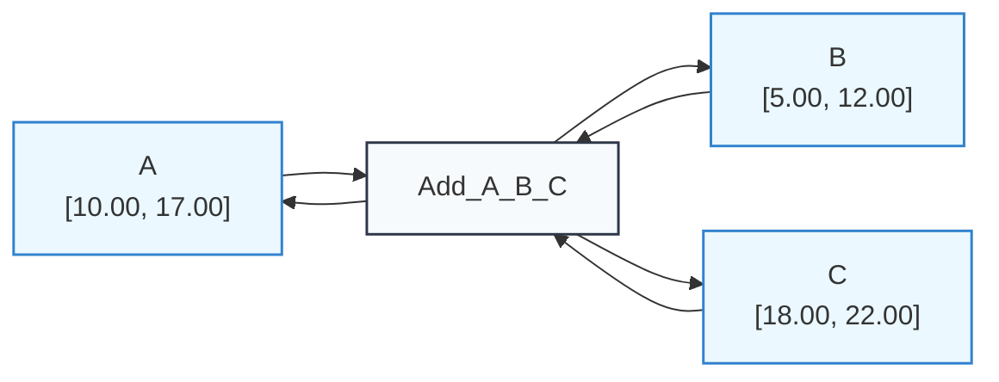
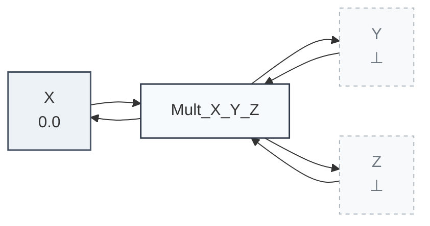
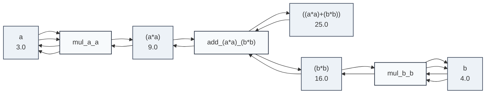

# Example: Bidirectional Arithmetic

Propagator networks eliminate the need to write separate forward and inverse functions. An arithmetic relation $A + B = C$ or $A \times B = C$ automatically computes any unknown variable as soon as the other two become available.

> [!NOTE] Prerequisites
> This example builds on basic concepts introduced in the [Getting Started Guide](../getting_started.md).

---

## 1. Bidirectional Adder

In this example, we observe both forward calculation ($A + B \implies C$) and backward deduction ($C − B \implies A$):

```python
import math
from lattice_propagator import (
    PropagatorNetwork,
    IntervalValue,
    AdderPropagator,
)

net = PropagatorNetwork("AdderDemo")
a = net.add_cell("A")
b = net.add_cell("B")
c = net.add_cell("C")

# Connect the multi-directional adder constraint
net.add_propagator(AdderPropagator("Add_A_B_C", a, b, c))

# Step 1: Forward propagation with intervals
a.set_value(IntervalValue(10.0, 20.0))
b.set_value(IntervalValue(5.0, 15.0))
net.run()

print(f"C: {c.value}")  # IntervalValue(15.0, 35.0)

# Step 2: Backward refinement
# Suppose an external sensor constrains C to [18.0, 22.0]
c.set_value(IntervalValue(18.0, 22.0))
net.run()

# The network automatically deduces A = C − B:
# [18 − 15, 22 − 5] = [3, 17] ∩ [10, 20] → [10, 17]
print(f"A refined: {a.value}")  # IntervalValue(10.0, 17.0)

# Export and persist network diagrams
from pathlib import Path

assets_dir = Path("docs/assets")
if assets_dir.is_dir():
    (assets_dir / "arithmetic_adder.mmd").write_text(net.generate_mermaid(), encoding="utf-8")
    (assets_dir / "arithmetic_adder.dot").write_text(net.generate_dot(), encoding="utf-8")
```

### Adder Network Topology & Refined States

The multi-directional adder continuously maintains mutual consistency across all three directions. The diagram reflects the interval bounds after bidirectional relaxation:



#### Downloadable Diagram Assets
- [Mermaid Diagram Source (`arithmetic_adder.mmd`)](../assets/arithmetic_adder.mmd)
- [Graphviz DOT Specification (`arithmetic_adder.dot`)](../assets/arithmetic_adder.dot)

---

## 2. Multiplier & Zero-Absorption

`MultiplierPropagator` handles multiplication and division ($X \times Y = Z$), including zero-absorption ($0 \times Y = 0$):

```python
from lattice_propagator import (
    PropagatorNetwork,
    FlatValue,
    MultiplierPropagator,
)

net = PropagatorNetwork("MultDemo")
x = net.add_cell("X")
y = net.add_cell("Y")
z = net.add_cell("Z")

net.add_propagator(MultiplierPropagator("Mult_X_Y_Z", x, y, z))

# If X is 0, Z must be 0 regardless of Y (0 × Y = 0):
x.set_value(FlatValue(0.0))
net.run()

print(f"Z: {z.value}")  # FlatValue(0.0)

# Export and persist network diagrams
from pathlib import Path

assets_dir = Path("docs/assets")
if assets_dir.is_dir():
    (assets_dir / "arithmetic_multiplier.mmd").write_text(net.generate_mermaid(), encoding="utf-8")
    (assets_dir / "arithmetic_multiplier.dot").write_text(net.generate_dot(), encoding="utf-8")
```

### Multiplier Network Topology

The diagram displays the assigned input $X = 0.0$ and unassigned ($\bot$) cells $Y$ and $Z$ with distinct dashed styling:



#### Downloadable Diagram Assets
- [Mermaid Diagram Source (`arithmetic_multiplier.mmd`)](../assets/arithmetic_multiplier.mmd)
- [Graphviz DOT Specification (`arithmetic_multiplier.dot`)](../assets/arithmetic_multiplier.dot)

---

## 3. Operator Overloading & Formulas

Cells support operator overloading (`+`, `−`, `×`, `÷`) for constructing complex formulas declaratively:

```python
from lattice_propagator import Cell, PropagatorNetwork, FlatValue

net = PropagatorNetwork("FormulaDemo")

# Declarative construction of Pythagorean theorem: c² = a² + b²
a = net.add_cell("a", FlatValue(3.0))
b = net.add_cell("b", FlatValue(4.0))

a_sq = a * a
b_sq = b * b
c_sq = a_sq + b_sq

net.run()
print(f"c² = {c_sq.value}")  # FlatValue(25.0)

# Export and persist network diagrams
from pathlib import Path

assets_dir = Path("docs/assets")
if assets_dir.is_dir():
    (assets_dir / "arithmetic_pythagorean.mmd").write_text(net.generate_mermaid(), encoding="utf-8")
    (assets_dir / "arithmetic_pythagorean.dot").write_text(net.generate_dot(), encoding="utf-8")
```

### Synthesized Computational Graph ($c^2 = a^2 + b^2$)

Operator overloading builds intermediate anonymous cells `(a*a)` and `(b*b)` and connects them through `MultiplierPropagator` and `AdderPropagator` instances:



#### Downloadable Diagram Assets
- [Mermaid Diagram Source (`arithmetic_pythagorean.mmd`)](../assets/arithmetic_pythagorean.mmd)
- [Graphviz DOT Specification (`arithmetic_pythagorean.dot`)](../assets/arithmetic_pythagorean.dot)
