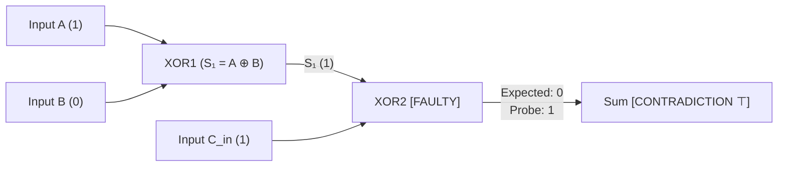

# Example: Digital Circuit Fault Diagnosis

A quintessential application of Truth Maintenance Systems (Johan de Kleer, 1986; Gerald Jay Sussman, 1980) is **model-based diagnosis**:
- A physical system (such as a 1-bit full adder) is modeled as a network of constraint propagators representing logic gates.
- Each gate's correct operation is conditioned on a defeasible hypothesis: `Assumption("gate_XOR1_ok")`.
- When observed test probe outputs contradict the expected deduction, a `Contradiction` is flagged.
- The [`NetworkTMS`](file:///home/doug/code/lattice-propagator/docs/api/tms.md) isolates the conflicting causal ancestry, extracts the minimal set of suspect components (a **nogood**), and retracts the faulty assumption.

---

## 1. Schematic Diagram (Human View)




---

## 2. Executable Propagator Implementation

```python
from lattice_propagator import (
    Cell,
    Contradiction,
    FlatValue,
    Propagator,
    PropagatorNetwork,
)
from lattice_propagator.tms import NetworkTMS


class LogicGatePropagator(Propagator):
    """Boolean logic gate with Truth Maintenance System assumption tracking."""

    def __init__(
        self,
        name: str,
        gate_type: str,
        in1: Cell,
        in2: Cell,
        out: Cell,
        health_assumption: str,
    ) -> None:
        super().__init__(
            name,
            [in1, in2],
            [out],
            confidence=0.90,
            is_assumption=True,
        )
        self.gate_type = gate_type
        self.in1 = in1
        self.in2 = in2
        self.out = out
        self.health_assumption = health_assumption

    def alert(self, network: PropagatorNetwork) -> None:
        v1, v2 = self.in1.value, self.in2.value
        if isinstance(v1, FlatValue) and isinstance(v2, FlatValue):
            b1, b2 = bool(v1.val), bool(v2.val)
            if self.gate_type == "XOR":
                res = b1 ^ b2
            elif self.gate_type == "AND":
                res = b1 and b2
            elif self.gate_type == "OR":
                res = b1 or b2
            else:
                return

            self.emit(self.out, FlatValue(res), source=self.health_assumption)


# 1. Instantiate the Full Adder Network
net = PropagatorNetwork("FullAdderDiagnosis")
tms = NetworkTMS(net)

# Inputs
A = net.add_cell("A", FlatValue(True))
B = net.add_cell("B", FlatValue(False))
Cin = net.add_cell("Cin", FlatValue(True))

# Internal wires & Outputs registered with NetworkTMS
S1 = net.add_cell("S1")
C1 = net.add_cell("C1")
C2 = net.add_cell("C2")
Sum = net.add_cell("Sum")
Cout = net.add_cell("Cout")
for wire in ("S1", "C1", "C2", "Sum", "Cout"):
    tms.get_or_create_cell_tms(wire)

# Connect logic gates
net.add_propagator(LogicGatePropagator("XOR1", "XOR", A, B, S1, "gate_xor1_ok"))
net.add_propagator(LogicGatePropagator("XOR2", "XOR", S1, Cin, Sum, "gate_xor2_ok"))
net.add_propagator(LogicGatePropagator("AND1", "AND", A, B, C1, "gate_and1_ok"))
net.add_propagator(LogicGatePropagator("AND2", "AND", S1, Cin, C2, "gate_and2_ok"))
net.add_propagator(LogicGatePropagator("OR1", "OR", C1, C2, Cout, "gate_or1_ok"))

net.run()

print(f"Normal deduction: Sum = {Sum.value}, Cout = {Cout.value}")
assert Sum.value == FlatValue(False)
assert Cout.value == FlatValue(True)

# 2. Inject Physical Fault: Multimeter probe reads True on Sum pin
# Register ground truth observation (confidence=1.0, non-defeasible)
Sum.set_value(FlatValue(True), source="multimeter_probe", is_assumption=False)
net.run()

# 3. Contradiction Detection & Nogood Extraction
assert isinstance(Sum.value, Contradiction)
print(f"Contradiction: {Sum.value.reason}")

# DDB isolates the suspect assumption set (including transitive support from S1 -> XOR1) and retracts the weakest culprit
culprit = tms.resolve_contradiction(Sum.tms.active_sources)
print(f"Diagnostic conclusion: Isolated faulty component -> {culprit}")
print(f"Recorded Nogood set: {tms.nogoods}")
assert culprit in ("gate_xor1_ok", "gate_xor2_ok")
```
