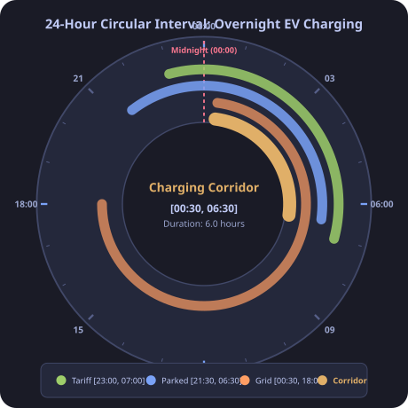
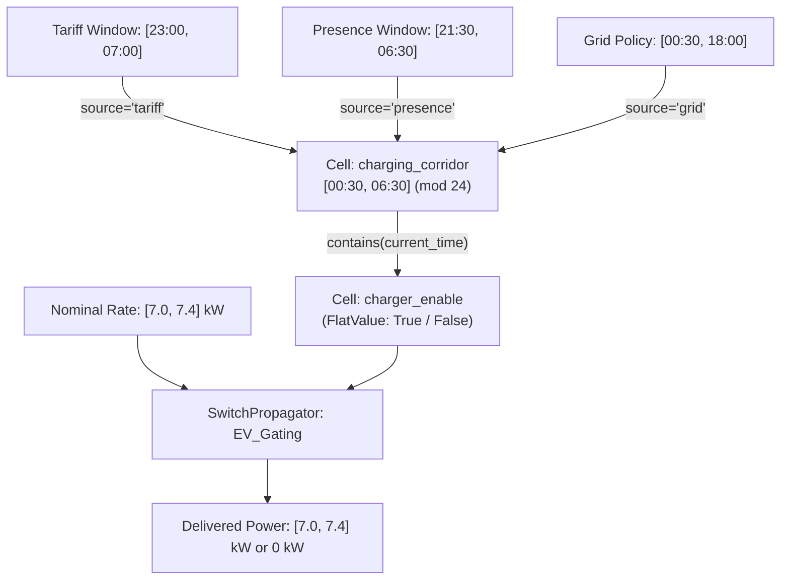

# Example: Time-of-Day Clock Intervals & Overnight Energy Scheduling

In home automation, energy management, and transit scheduling, time constraints frequently cross the midnight boundary (e.g. 23:00 to 07:00).

In standard linear interval arithmetic, intervals are strictly ordered with $min \le max$; an overnight window like $[23.0, 7.0]$ is considered invalid or inverted.

The lattice propagator framework solves this with [`CircularInterval`](file:///home/doug/code/lattice-propagator/docs/api/lattice.md) on the circle topology $S^1 / (24 \times \mathbb{Z})$:
- Represents directed arcs sweeping clockwise from $start$ to $end$ modulo a period (here $24.0\text{ hours}$).
- Preserves the join-semilattice algebraic laws (associativity, commutativity, idempotence, and monotonicity) under monotonic intersection ($\sqcap$).
- Seamlessly controls reactive actuators via [`SwitchPropagator`](file:///home/doug/code/lattice-propagator/docs/api/primitives.md).

---

## 1. The Overnight EV Charging Problem

An Electric Vehicle (EV) must be charged overnight subject to three independent real-world constraints:
1. **Super-Off-Peak Tariff Window:** Inexpensive overnight electricity rate runs from **23:00 to 07:00** ($[23.0, 7.0]\pmod{24}$, duration $8.0\text{ h}$).
2. **Vehicle Home Presence:** The homeowner arrives home at **21:30** and departs for work at **06:30** ($[21.5, 6.5]\pmod{24}$, duration $9.0\text{ h}$).
3. **Grid Demand-Response Curtailment:** The local utility issues a peak load-shedding hold until **00:30** (charging is only permitted in $[0.5, 18.0]\pmod{24}$).

The autonomous propagator network must fuse these partial policies, determine the exact allowed charging corridor across the midnight cut, and conditionally energize the EV charger.

---

## 2. 24-Hour Circular Dial & Architecture (Human View)





---

## 3. 24-Hour Timeline Ribbon (LLM / Terminal View)

```text
24-Hour Circular Modulo-24 Timeline:
Hour:      00 01 02 03 04 05 06 07 08 09 10 11 12 13 14 15 16 17 18 19 20 21 22 23 24
Tariff:    [===================]                                                 [===]
Presence:              [===]                                           [=============]
Grid:      . [====================================================]
Corridor:  . [===============] . . . . . . . . . . . . . . . . . . . . . . . . . . .
           ↑ 00:30       ↑ 06:30 (Charging Corridor: 6.0 h)
```

---

## 4. Executable Propagator Implementation

```python
from lattice_propagator import (
    CircularInterval,
    Contradiction,
    FlatValue,
    IntervalValue,
    PropagatorNetwork,
    SwitchPropagator,
)

# ==========================================
# Phase 1: Modular Interval Fusion in a Reactive Cell
# ==========================================
net = PropagatorNetwork("OvernightEVScheduler")

# Reactive cell holding the consolidated charging corridor
charging_cell = net.add_cell(
    "charging_corridor",
    unit="h",
    display_name="Consolidated Charging Corridor",
)

# 1. Assert utility off-peak tariff: 23:00 to 07:00 (wraps midnight)
charging_cell.set_value(
    CircularInterval(start=23.0, end=7.0, modulus=24.0),
    source="tariff_policy",
)

# 2. Assert vehicle presence: home at 21:30, depart at 06:30 (wraps midnight)
charging_cell.set_value(
    CircularInterval(start=21.5, end=6.5, modulus=24.0),
    source="homeowner_presence",
)

# 3. Assert utility demand-response hold: charging prohibited until 00:30
charging_cell.set_value(
    CircularInterval(start=0.5, end=18.0, modulus=24.0),
    source="grid_curtailment",
)

corridor = charging_cell.value
assert isinstance(corridor, CircularInterval)

print(f"Refined Charging Corridor: {corridor}")
print(f"Corridor Start: {corridor.start:.1f}h (00:30), End: {corridor.end:.1f}h (06:30)")
print(f"Available Charging Duration: {corridor.length:.1f} hours")

assert abs(corridor.start - 0.5) < 1e-4
assert abs(corridor.end - 6.5) < 1e-4
assert abs(corridor.length - 6.0) < 1e-4

# Inspect causal provenance explanation
print("\n--- TMS Fusion Explanation ---")
print(charging_cell.explain())

# ==========================================
# Phase 2: Actuation Control via SwitchPropagator
# ==========================================
# Nominal Level-2 charging power interval [7.0, 7.4] kW
nominal_power = net.add_cell("nominal_power", IntervalValue(7.0, 7.4), unit="kW")
enable_switch = net.add_cell("enable_switch", unit="")
delivered_power = net.add_cell("delivered_power", unit="kW")

# SwitchPropagator gates nominal_power to delivered_power only when enable_switch is True
net.add_propagator(
    SwitchPropagator(
        "EV_Contactor",
        control_cell=enable_switch,
        input_cell=nominal_power,
        output_cell=delivered_power,
        on_value=True,
    )
)

# Query Test 1: At 02:00 (inside charging corridor)
time_night = 2.0
is_active_night = corridor.contains(time_night)
enable_switch.set_value(FlatValue(is_active_night), overwrite=True)
net.run()

print(f"\nClock = {time_night:04.1f}h (Within Corridor):")
print(f"  Contactor Enabled: {is_active_night}")
print(f"  Delivered Charging Power: {delivered_power.value}")
assert is_active_night is True
assert isinstance(delivered_power.value, IntervalValue)
assert abs(delivered_power.value.min_val - 7.0) < 1e-4

# Query Test 2: At 22:00 (outside corridor, evening peak)
time_evening = 22.0
is_active_evening = corridor.contains(time_evening)
enable_switch.set_value(FlatValue(is_active_evening), overwrite=True)
delivered_power.value = IntervalValue(0.0, 0.0)
net.run()

print(f"\nClock = {time_evening:04.1f}h (Evening Peak):")
print(f"  Contactor Enabled: {is_active_evening}")
print(f"  Delivered Charging Power: {delivered_power.value}")
assert is_active_evening is False
assert delivered_power.value == IntervalValue(0.0, 0.0)

# Energy Delivered: 6.0 h × [7.0, 7.4] kW = [42.0, 44.4] kWh
min_energy = corridor.length * delivered_power.value.min_val
print(f"\nTotal Potential Energy Delivered during Corridor: {6.0 * 7.2:.1f} kWh")
```

---

## 5. Architectural Comparison: Traditional Python vs. Lattice Propagator

### 5.1 Why Traditional Code Struggles with Midnight

In standard Python, time-of-day is represented as scalar numbers on a flat linear axis $[0.0, 24.0)$. Because the line has an artificial boundary seam at midnight ($24.0 \equiv 0.0$), an overnight window like $23:00 \rightarrow 07:00$ cannot be written as $[23.0, 7.0]$ without violating the invariant $start \le end$.

To compute the intersection of multiple overlapping overnight schedules, traditional imperative code must:
1. **Split at midnight:** Dissect wrapping windows into pairs of linear intervals ($[23.0, 7.0] \rightarrow [23.0, 24.0) \cup [0.0, 7.0)$).
2. **Combinatorial intersection:** Perform pairwise Cartesian intersection across all fragments.
3. **Re-stitching:** Detect if leftover pieces meet across the $24.0 / 0.0$ boundary and fuse them back into a single interval.
4. **Silent failure:** Return an empty list `[]` when schedules conflict, losing all information about *which* rules clashed.

In contrast, [`CircularInterval`](file:///home/doug/code/lattice-propagator/docs/api/lattice.md) treats time as an intrinsic 1-sphere circle $S^1 / (24 \times \mathbb{Z})$ where midnight is just another point on the dial.

### 5.2 Side-by-Side Executable Code Comparison

```python
import math
from lattice_propagator import CircularInterval, PropagatorNetwork


# ==============================================================================
# Approach A: Traditional Imperative Python (~35 lines of piecewise splitting)
# ==============================================================================
def intersect_windows_traditional(windows: list[tuple[float, float]]) -> list[tuple[float, float]]:
    """Traditional imperative approach: split each window at midnight, intersect pieces, and re-stitch."""
    # Step 1: Split wrapping windows across the artificial 24.0 seam
    split_pieces: list[list[tuple[float, float]]] = []
    for s, e in windows:
        if s <= e:
            split_pieces.append([(s, e)])
        else:
            split_pieces.append([(s, 24.0), (0.0, e)])

    # Step 2: Intersect piecewise fragments iteratively
    def intersect_two(
        list_a: list[tuple[float, float]], list_b: list[tuple[float, float]]
    ) -> list[tuple[float, float]]:
        result = []
        for a_s, a_e in list_a:
            for b_s, b_e in list_b:
                start, end = max(a_s, b_s), min(a_e, b_e)
                if start < end:
                    result.append((start, end))
        return result

    current = split_pieces[0]
    for nxt in split_pieces[1:]:
        current = intersect_two(current, nxt)

    # Step 3: Re-stitch pieces that meet across the midnight boundary
    head = next((w for w in current if math.isclose(w[1], 24.0)), None)
    tail = next((w for w in current if math.isclose(w[0], 0.0)), None)
    if head and tail:
        others = [w for w in current if w not in (head, tail)]
        return [(head[0], tail[1])] + others
    return current


# ==============================================================================
# Approach B: Lattice Propagator (4 declarative lines)
# ==============================================================================
def intersect_windows_propagator(
    policies: list[tuple[str, float, float]],
) -> CircularInterval:
    net_comp = PropagatorNetwork("ComparisonNet")
    corridor_cell = net_comp.add_cell("corridor")
    for source_name, start, end in policies:
        corridor_cell.set_value(
            CircularInterval(start, end, modulus=24.0),
            source=source_name,
        )
    return corridor_cell.value


# ==============================================================================
# Verification: Both produce identical results, but with vastly different complexity
# ==============================================================================
policy_inputs = [
    ("tariff", 23.0, 7.0),  # 23:00 to 07:00 (wraps midnight)
    ("presence", 21.5, 6.5),  # 21:30 to 06:30 (wraps midnight)
    ("grid", 0.5, 18.0),  # 00:30 to 18:00
]

# Run Traditional
trad_inputs = [(s, e) for _, s, e in policy_inputs]
trad_result = intersect_windows_traditional(trad_inputs)
print(f"Traditional Python Result: {trad_result}")
assert trad_result == [(0.5, 6.5)]

# Run Propagator
prop_result = intersect_windows_propagator(policy_inputs)
print(f"Lattice Propagator Result: {prop_result}")
assert isinstance(prop_result, CircularInterval)
assert (prop_result.start, prop_result.end) == (0.5, 6.5)
```

### 5.3 Comparison Summary

| Dimension | Traditional Imperative Python | Lattice Propagator (`CircularInterval`) |
| :--- | :--- | :--- |
| **Topology** | Flat Euclidean $[0, 24)$ with artificial discontinuity at midnight | Intrinsic circle $S^1 / (24\mathbb{Z})$ (no branch cut seam) |
| **Code Volume** | ~35 lines of piecewise splitting, combinatorics, and re-stitching | 4 declarative lines using pure semilattice $\sqcap$ merge |
| **Algebraic Monotonicity** | Order-dependent; fragile when rules are added/removed dynamically | Mathematically commutative, associative, and idempotent |
| **Provenance & Explainability** | Returns `[]` on contradiction with zero explanation of *why* | Tracks causal history (`cell.explain()`) pinpointing conflicting policies |
| **Reactive Integration** | Requires manual callbacks, poller loops, and re-running from scratch | Reactive cells trigger downstream propagators ([`SwitchPropagator`](file:///home/doug/code/lattice-propagator/docs/api/primitives.md)) automatically |

