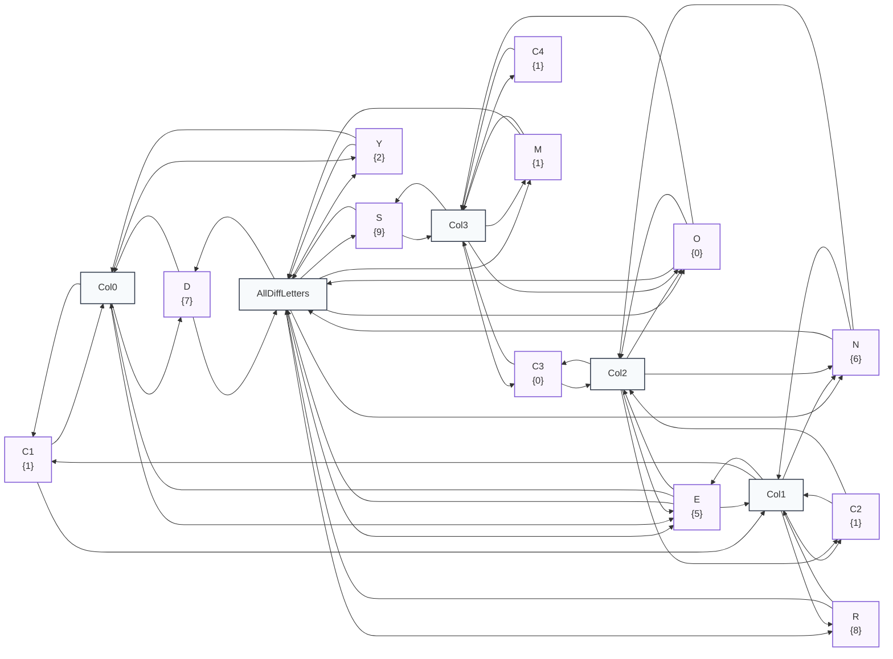
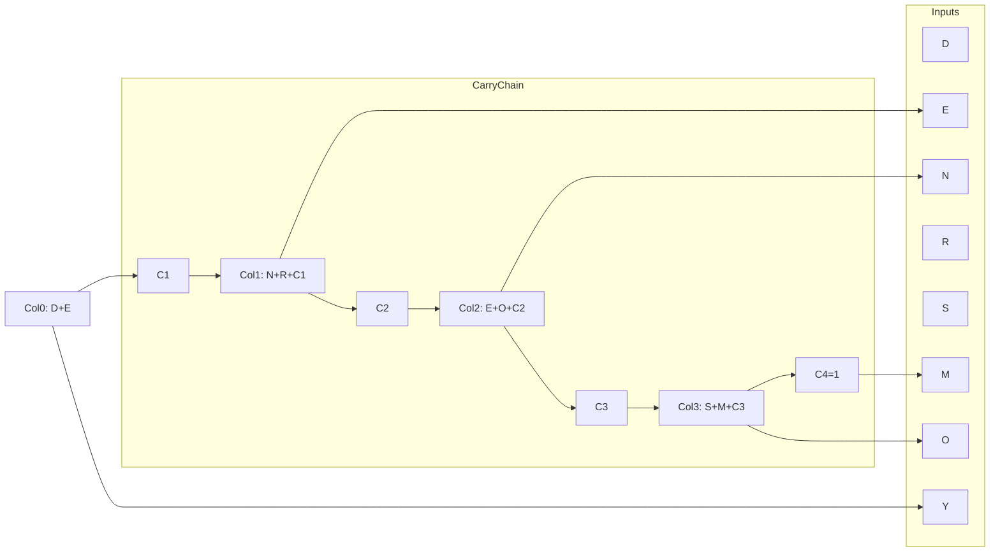

# Example: Cryptarithmetic ($SEND + MORE = MONEY$)

Cryptarithmetic is a classic constraint problem that bridges finite discrete domains with arithmetic relations:
$$\begin{array}{r@{\quad}l}
  & S\;E\;N\;D \\
+ & M\;O\;R\;E \\
\hline
M & O\;N\;E\;Y
\end{array}$$

Each distinct letter represents a unique decimal digit $d \in \{0, \dots, 9\}$. Leading digits $S$ and $M$ cannot be zero ($S, M \neq 0$).

---

## 1. Mathematical Formulation

The problem combines two classes of constraints:
1. **Global Uniqueness:** [`AllDistinctPropagator`](file:///home/doug/code/lattice-propagator/docs/api/primitives.md) (or [`AllDifferentPropagator`](file:///home/doug/code/lattice-propagator/docs/api/primitives.md)) across all 8 letters $\{S, E, N, D, M, O, R, Y\}$.
2. **Column Additions with Carry Chain:**
   - Units: $D + E = Y + 10 \times C_1$, with carry $C_1 \in \{0, 1\}$.
   - Tens: $N + R + C_1 = E + 10 \times C_2$, with carry $C_2 \in \{0, 1\}$.
   - Hundreds: $E + O + C_2 = N + 10 \times C_3$, with carry $C_3 \in \{0, 1\}$.
   - Thousands: $S + M + C_3 = O + 10 \times C_4$, with carry $C_4 \in \{0, 1\}$.
   - Ten-Thousands: $C_4 = M$ (forcing $M = 1$ and $C_4 = 1$).

---

## 2. Executable Propagator Implementation

```python
import itertools

from lattice_propagator import (
    AllDifferentPropagator,
    AllDistinctPropagator,
    Cell,
    ChoiceEngine,
    Contradiction,
    DiscreteDomain,
    Propagator,
    PropagatorNetwork,
)


class ColumnSumPropagator(Propagator):
    """Propagator enforcing column sum consistency: sum(inputs) == right_digit + 10 * carry_out."""

    def __init__(
        self,
        name: str,
        addends: list[Cell],
        right_digit: Cell,
        carry_out: Cell,
    ) -> None:
        inputs = addends + [right_digit, carry_out]
        super().__init__(name, inputs, inputs)
        self.addends = addends
        self.right_digit = right_digit
        self.carry_out = carry_out

    def alert(self, network: PropagatorNetwork) -> None:
        all_cells = self.addends + [self.right_digit, self.carry_out]
        if any(not isinstance(c.value, DiscreteDomain) for c in all_cells):
            return

        candidates_lists = [c.value.candidates for c in self.addends]
        right_cands = self.right_digit.value.candidates
        carry_cands = self.carry_out.value.candidates

        valid_addends = [set() for _ in self.addends]
        valid_right = set()
        valid_carry = set()
        found_any = False

        for left_tuple in itertools.product(*candidates_lists):
            total = sum(left_tuple)
            for r in right_cands:
                for cout in carry_cands:
                    if total == r + 10 * cout:
                        found_any = True
                        for idx, v in enumerate(left_tuple):
                            valid_addends[idx].add(v)
                        valid_right.add(r)
                        valid_carry.add(cout)

        if not found_any:
            self.right_digit.set_value(
                Contradiction(f"No consistent combination in {self.name}"),
                source=self.name,
            )
            return

        for cell, valids in zip(self.addends, valid_addends):
            if valids != cell.value.candidates:
                cell.set_value(DiscreteDomain(valids), source=self.name)
        if valid_right != self.right_digit.value.candidates:
            self.right_digit.set_value(DiscreteDomain(valid_right), source=self.name)
        if valid_carry != self.carry_out.value.candidates:
            self.carry_out.set_value(DiscreteDomain(valid_carry), source=self.name)


# Build Propagator Network
net = PropagatorNetwork("SendMoreMoney")
letters = ["S", "E", "N", "D", "M", "O", "R", "Y"]
letter_cells = {ch: net.add_cell(ch, DiscreteDomain.range(0, 10)) for ch in letters}

# Domain restrictions: S != 0, M = 1
letter_cells["S"].set_value(DiscreteDomain.range(1, 10), overwrite=True)
letter_cells["M"].set_value(DiscreteDomain.single(1), overwrite=True)

# Uniqueness constraint (Régin's GAC via bipartite matching)
net.add_propagator(AllDistinctPropagator("AllDistinctDigits", list(letter_cells.values())))

# Carry cells
c1 = net.add_cell("C1", DiscreteDomain({0, 1}))
c2 = net.add_cell("C2", DiscreteDomain({0, 1}))
c3 = net.add_cell("C3", DiscreteDomain({0, 1}))
c4 = net.add_cell("C4", DiscreteDomain.single(1))

# Column sum propagators
net.add_propagator(
    ColumnSumPropagator("Col0", [letter_cells["D"], letter_cells["E"]], letter_cells["Y"], c1)
)
net.add_propagator(
    ColumnSumPropagator("Col1", [letter_cells["N"], letter_cells["R"], c1], letter_cells["E"], c2)
)
net.add_propagator(
    ColumnSumPropagator("Col2", [letter_cells["E"], letter_cells["O"], c2], letter_cells["N"], c3)
)
net.add_propagator(
    ColumnSumPropagator("Col3", [letter_cells["S"], letter_cells["M"], c3], letter_cells["O"], c4)
)

# Solve using ChoiceEngine on primary decision variables
engine = ChoiceEngine(net, variables=list(letter_cells.values()))
solved = engine.first_solution()
assert solved, "Failed to solve cryptarithmetic puzzle!"

# Render solution for LLMs & text inspection:
print("--- Cryptarithmetic Solution ---")
for ch in letters:
    print(f"{ch} = {letter_cells[ch].value.value}")

send = int("".join(str(letter_cells[c].value.value) for c in "SEND"))
more = int("".join(str(letter_cells[c].value.value) for c in "MORE"))
money = int("".join(str(letter_cells[c].value.value) for c in "MONEY"))
print(f"{send} + {more} = {money}")
assert send + more == money

# Export and persist network diagrams
from pathlib import Path

assets_dir = Path("docs/assets")
if assets_dir.is_dir():
    (assets_dir / "cryptarithmetic_network.mmd").write_text(
        net.generate_mermaid(), encoding="utf-8"
    )
    (assets_dir / "cryptarithmetic_network.dot").write_text(net.generate_dot(), encoding="utf-8")
```

---

## 3. Solved Constraint Network Topology & Live Visualization

The network topology connects each digit cell to the global `AllDifferentPropagator` as well as the column-sum arithmetic constraints with the ripple carry chain. The diagram generated by `net.generate_mermaid()` displays the final assigned discrete domain values:



### Downloadable Diagram Assets
- [Mermaid Diagram Source (`cryptarithmetic_network.mmd`)](../assets/cryptarithmetic_network.mmd)
- [Graphviz DOT Specification (`cryptarithmetic_network.dot`)](../assets/cryptarithmetic_network.dot)

---

## 4. Structural Graph (Human View)



---

## 5. Direct CLP(Z) Linear Formulation (No Carry Decomposition Needed)

Using [`lattice_propagator.clpz`](file:///home/doug/code/lattice-propagator/docs/api/clpz.md), the entire puzzle can also be expressed directly as a single multi-term integer linear equation over `IntegerDomain` cells—matching Prolog's `library(clpz)` idiom without writing custom `ColumnSumPropagator` classes:

```python
from lattice_propagator import (
    ChoiceEngine,
    PropagatorNetwork,
    add_int_all_different,
    add_int_linear,
    add_int_rel,
    int_cells,
    int_expr,
)

clpz_net = PropagatorNetwork("SendMoreMoneyCLPZ")
letters = int_cells(clpz_net, ["S", "E", "N", "D", "M", "O", "R", "Y"], lo=0, hi=9)
s, e, n, d, m, o, r, y = letters

add_int_rel(clpz_net, s, "#\\=", 0)
add_int_rel(clpz_net, m, "#\\=", 0)
add_int_all_different(clpz_net, letters)

lhs = (
    1000 * int_expr(s)
    + 100 * int_expr(e)
    + 10 * int_expr(n)
    + int_expr(d)
    + 1000 * int_expr(m)
    + 100 * int_expr(o)
    + 10 * int_expr(r)
    + int_expr(e)
)
rhs = 10000 * int_expr(m) + 1000 * int_expr(o) + 100 * int_expr(n) + 10 * int_expr(e) + int_expr(y)
add_int_linear(clpz_net, lhs - rhs, "#=", 0)

assert ChoiceEngine(clpz_net, variables=letters).first_solution()
print("CLP(Z) solution:", {c.cell_id: c.value.value for c in letters})
```
