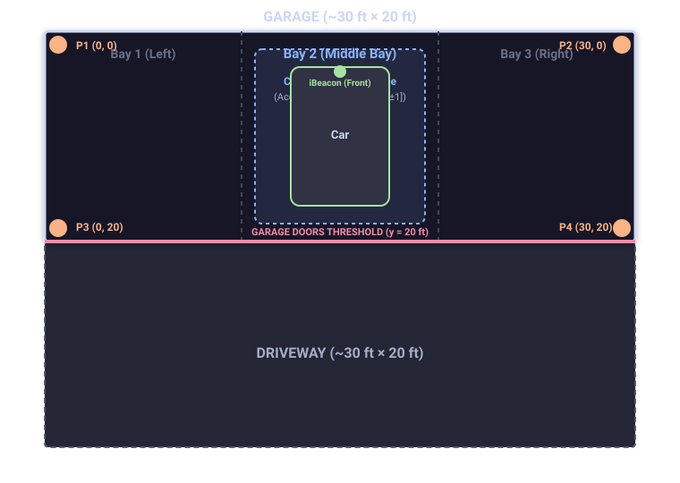
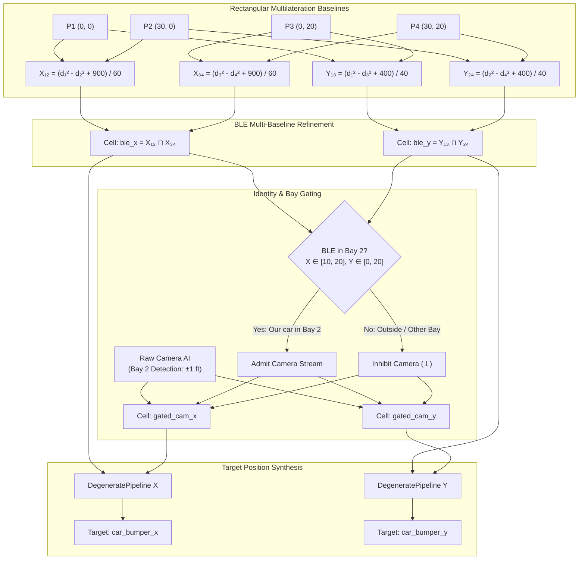

# Example: Triangulation with Degeneracy (BLE Multilateration & Camera Fusion)

In *Software Design for Flexibility* (MIT Press, 2021) and Gerald Jay Sussman's foundational MIT lectures, **degeneracy** describes systems where structurally and physically different computational pathways calculate the same target state.

Unlike simple sensor duplication, degenerate computation combines **heterogeneous physical mechanisms**:
- **Rectangular BLE Multilateration (`branch_ble`, priority 0.8)**: 4 ESPHome Bluetooth Proxies ($P_1, P_2, P_3, P_4$) installed in the four corners of a 3-bay garage measure distance to an iBeacon mounted in the center of the car's front bumper. Distance intervals derived from RSSI signal path loss continuously estimate the vehicle's $2\text{D}$ coordinate box $(X, Y)$ across both the garage and the driveway.
- **Overhead Middle-Bay Computer Vision (`branch_camera`, priority 1.0)**: An AI camera (e.g. Frigate / Coral TPU in Home Assistant) monitors the middle bay (Bay 2), measuring vehicle position to within $2\text{ ft}$ ($[X \pm 1.0, Y \pm 1.0]\text{ ft}$).
- **Identity & Bay Gating Constraint**: The camera detects *any* car in the middle bay, but lacks RF MAC/iBeacon identity. A conditioning propagator gates the camera stream: camera readings are attributed to *our* vehicle **only when BLE multilateration confirms our car is in the middle bay**. If a guest car parks in Bay 2 while our car is on the driveway, the camera reading is rejected, avoiding identity confusion and false contradiction ($\top$).

When our car is in Bay 2, both pathways fuse monotonically via interval intersection ($\sqcap$), sharpening accuracy to $\pm 1.0\text{ ft}$. When parked in the driveway or Bay 1, the system seamlessly operates in a **degraded mode** using BLE alone. Furthermore, if a proxy goes offline (such as $P_1$, the sensor closest to Bay 1), the system remains fully operational with quantified, wider uncertainty.

---

## 1. Physical Layout

The garage measures $30\text{ ft}$ wide (3 bays of $10\text{ ft}$) by $20\text{ ft}$ deep, with an adjacent $30\text{ ft} \times 20\text{ ft}$ driveway in front:




---

## 2. Mathematical Formulation: Rectangular Multilateration

Let the 4 proxies be positioned at:
$$P_1 = (0, 0), \quad P_2 = (30, 0), \quad P_3 = (0, 20), \quad P_4 = (30, 20)$$

For an unknown front-bumper position $(x, y)$, the Euclidean distance equations are:
$$d_i^2 = (x - x_i)^2 + (y - y_i)^2$$

Subtracting baseline pairs cancels quadratic cross-terms, yielding direct linear coordinate projections:
1. **Horizontal Back Baseline ($P_1 \leftrightarrow P_2$, at $y=0$):**
   $$x^2 - (x - 30)^2 = d_1^2 - d_2^2 \implies 60x - 900 = d_1^2 - d_2^2 \implies X_{12} = \frac{d_1^2 - d_2^2 + 900}{60}$$
2. **Horizontal Entrance Baseline ($P_3 \leftrightarrow P_4$, at $y=20$):**
   $$X_{34} = \frac{d_3^2 - d_4^2 + 900}{60}$$
3. **Vertical Left Baseline ($P_1 \leftrightarrow P_3$, at $x=0$):**
   $$y^2 - (y - 20)^2 = d_1^2 - d_3^2 \implies 40y - 400 = d_1^2 - d_3^2 \implies Y_{13} = \frac{d_1^2 - d_3^2 + 400}{40}$$
4. **Vertical Right Baseline ($P_2 \leftrightarrow P_4$, at $x=30$):**
   $$Y_{24} = \frac{d_2^2 - d_4^2 + 400}{40}$$

Over the interval semilattice, $d_i \in [d_{i,\min}, d_{i,\max}]$. The independent baseline estimators merge via lattice intersection:
$$X_{\text{ble}} = X_{12} \sqcap X_{34}, \quad Y_{\text{ble}} = Y_{13} \sqcap Y_{24}$$

---

## 3. Architectural Topology & Gated Pipeline



---

## 4. Complete Implementation & Scenario Execution

The following complete, executable program sets up the network and tests all five operational scenarios:

```python
import math
from typing import Any
from lattice_propagator import (
    Bottom,
    DegenerateBranch,
    IntervalValue,
    NetworkTMS,
    PropagatorNetwork,
    add_degenerate_pipeline,
)
from lattice_propagator.primitives import FunctionalPropagator


def build_localization_network():
    """Build the 2D multilateration and degenerate camera fusion network."""
    net = PropagatorNetwork("Triangulation_With_Degeneracy")
    NetworkTMS(net)

    # 1. Four corner BLE proxy distance measurement cells
    d1 = net.add_cell("d1_P1_NW", unit="ft")
    d2 = net.add_cell("d2_P2_NE", unit="ft")
    d3 = net.add_cell("d3_P3_SW", unit="ft")
    d4 = net.add_cell("d4_P4_SE", unit="ft")

    # Raw camera detection cells for Middle Bay (Bay 2)
    raw_cam_x = net.add_cell("raw_cam_x", unit="ft")
    raw_cam_y = net.add_cell("raw_cam_y", unit="ft")

    # Intermediate BLE coordinate cells
    ble_x = net.add_cell("ble_x", unit="ft")
    ble_y = net.add_cell("ble_y", unit="ft")

    # 2. Multilateration baseline propagators:
    # Baseline P1-P2 (y=0): X12 = (d1² - d2² + 900) / 60
    def calc_x12(v1: IntervalValue, v2: IntervalValue) -> IntervalValue:
        return (v1 * v1 - v2 * v2 + 900.0) / 60.0

    # Baseline P3-P4 (y=20): X34 = (d3² - d4² + 900) / 60
    def calc_x34(v3: IntervalValue, v4: IntervalValue) -> IntervalValue:
        return (v3 * v3 - v4 * v4 + 900.0) / 60.0

    # Baseline P1-P3 (x=0): Y13 = (d1² - d3² + 400) / 40
    def calc_y13(v1: IntervalValue, v3: IntervalValue) -> IntervalValue:
        return (v1 * v1 - v3 * v3 + 400.0) / 40.0

    # Baseline P2-P4 (x=30): Y24 = (d2² - d4² + 400) / 40
    def calc_y24(v2: IntervalValue, v4: IntervalValue) -> IntervalValue:
        return (v2 * v2 - v4 * v4 + 400.0) / 40.0

    net.add_propagator(FunctionalPropagator("prop_x12", calc_x12, [d1, d2], ble_x, overwrite=False))
    net.add_propagator(FunctionalPropagator("prop_x34", calc_x34, [d3, d4], ble_x, overwrite=False))
    net.add_propagator(FunctionalPropagator("prop_y13", calc_y13, [d1, d3], ble_y, overwrite=False))
    net.add_propagator(FunctionalPropagator("prop_y24", calc_y24, [d2, d4], ble_y, overwrite=False))

    # 3. Identity & Bay Gating
    # Bay 2 spatial bounds: X ∈ [10, 20], Y ∈ [0, 20]
    gated_cam_x = net.add_cell("gated_cam_x", unit="ft")
    gated_cam_y = net.add_cell("gated_cam_y", unit="ft")

    def gate_x(bx: Any, by: Any, cx: Any) -> Any:
        if not (isinstance(bx, IntervalValue) and isinstance(by, IntervalValue)):
            return Bottom()
        in_bay2 = (
            bx.max_val >= 10.0 and bx.min_val <= 20.0 and by.max_val >= 0.0 and by.min_val <= 20.0
        )
        return cx if in_bay2 else Bottom()

    def gate_y(bx: Any, by: Any, cy: Any) -> Any:
        if not (isinstance(bx, IntervalValue) and isinstance(by, IntervalValue)):
            return Bottom()
        in_bay2 = (
            bx.max_val >= 10.0 and bx.min_val <= 20.0 and by.max_val >= 0.0 and by.min_val <= 20.0
        )
        return cy if in_bay2 else Bottom()

    net.add_propagator(
        FunctionalPropagator(
            "gate_cam_x", gate_x, [ble_x, ble_y, raw_cam_x], gated_cam_x, overwrite=False
        )
    )
    net.add_propagator(
        FunctionalPropagator(
            "gate_cam_y", gate_y, [ble_x, ble_y, raw_cam_y], gated_cam_y, overwrite=False
        )
    )

    # 4. Synthesized Target Cells & Degenerate Pipelines
    target_x = net.add_cell("car_bumper_x", unit="ft")
    target_y = net.add_cell("car_bumper_y", unit="ft")

    pipe_x = add_degenerate_pipeline(
        net,
        target_x,
        [
            DegenerateBranch("camera_x", gated_cam_x, priority=1.0),
            DegenerateBranch("ble_x", ble_x, priority=0.8),
        ],
        mode="consensus",
    )
    pipe_y = add_degenerate_pipeline(
        net,
        target_y,
        [
            DegenerateBranch("camera_y", gated_cam_y, priority=1.0),
            DegenerateBranch("ble_y", ble_y, priority=0.8),
        ],
        mode="consensus",
    )

    return net, (d1, d2, d3, d4), (raw_cam_x, raw_cam_y), (target_x, target_y), (pipe_x, pipe_y)


def run_scenario(scenario_name, true_x, true_y, err_ble=1.0, cam_box=None, p1_offline=False):
    """Set up evidence, propagate, and print synthesized location and accuracy."""
    net, (d1, d2, d3, d4), (cam_x, cam_y), (target_x, target_y), (pipe_x, pipe_y) = (
        build_localization_network()
    )

    p1, p2, p3, p4 = (0.0, 0.0), (30.0, 0.0), (0.0, 20.0), (30.0, 20.0)
    dist1 = math.hypot(true_x - p1[0], true_y - p1[1])
    dist2 = math.hypot(true_x - p2[0], true_y - p2[1])
    dist3 = math.hypot(true_x - p3[0], true_y - p3[1])
    dist4 = math.hypot(true_x - p4[0], true_y - p4[1])

    if p1_offline:
        d1.set_value(Bottom(), overwrite=True)
    else:
        d1.set_value(IntervalValue(max(0.0, dist1 - err_ble), dist1 + err_ble), overwrite=True)
    d2.set_value(IntervalValue(max(0.0, dist2 - err_ble), dist2 + err_ble), overwrite=True)
    d3.set_value(IntervalValue(max(0.0, dist3 - err_ble), dist3 + err_ble), overwrite=True)
    d4.set_value(IntervalValue(max(0.0, dist4 - err_ble), dist4 + err_ble), overwrite=True)

    if cam_box is not None:
        cam_x.set_value(cam_box[0], overwrite=True)
        cam_y.set_value(cam_box[1], overwrite=True)
    else:
        cam_x.set_value(Bottom(), overwrite=True)
        cam_y.set_value(Bottom(), overwrite=True)

    net.run()

    vx = target_x.value
    vy = target_y.value
    status = pipe_x.status.upper()
    x_spread = (vx.max_val - vx.min_val) / 2.0
    y_spread = (vy.max_val - vy.min_val) / 2.0

    print(f"[{scenario_name}]")
    print(f"  Status: {status}")
    print(
        f"  car location Between X1: {vx.min_val:.1f} ft, X2: {vx.max_val:.1f} ft, Y1: {vy.min_val:.1f} ft, Y2: {vy.max_val:.1f} ft"
    )
    print(f"  Accuracy: ±{x_spread:.1f} ft in X, ±{y_spread:.1f} ft in Y\n")
    return vx, vy, pipe_x


# Scenario 1: Parked in Middle Bay (Consensus)
vx1, vy1, px1 = run_scenario(
    "Scenario 1: Parked in Middle Bay",
    true_x=15.0,
    true_y=6.0,
    err_ble=1.0,
    cam_box=(IntervalValue(14.0, 16.0), IntervalValue(5.0, 7.0)),
)
assert px1.status == "consensus"
assert vx1 == IntervalValue(14.0, 16.0)
assert vy1 == IntervalValue(5.0, 7.0)

# Scenario 2: Parked in Driveway (Degraded Mode)
vx2, vy2, px2 = run_scenario(
    "Scenario 2: Parked in Driveway",
    true_x=15.0,
    true_y=30.0,
    err_ble=1.5,
    cam_box=None,
)
assert px2.status == "degraded"
assert vx2.contains(15.0) and vy2.contains(30.0)

# Scenario 3: Parked in Left Bay (Bay 1)
vx3, vy3, px3 = run_scenario(
    "Scenario 3: Parked in Left Bay (Bay 1)",
    true_x=5.0,
    true_y=6.0,
    err_ble=1.0,
    cam_box=None,
)
assert px3.status == "degraded"
assert vx3.contains(5.0) and vy3.contains(6.0)

# Scenario 4: Our Car in Driveway, Guest Car in Middle Bay (Identity Gated)
vx4, vy4, px4 = run_scenario(
    "Scenario 4: Our Car in Driveway, Guest Car in Middle Bay",
    true_x=15.0,
    true_y=30.0,
    err_ble=1.5,
    cam_box=(IntervalValue(14.0, 16.0), IntervalValue(5.0, 7.0)),
)
assert px4.status == "degraded"
# Camera detection was rejected from our car's pipeline: bumper remains in driveway
assert vy4.min_val > 20.0
assert vx4 == vx2 and vy4 == vy2

# Scenario 5: Left Bay with Proxy P1 Offline (Fault-Tolerant Degraded Mode)
vx5, vy5, px5 = run_scenario(
    "Scenario 5: Left Bay with Proxy P1 Offline",
    true_x=5.0,
    true_y=6.0,
    err_ble=1.0,
    cam_box=None,
    p1_offline=True,
)
assert px5.status == "degraded"
assert vx5.contains(5.0) and vy5.contains(6.0)

# Verify accuracy degradation without P1:
span_y3 = vy3.max_val - vy3.min_val
span_y5 = vy5.max_val - vy5.min_val
assert span_y5 > 2.0 * span_y3
```

---

## 5. Output Summary & Accuracy Comparison

```text
[Scenario 1: Parked in Middle Bay]
  Status: CONSENSUS
  car location Between X1: 14.0 ft, X2: 16.0 ft, Y1: 5.0 ft, Y2: 7.0 ft
  Accuracy: ±1.0 ft in X, ±1.0 ft in Y

[Scenario 2: Parked in Driveway]
  Status: DEGRADED
  car location Between X1: 13.2 ft, X2: 16.8 ft, Y1: 26.1 ft, Y2: 33.9 ft
  Accuracy: ±1.8 ft in X, ±3.9 ft in Y

[Scenario 3: Parked in Left Bay (Bay 1)]
  Status: DEGRADED
  car location Between X1: 3.9 ft, X2: 6.1 ft, Y1: 4.9 ft, Y2: 7.1 ft
  Accuracy: ±1.1 ft in X, ±1.1 ft in Y

[Scenario 4: Our Car in Driveway, Guest Car in Middle Bay]
  Status: DEGRADED
  car location Between X1: 13.2 ft, X2: 16.8 ft, Y1: 26.1 ft, Y2: 33.9 ft
  Accuracy: ±1.8 ft in X, ±3.9 ft in Y

[Scenario 5: Left Bay with Proxy P1 Offline]
  Status: DEGRADED
  car location Between X1: 3.5 ft, X2: 6.5 ft, Y1: 3.3 ft, Y2: 8.7 ft
  Accuracy: ±1.5 ft in X, ±2.7 ft in Y
```

### Analysis of Degraded Accuracy (Scenario 3 vs Scenario 5)
In Scenario 5, proxy $P_1$ (at $0, 0$) fails. $P_1$ is the sensor that produces the greatest impact on Bay 1 estimation:
1. **Geometric Proximity**: $P_1$ is only $7.8\text{ ft}$ from the bumper at $(5, 6)$, while $P_3$ is $14.8\text{ ft}$, $P_2$ is $25.7\text{ ft}$, and $P_4$ is $28.6\text{ ft}$ away.
2. **Dual Baseline Loss**: Losing $P_1$ simultaneously eliminates the $P_1-P_2$ horizontal baseline and the $P_1-P_3$ vertical baseline.
3. **Uncertainty Expansion**: While $X$ still has the $P_3-P_4$ baseline at the front entrance, $Y$ must rely entirely on the far-wall baseline $P_2-P_4$ ($26-29\text{ ft}$ away). As a result, the uncertainty span along $Y$ widens from $2.27\text{ ft}$ to $5.44\text{ ft}$ ($> 140\%$ increase).
4. **Architectural Value**: Despite losing the critical sensor, the propagator network computes the correct bounding box without crashes, unhandled exceptions, or silent errors.
