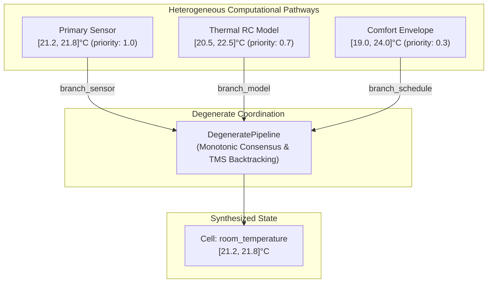

# Example: Multi-Source Degenerate Computation & Fault-Tolerant Estimation

In *Software Design for Flexibility* (MIT Press, 2021) and Gerald Jay Sussman's seminal MIT lectures, **degeneracy** describes systems where structurally different computational mechanisms compute the same quantity.

Unlike simple duplication (voting identical sensors), degenerate systems combine **heterogeneous sources of information**:
- **Direct Empirical Sensing**: High-accuracy IoT sensors ($[21.2, 21.8]^\circ\text{C}$, priority $1.0$).
- **Physics-Based Dynamic Simulation**: Thermal lumped-capacitance RC model driven by HVAC heat flux and outdoor ambient temperature ($[20.5, 22.5]^\circ\text{C}$, priority $0.7$).
- **Heuristic Baseline & Schedule**: Occupancy time-of-day profile ($[19.0, 24.0]^\circ\text{C}$, priority $0.3$).

When all pathways are healthy, they **monotonically refine uncertainty** via join-semilattice intersection ($\sqcap$). If a high-fidelity sensor drops offline or glitches with an unphysical reading (e.g., $48.0^\circ\text{C}$), the integrated Truth Maintenance System (TMS) detects the contradiction ($\top$), executes Dependency-Directed Backtracking (DDB) to retract the faulty branch, and **gracefully degrades** without system failure.

---

## 1. Architectural Topology



---

## 2. Multi-Pathway Consensus & Refinement

```python
from lattice_propagator import (
    DegenerateBranch,
    IntervalValue,
    NetworkTMS,
    PropagatorNetwork,
    add_degenerate_pipeline,
)

# 1. Initialize Network and TMS
net = PropagatorNetwork("Degenerate_Thermal_Estimation")
tms = NetworkTMS(net)

# 2. Allocate Pathway Input Cells
c_sensor = net.add_cell("sensor_reading")
c_model = net.add_cell("rc_model_estimate")
c_schedule = net.add_cell("schedule_envelope")

target = net.add_cell("room_temperature")

# 3. Define Heterogeneous Branches with Defeasible Priorities
b_sensor = DegenerateBranch("sensor", c_sensor, priority=1.0)
b_model = DegenerateBranch("rc_model", c_model, priority=0.7)
b_schedule = DegenerateBranch("schedule", c_schedule, priority=0.3)

pipeline = add_degenerate_pipeline(
    net,
    target,
    [b_sensor, b_model, b_schedule],
    mode="consensus",
)

# 4. Provide Initial Evidence:
#    Schedule: Wide baseline [19.0, 24.0]°C
c_schedule.set_value(IntervalValue(19.0, 24.0))

#    RC Model: Physics simulation [20.5, 22.5]°C
c_model.set_value(IntervalValue(20.5, 22.5))

#    Primary Sensor: Fine-grained measurement [21.2, 21.8]°C
c_sensor.set_value(IntervalValue(21.2, 21.8))

net.run()

# 5. Verify Monotonic Consensus Fusion:
#    [19.0, 24.0] ⊓ [20.5, 22.5] ⊓ [21.2, 21.8] = [21.2, 21.8]°C
print(f"Synthesized Target: {target.value}")
assert target.value == IntervalValue(21.2, 21.8)
assert pipeline.status == "consensus"
assert pipeline.is_degraded is False

# 6. Human-Readable Fusion Explanation from TMS
explanation = tms.explain(target.cell_id)
print(f"TMS Fusion Explanation:\n{explanation}")
assert "sensor" in explanation
```

---

## 3. Graceful Degradation upon Sensor Loss

When the primary physical sensor drops offline, the pipeline dynamically retracts its assumption and smoothly degrades to the secondary physical model:

```python
from lattice_propagator import (
    DegenerateBranch,
    IntervalValue,
    NetworkTMS,
    PropagatorNetwork,
    add_degenerate_pipeline,
)

net = PropagatorNetwork("Degradation_Demo")
NetworkTMS(net)

c_sensor = net.add_cell("sensor", IntervalValue(21.2, 21.8))
c_model = net.add_cell("rc_model", IntervalValue(20.5, 22.5))
c_schedule = net.add_cell("schedule", IntervalValue(19.0, 24.0))
target = net.add_cell("room_temp")

pipeline = add_degenerate_pipeline(
    net,
    target,
    [
        DegenerateBranch("sensor", c_sensor, priority=1.0),
        DegenerateBranch("rc_model", c_model, priority=0.7),
        DegenerateBranch("schedule", c_schedule, priority=0.3),
    ],
)
net.run()
assert target.value == IntervalValue(21.2, 21.8)

# Simulate Sensor Failure / Dropout
pipeline.retract_branch("sensor", reason="battery_exhausted")
net.run()

# Target automatically relaxes to RC Model ⊓ Schedule = [20.5, 22.5]°C
print(f"Degraded Estimate: {target.value}")
assert target.value == IntervalValue(20.5, 22.5)
assert pipeline.is_degraded is True
assert pipeline.status == "degraded"
```

---

## 4. Conflict Resolution via Dependency-Directed Backtracking

If a faulty sensor asserts an erroneous reading ($48.0^\circ\text{C}$) that conflicts with the thermal dynamics model, the system registers a `Contradiction` ($\top$) and automatically isolates the culprit:

```python
from lattice_propagator import (
    Contradiction,
    DegenerateBranch,
    IntervalValue,
    NetworkTMS,
    PropagatorNetwork,
    add_degenerate_pipeline,
)

net = PropagatorNetwork("Conflict_Recovery")
tms = NetworkTMS(net)

# Glitched sensor reports extreme heat [45.0, 50.0]°C
c_glitched = net.add_cell("glitched_sensor", IntervalValue(45.0, 50.0))
c_model = net.add_cell("physics_model", IntervalValue(20.5, 22.5))
target = net.add_cell("safe_temp")

# Assign model higher confidence than the suspect sensor
b_sensor = DegenerateBranch("sensor", c_glitched, priority=0.4)
b_model = DegenerateBranch("model", c_model, priority=0.9)

pipeline = add_degenerate_pipeline(net, target, [b_sensor, b_model])
net.run()

# Detect contradiction: [45.0, 50.0] ∩ [20.5, 22.5] = ∅
assert isinstance(target.value, Contradiction)
assert pipeline.status == "contradiction"
print(f"Contradiction detected: {target.value.reason}")

# Invoke Dependency-Directed Backtracking (DDB)
culprit = pipeline.resolve_conflict()
print(f"DDB isolated and retracted culprit assumption: {culprit}")
assert culprit == "branch_sensor"

# Safe operating state is immediately restored
assert target.value == IntervalValue(20.5, 22.5)
assert pipeline.status == "degraded"
print(f"Restored Temperature: {target.value}")
```
