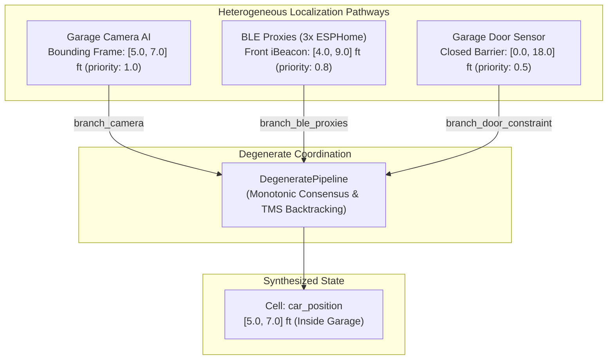

# Example: Vehicle Localization & Garage Presence via Degenerate Estimation

In *Software Design for Flexibility* (MIT Press, 2021) and Gerald Jay Sussman's foundational MIT lectures, **degeneracy** describes architectures where structurally different computational mechanisms calculate the same target state.

Unlike simple sensor duplication, degenerate computation combines **heterogeneous physical pathways**:
- **Overhead Camera AI Bounding Box (`branch_camera`, priority 1.0)**: Vision model (e.g. Frigate / Coral TPU in Home Assistant) detects the vehicle inside the garage bay and draws a bounding frame, accurate to about $2\text{ ft}$ ($[5.0, 7.0]\text{ ft}$). It operates only when the car is inside the garage, parked, and within line of sight.
- **Multi-Proxy BLE iBeacon (`branch_ble_proxies`, priority 0.8)**: An iBeacon mounted on the front bumper communicates with three ESPHome Bluetooth Proxies. It estimates longitudinal distance along the garage-driveway axis ($[4.0, 9.0]\text{ ft}$ in garage, $[21.0, 27.0]\text{ ft}$ in driveway). However, when the garage door is closed, external proxies lose line-of-sight, and multipath reflections can occasionally produce anomalies.
- **Garage Door Barrier Constraint (`branch_door_constraint`, priority 0.5)**: Track contact sensor. When closed, the physical barrier enforces that the vehicle cannot occupy the door boundary ($x \le 18.0\text{ ft}$ if inside, $x \ge 18.0\text{ ft}$ if outside).

When all pathways are available, they **monotonically refine spatial uncertainty** via interval intersection ($\sqcap$). If the car parks outside in the driveway (where the garage camera is blind) or if closing the garage door causes a BLE proxy dropout, the [`DegeneratePipeline`](file:///home/doug/code/lattice-propagator/docs/api/degenerate.md) seamlessly transitions to a **degraded mode**. If a multipath RF reflection asserts an impossible driveway reading while the camera sees the car in the bay, the Truth Maintenance System (TMS) isolates the conflict ($\top$) and uses Dependency-Directed Backtracking (DDB) to retract the faulty branch.

---

## 1. Architectural Topology



---

## 2. Multi-Pathway Consensus in Garage Bay

When the car is parked in the garage, the camera bounding box, front-bumper BLE iBeacon proxies, and closed door sensor all contribute:

```python
from lattice_propagator import (
    DegenerateBranch,
    IntervalValue,
    NetworkTMS,
    PropagatorNetwork,
    add_degenerate_pipeline,
)

# 1. Initialize Network and TMS
net = PropagatorNetwork("Vehicle_Localization")
tms = NetworkTMS(net)

# 2. Allocate Pathway Input Cells (distance in feet from garage back wall)
c_camera = net.add_cell("camera_bounding_box")
c_ble = net.add_cell("ble_proxy_estimate")
c_door = net.add_cell("door_barrier_constraint")

target = net.add_cell("car_position", unit="ft")

# 3. Define Heterogeneous Branches with Defeasible Priorities
b_camera = DegenerateBranch("camera", c_camera, priority=1.0)
b_ble = DegenerateBranch("ble_proxies", c_ble, priority=0.8)
b_door = DegenerateBranch("door_constraint", c_door, priority=0.5)

pipeline = add_degenerate_pipeline(
    net,
    target,
    [b_camera, b_ble, b_door],
    mode="consensus",
)

# 4. Assert Evidence for Parked Vehicle:
#    Door contact: Garage door closed => car constrained to [0.0, 18.0] ft
c_door.set_value(IntervalValue(0.0, 18.0))

#    BLE Proxies: 3 proxies trilaterate beacon to [4.0, 9.0] ft
c_ble.set_value(IntervalValue(4.0, 9.0))

#    Camera AI: Computer vision bounding frame puts car at [5.0, 7.0] ft (2 ft frame)
c_camera.set_value(IntervalValue(5.0, 7.0))

net.run()

# 5. Verify Monotonic Consensus Fusion:
#    [0.0, 18.0] ⊓ [4.0, 9.0] ⊓ [5.0, 7.0] = [5.0, 7.0] ft
print(f"Synthesized Vehicle Position: {target.value} ft")
assert target.value == IntervalValue(5.0, 7.0)
assert pipeline.status == "consensus"
assert pipeline.is_degraded is False

# 6. Human-Readable Provenance Explanation from TMS
explanation = tms.explain(target.cell_id)
print(f"TMS Fusion Explanation:\n{explanation}")
assert "camera" in explanation
```

---

## 3. Graceful Degradation (Car in Driveway / Camera Blind)

When the car is parked outside in the driveway, the overhead garage camera cannot see it (reports $\bot$). The system gracefully degrades to the BLE proxies and open door threshold:

```python
from lattice_propagator import (
    Bottom,
    DegenerateBranch,
    IntervalValue,
    NetworkTMS,
    PropagatorNetwork,
    add_degenerate_pipeline,
)

net = PropagatorNetwork("Driveway_Localization")
NetworkTMS(net)

# Target: car position along longitudinal axis (ft)
target = net.add_cell("car_position", unit="ft")

# Camera is blind (car is outside in driveway) => Bottom
c_camera = net.add_cell("camera", Bottom())

# BLE Proxies detect beacon out in the driveway: [21.0, 27.0] ft
c_ble = net.add_cell("ble", IntervalValue(21.0, 27.0))

# Door is open/driveway boundary: [18.0, 40.0] ft
c_door = net.add_cell("door", IntervalValue(18.0, 40.0))

pipeline = add_degenerate_pipeline(
    net,
    target,
    [
        DegenerateBranch("camera", c_camera, priority=1.0),
        DegenerateBranch("ble_proxies", c_ble, priority=0.8),
        DegenerateBranch("door_constraint", c_door, priority=0.5),
    ],
)
net.run()

# Pipeline operates smoothly on secondary pathways without failing
# [21.0, 27.0] ⊓ [18.0, 40.0] = [21.0, 27.0] ft
print(f"Driveway Degraded Position: {target.value} ft")
assert target.value == IntervalValue(21.0, 27.0)
assert pipeline.is_degraded is True
assert pipeline.status == "degraded"
```

---

## 4. RF Reflection Conflict & Backtracking Recovery

Suppose the car is parked in the garage bay ($[5.0, 7.0]\text{ ft}$ verified by the camera). A multipath RF bounce or proxy anomaly asserts that the beacon is out in the driveway ($[24.0, 29.0]\text{ ft}$).

The empty intersection causes a `Contradiction` ($\top$). Dependency-Directed Backtracking isolates the lower-priority BLE reading and restores the verified camera position:

```python
from lattice_propagator import (
    Contradiction,
    DegenerateBranch,
    IntervalValue,
    NetworkTMS,
    PropagatorNetwork,
    add_degenerate_pipeline,
)

net = PropagatorNetwork("BLE_Conflict_Recovery")
NetworkTMS(net)

target = net.add_cell("car_position", unit="ft")

# Camera AI reliably detects car in the garage bay
c_camera = net.add_cell("camera", IntervalValue(5.0, 7.0))

# Glitched BLE proxy reads multipath reflection in driveway [24.0, 29.0] ft
c_ble_glitch = net.add_cell("ble_glitched", IntervalValue(24.0, 29.0))

# Camera has higher priority (1.0) than suspect BLE proxy (0.8)
b_camera = DegenerateBranch("camera", c_camera, priority=1.0)
b_ble = DegenerateBranch("ble_proxies", c_ble_glitch, priority=0.8)

pipeline = add_degenerate_pipeline(net, target, [b_camera, b_ble])
net.run()

# Contradiction detected: [5.0, 7.0] ∩ [24.0, 29.0] = ∅
assert isinstance(target.value, Contradiction)
assert pipeline.status == "contradiction"
print(f"Conflict detected: {target.value.reason}")

# Invoke Dependency-Directed Backtracking (DDB) to resolve conflict
culprit = pipeline.resolve_conflict()
print(f"TMS isolated and retracted faulty assumption: {culprit}")
assert culprit == "branch_ble_proxies"

# Target immediately recovers to the camera-verified bay position
assert target.value == IntervalValue(5.0, 7.0)
assert pipeline.status == "degraded"
print(f"Restored Position: {target.value} ft")
```
