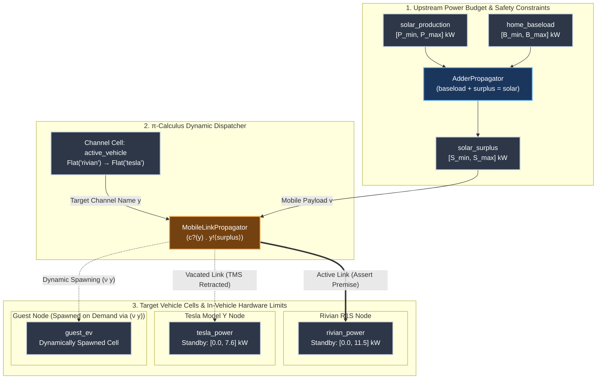

# Example: Dynamic EV Power Budgeting & π-Calculus Link Mobility

Classical dataflow graphs and constraint networks feature a **static topology**: wires between computational cells are fixed before execution starts. 

However, real-world physical systems frequently require **dynamic topology**—where connections between producers, consumers, and actuators change at runtime based on environmental state, priority tokens, or physical movement.

This example demonstrates how [`MobileLinkPropagator`](file:///home/doug/code/lattice-propagator/docs/api/primitives.md) implements Robin Milner's **$\pi$-calculus link mobility** ($c?(y).\, y!\langle v \rangle$) over partial-information lattices to solve the **dynamic solar power budget allocation problem** for a dual-vehicle smart charging garage.

---

## 1. The Dynamic Solar Splitter Problem

A home has a solar photovoltaic (PV) array, varying household baseload, and a shared $40\,\text{A}$ ($9.6\,\text{kW}$ continuous @ $240\,\text{V}$) electrical feed in the garage. Two Electric Vehicles (EVs) are parked in the driveway:

1. **Rivian R1S:** High battery capacity ($135\,\text{kWh}$), accepts up to $11.5\,\text{kW}$ on AC Level 2. Needs to reach $80\%$ State of Charge (SOC) for an afternoon trip.
2. **Tesla Model Y:** Secondary commuter vehicle ($75\,\text{kWh}$), accepts up to $7.6\,\text{kW}$ on AC Level 2.

### Why Static Graphs Struggle
Under a static graph topology, you cannot simply wire the fluctuating solar surplus cell directly into both vehicle cells simultaneously, because:
- **Destructive Interference:** Summing or joining both vehicle inputs directly into the single circuit would violate the $9.6\,\text{kW}$ safety limit or create contradictory constraints when one car finishes charging.
- **Manual Cleanup Boilerplate:** In classical automation systems (like raw Home Assistant automations or Node-RED flows), switching charging from Car A to Car B requires imperative scripting to manually zero out Car A, stop its loop, calculate the new budget, and start Car B's loop. If any step fails, Car A is left with a stale, non-zero charging command.

### The $\pi$-Calculus Solution
In Milner's $\pi$-calculus, communication channels are first-class values: processes send **channel names** across channels ($c?(y).\, y!\langle v \rangle$). 

With [`MobileLinkPropagator`](file:///home/doug/code/lattice-propagator/docs/api/primitives.md):
- **Payload Cell ($v$):** The dynamically calculated solar surplus power envelope $[P_{\min}, P_{\max}]\,\text{kW}$.
- **Channel Cell ($y$):** The dispatcher cell carrying the active destination vehicle identifier (`FlatValue("rivian")`, `FlatValue("tesla")`, or a candidate set `DiscreteDomain`).
- **Automatic TMS Retraction:** When the channel moves from `"rivian"` to `"tesla"`, the propagator automatically calls `Cell.retract_source()` on the Rivian cell. The Rivian relaxes cleanly back to its unconstrained standby baseline $[0.0, 11.5]\,\text{kW}$, while the Tesla instantly refines to the new solar budget!
- **Dynamic Scope Extrusion ($(\nu y)$):** When a guest vehicle plugs in (`"guest_ev"`), setting `spawn_missing=True` dynamically allocates a brand-new cell in the network on the fly.

---

## 2. Network Architecture & Topology



---

## 3. Hourly Time Series Simulation Overview

We simulate a 5-hour charging profile across the midday solar window:

| Hour | Solar Generation | Home Baseload | Solar Surplus | Active Channel | Rivian Allocation | Tesla Allocation | Operational Event |
| :---: | :---: | :---: | :---: | :---: | :---: | :---: | :--- |
| **11:00** | $[3.5, 4.0]\,\text{kW}$ | $[0.5, 0.8]\,\text{kW}$ | $[2.7, 3.5]\,\text{kW}$ | `"rivian"` | $[2.7, 3.5]\,\text{kW}$ | Standby ($[0.0, 7.6]\,\text{kW}$) | Morning solar ramp; Rivian prioritised (SOC $65\%$). |
| **12:00** | $[6.0, 7.5]\,\text{kW}$ | $[1.0, 1.2]\,\text{kW}$ | $[4.8, 6.5]\,\text{kW}$ | `"rivian"` | $[4.8, 6.5]\,\text{kW}$ | Standby ($[0.0, 7.6]\,\text{kW}$) | Solar peak; cooking lunch increases baseload. |
| **13:00** | $[6.8, 7.2]\,\text{kW}$ | $[0.6, 0.8]\,\text{kW}$ | $[6.0, 6.6]\,\text{kW}$ | `"tesla"` | Standby ($[0.0, 11.5]\,\text{kW}$) | $[6.0, 6.6]\,\text{kW}$ | **$\pi$-Handoff:** Rivian hit $80\%$; TMS retracts Rivian, engages Tesla. |
| **14:00** | $[5.0, 5.5]\,\text{kW}$ | $[0.8, 1.0]\,\text{kW}$ | $[4.0, 4.7]\,\text{kW}$ | `"tesla"` | Standby ($[0.0, 11.5]\,\text{kW}$) | $[4.0, 4.7]\,\text{kW}$ | Solar tapers; Tesla absorbs remaining afternoon power. |
| **15:00** | $[4.2, 4.8]\,\text{kW}$ | $[0.7, 0.9]\,\text{kW}$ | $[3.3, 4.1]\,\text{kW}$ | `"guest_ev"` | Standby ($[0.0, 11.5]\,\text{kW}$) | Standby ($[0.0, 7.6]\,\text{kW}$) | **$(\nu y)$ Spawning:** Guest plugs in; network allocates cell on demand. |

---

## 4. Executable Python Implementation

```python
from lattice_propagator import (
    BOTTOM,
    AdderPropagator,
    DiscreteDomain,
    IntervalValue,
    MobileLinkPropagator,
    PropagatorNetwork,
)

# 1. Instantiate network and physical cells
net = PropagatorNetwork("SolarEVSplitter")

solar = net.add_cell("solar_production", unit="kW")
baseload = net.add_cell("home_baseload", unit="kW")
surplus = net.add_cell("solar_surplus", unit="kW")
channel = net.add_cell("active_vehicle")

# 2. Target vehicles with baseline hardware standby capabilities
rivian = net.add_cell("rivian_power", unit="kW")
tesla = net.add_cell("tesla_power", unit="kW")

rivian.set_value(IntervalValue(0.0, 11.5), source="hardware_envelope")
tesla.set_value(IntervalValue(0.0, 7.6), source="hardware_envelope")

# 3. Upstream constraint: baseload + surplus = solar  (surplus = solar − baseload)
net.add_propagator(AdderPropagator("power_balance", baseload, surplus, solar))

# 4. π-Calculus Mobile Link Propagator
net.add_propagator(
    MobileLinkPropagator(
        "ev_dispatcher",
        channel_cell=channel,
        payload_cell=surplus,
        targets={"rivian": rivian, "tesla": tesla},
        spawn_missing=True,  # Enables (ν y) dynamic cell creation
    )
)

# 5. Hourly time series simulation readings
hourly_readings = [
    ("11:00", IntervalValue(3.5, 4.0), IntervalValue(0.5, 0.8), "rivian"),
    ("12:00", IntervalValue(6.0, 7.5), IntervalValue(1.0, 1.2), "rivian"),
    ("13:00", IntervalValue(6.8, 7.2), IntervalValue(0.6, 0.8), "tesla"),
    ("14:00", IntervalValue(5.0, 5.5), IntervalValue(0.8, 1.0), "tesla"),
    ("15:00", IntervalValue(4.2, 4.8), IntervalValue(0.7, 0.9), "guest_ev"),
]

for hour, sol_val, base_val, vehicle_id in hourly_readings:
    # Clear intermediate surplus cell for the new discrete time step
    surplus.set_value(BOTTOM, overwrite=True)
    solar.set_value(sol_val, overwrite=True)
    baseload.set_value(base_val, overwrite=True)
    channel.set_value(DiscreteDomain.single(vehicle_id), overwrite=True)
    net.run()

    # Verify expected dynamic routing and automatic TMS relaxation
    if vehicle_id == "rivian":
        assert rivian.value == surplus.value
        assert tesla.value == IntervalValue(0.0, 7.6)  # Tesla is in standby
    elif vehicle_id == "tesla":
        assert rivian.value == IntervalValue(0.0, 11.5)  # Rivian relaxed back to standby
        assert tesla.value == surplus.value
    elif vehicle_id == "guest_ev":
        assert rivian.value == IntervalValue(0.0, 11.5)
        assert tesla.value == IntervalValue(0.0, 7.6)
        assert "guest_ev" in net.cells
        assert net.cells["guest_ev"].value == surplus.value

    print(
        f"Hour {hour} | Target: {vehicle_id:10} | Surplus: {surplus.value} | "
        f"Rivian: {rivian.value} | Tesla: {tesla.value}"
    )
```

```text
Hour 11:00 | Target: rivian     | Surplus: [2.700, 3.500] | Rivian: [2.700, 3.500] | Tesla: [0.000, 7.600]
Hour 12:00 | Target: rivian     | Surplus: [4.800, 6.500] | Rivian: [4.800, 6.500] | Tesla: [0.000, 7.600]
Hour 13:00 | Target: tesla      | Surplus: [6.000, 6.600] | Rivian: [0.000, 11.500] | Tesla: [6.000, 6.600]
Hour 14:00 | Target: tesla      | Surplus: [4.000, 4.700] | Rivian: [0.000, 11.500] | Tesla: [4.000, 4.700]
Hour 15:00 | Target: guest_ev   | Surplus: [3.300, 4.100] | Rivian: [0.000, 11.500] | Tesla: [0.000, 7.600]
```

---

## 5. Ambiguous Routing & Speculative Superposition

What happens if the energy management system has not yet decided which vehicle to prioritize, or wants to explore the speculative impact of charging either car?

By setting `propagate_ambiguous=True`, `MobileLinkPropagator` projects defeasible **`Assumption`** premises across all candidate targets:

```python
from lattice_propagator import (
    DiscreteDomain,
    IntervalValue,
    MobileLinkPropagator,
    NetworkTMS,
    PropagatorNetwork,
)

net = PropagatorNetwork("AmbiguousEVSplitter")
ntms = NetworkTMS(net)

surplus = net.add_cell("surplus", IntervalValue(3.0, 3.5))
channel = net.add_cell("channel")

rivian = net.add_cell("rivian_power")
tesla = net.add_cell("tesla_power")
ntms.get_or_create_cell_tms("rivian_power")
ntms.get_or_create_cell_tms("tesla_power")

rivian.set_value(IntervalValue(0.0, 11.5), source="hardware_limit")
tesla.set_value(IntervalValue(0.0, 7.6), source="hardware_limit")

net.add_propagator(
    MobileLinkPropagator(
        "ev_dispatcher",
        channel_cell=channel,
        payload_cell=surplus,
        targets={"rivian": rivian, "tesla": tesla},
        confidence=0.8,
        propagate_ambiguous=True,
    )
)

# Undecided between Rivian and Tesla:
channel.set_value(DiscreteDomain({"rivian", "tesla"}))
net.run()

# Both vehicles receive speculative bounds:
assert rivian.value == IntervalValue(3.0, 3.5)
assert tesla.value == IntervalValue(3.0, 3.5)

# Both bindings are marked as defeasible assumptions in the TMS:
assert rivian.tms.premises["ev_dispatcher@rivian"].is_assumption is True
assert tesla.tms.premises["ev_dispatcher@tesla"].is_assumption is True
```

If a downstream breaker limit or vehicle battery fault triggers a contradiction on either vehicle, `NetworkTMS.resolve_contradiction()` will trace the assumption back to `ev_dispatcher@...` and cleanly prune the invalid candidate branch.

---

## 6. Summary of Algebraic Properties

`MobileLinkPropagator` brings formal $\pi$-calculus guarantees to reactive constraint networks:

1. **Monotonicity with Scoped Retraction:** Information fusion within each active cell remains monotonic ($\sqcup$). When topological links move, non-monotonic belief revision is localized strictly to the source premise via the cell's `TruthMaintenanceSystem`.
2. **First-Class Channels:** Communication endpoints are ordinary lattice values (`FlatValue`, `DiscreteDomain`, `SetLattice`, `OrderedInterval`, or `BeliefMassValue`), enabling reasoning about routing paths using the same algebra as sensor data.
3. **No Dangling Wires:** Vacating a target automatically removes the asserted constraint, eliminating memory leaks and stale command states.
