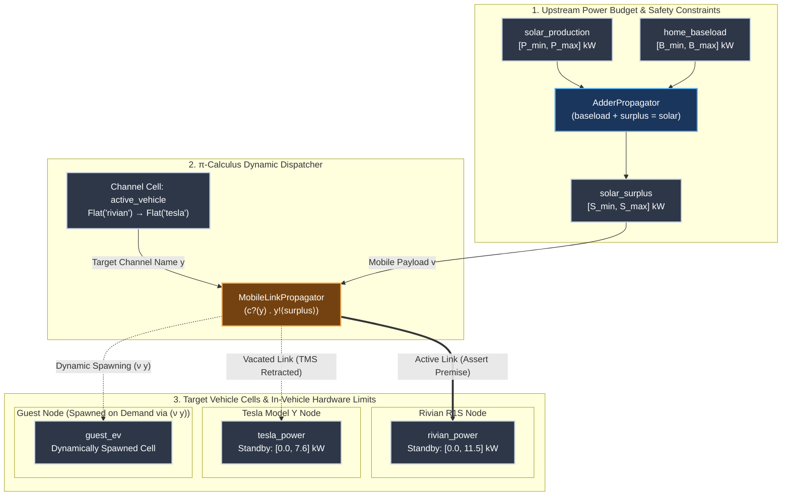
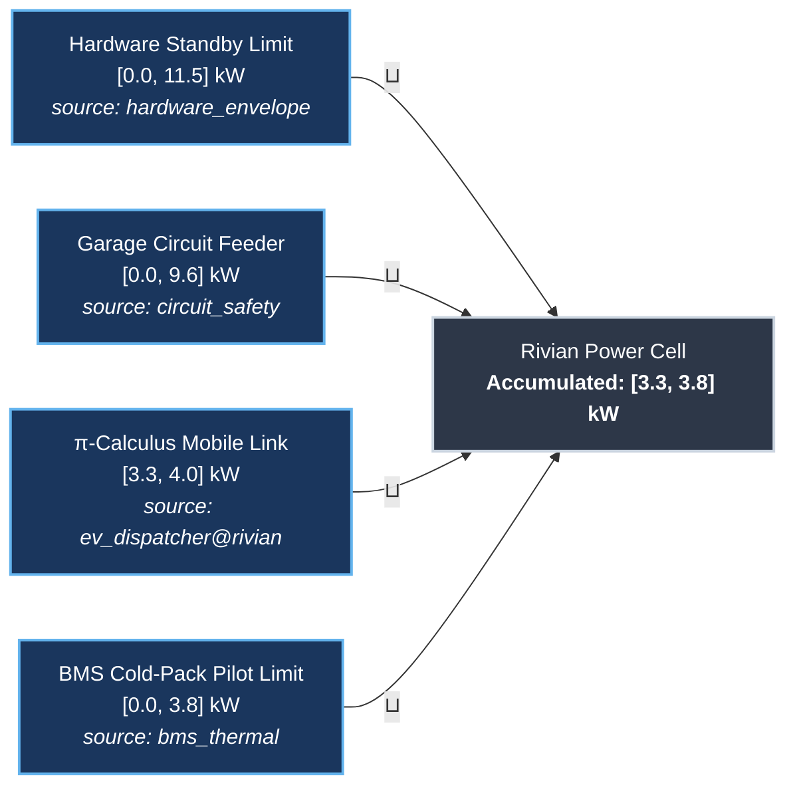
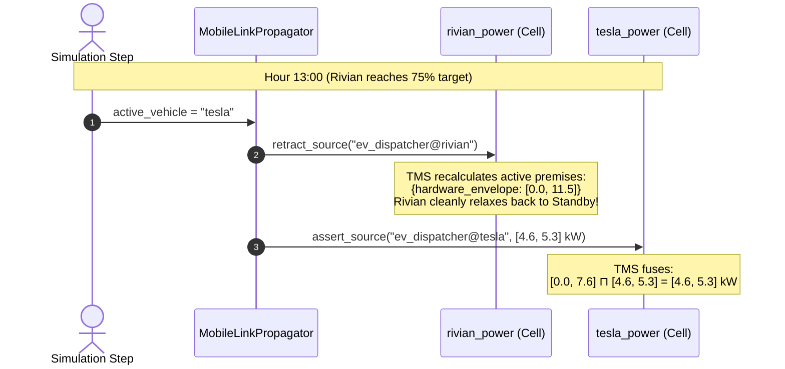
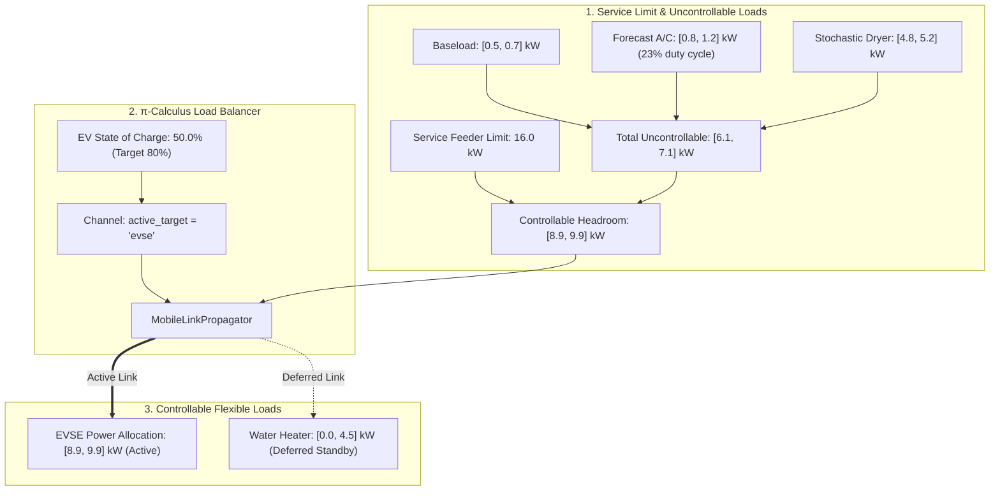
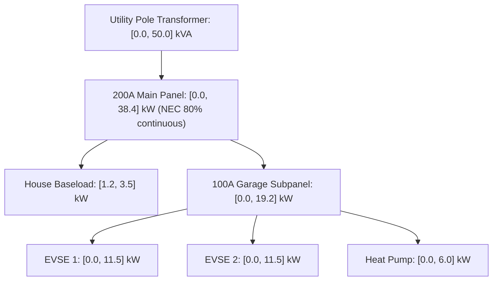
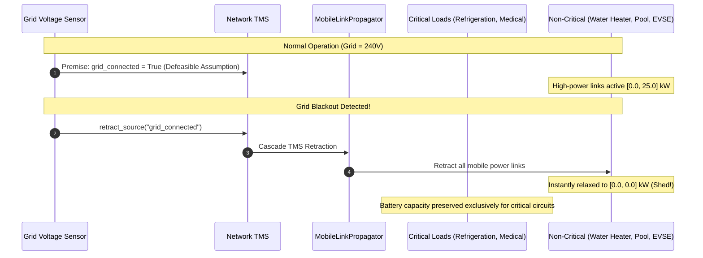
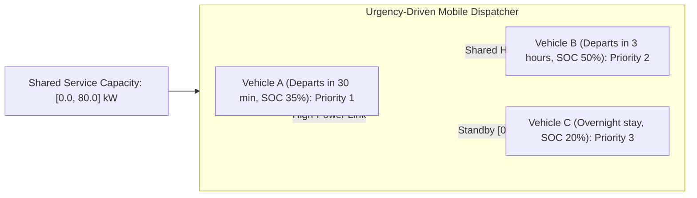

# Example: Dynamic EV Power Budgeting & π-Calculus Link Mobility

Classical dataflow graphs and constraint networks feature a **static topology**: wires between computational cells are fixed before execution starts. 

However, real-world physical systems frequently require **dynamic topology**—where connections between producers, consumers, and actuators change at runtime based on environmental state, priority tokens, or physical movement.

This example demonstrates how [`MobileLinkPropagator`](file:///home/doug/code/lattice-propagator/docs/api/primitives.md) implements Robin Milner's **$\pi$-calculus link mobility** ($c?(y).\, y!\langle v \rangle$) over partial-information lattices to solve the **dynamic solar power budget allocation problem** for a dual-vehicle smart charging garage.

---

## 1. The Dynamic Solar Splitter Problem

A home has a solar photovoltaic (PV) array, varying household baseload, and a shared $40\,\text{A}$ ($9.6\,\text{kW}$ continuous @ $240\,\text{V}$) electrical feed in the garage. Two Electric Vehicles (EVs) are parked in the driveway:

1. **Rivian R1S:** High battery capacity ($135.0\,\text{kWh}$ pack), accepts up to $11.5\,\text{kW}$ on AC Level 2. Starts at **$67.0\%$ State of Charge (SOC)** ($90.45\,\text{kWh}$ stored), with a priority target threshold of **$75.0\%$ SOC**.
2. **Tesla Model Y:** Secondary commuter vehicle ($75.0\,\text{kWh}$ pack), accepts up to $7.6\,\text{kW}$ on AC Level 2. Starts depleted at **$20.0\%$ SOC** ($15.00\,\text{kWh}$ stored), with a target threshold of **$30.0\%$ SOC**.
3. **Guest EV:** Visiting vehicle connected to a mobile charger plug, which should receive remaining solar power only after both primary household vehicles have reached their target state of charge.

### Why Static Graphs Struggle
Under a static graph topology, you cannot simply wire the fluctuating solar surplus cell directly into both vehicle cells simultaneously, because:
- **Destructive Interference:** Summing or joining both vehicle inputs directly into the single circuit would violate the $9.6\,\text{kW}$ safety limit or create contradictory constraints when one car finishes charging.
- **Manual Cleanup Boilerplate:** In classical automation systems (like raw Home Assistant automations or Node-RED flows), switching charging from Car A to Car B requires imperative scripting to manually zero out Car A, stop its loop, calculate the new budget, and start Car B's loop. If any step fails, Car A is left with a stale, non-zero charging command.

### The $\pi$-Calculus Solution
In Milner's $\pi$-calculus, communication channels are first-class values: processes send **channel names** across channels ($c?(y).\, y!\langle v \rangle$). 

With [`MobileLinkPropagator`](file:///home/doug/code/lattice-propagator/docs/api/primitives.md):
- **Payload Cell ($v$):** The dynamically calculated solar surplus power envelope $[P_{\min}, P_{\max}]\,\text{kW}$.
- **Channel Cell ($y$):** The dispatcher cell carrying the active destination vehicle identifier (`FlatValue("rivian")`, `FlatValue("tesla")`, or a candidate set `DiscreteDomain`).
- **Automatic TMS Retraction:** When the channel moves from `"rivian"` to `"tesla"`, the propagator automatically calls `Cell.retract_source()` on the Rivian cell. The Rivian relaxes cleanly back to its unconstrained standby baseline $[0.0, 11.5]\,\text{kW}$, while the Tesla instantly refines to the new solar budget!
- **Dynamic Scope Extrusion ($(\nu y)$):** When a guest vehicle plugs in (`"guest_ev"`), setting `spawn_missing=True` dynamically allocates a brand-new cell in the network on the fly.

---

## 2. Network Architecture & Topology



---

## 3. Hourly Simulation Overview

To illustrate the separation of inputs from autonomous network deductions, we divide the 6-hour simulation (11:00 to 16:00) into two views:

### A. Input Readings (Boundary Conditions)
These are the external sensor readings and environmental boundary conditions provided to the system each hour. Notice that **no vehicle names or switching decisions are specified in the inputs**:

| Hour | Solar Generation ($P_{\text{solar}}$) | Home Baseload ($P_{\text{base}}$) | Environmental Context |
| :---: | :---: | :---: | :--- |
| **11:00** | $[4.0, 4.5]\,\text{kW}$ | $[0.5, 0.7]\,\text{kW}$ | Morning solar ramp; clear skies |
| **12:00** | $[6.5, 7.5]\,\text{kW}$ | $[0.8, 1.0]\,\text{kW}$ | Solar peak; cooking lunch increases baseload |
| **13:00** | $[7.0, 7.5]\,\text{kW}$ | $[0.6, 0.8]\,\text{kW}$ | Early afternoon high solar window |
| **14:00** | $[5.5, 6.0]\,\text{kW}$ | $[0.7, 0.9]\,\text{kW}$ | Afternoon solar begins tapering |
| **15:00** | $[4.8, 5.4]\,\text{kW}$ | $[0.6, 0.8]\,\text{kW}$ | Late afternoon steady sun |
| **16:00** | $[3.5, 4.0]\,\text{kW}$ | $[0.5, 0.7]\,\text{kW}$ | Late afternoon lower solar angle |

### B. Network Deductions & Dynamic State Evolution (Outputs)
These are the autonomous outputs computed by the propagator network—the surplus power envelope, the dynamically evaluated active target channel (selected car), the allocated charging power, and the resulting integrated State of Charge (SOC):

| Hour | Solar Surplus ($P_{\text{surplus}}$) | Active Target Channel *(Active Car)* | Rivian Allocation & SOC *(Cap: $135\,\text{kWh}$, Target: $75\%$)* | Tesla Allocation & SOC *(Cap: $75\,\text{kWh}$, Target: $30\%$)* | Operational Event / $\pi$-Calculus Handoff |
| :---: | :---: | :---: | :---: | :---: | :--- |
| **11:00** | $[3.3, 4.0]\,\text{kW}$ | `"rivian"` | $[3.3, 4.0]\,\text{kW}$<br/>**SOC:** $[69.4\%, 70.0\%]$ | Standby ($[0.0, 7.6]\,\text{kW}$)<br/>**SOC:** $20.0\%$ | Rivian starts at $67.0\%$ and charges towards $75.0\%$ target. |
| **12:00** | $[5.5, 6.7]\,\text{kW}$ | `"rivian"` | $[5.5, 6.7]\,\text{kW}$<br/>**SOC:** $[73.5\%, 74.9\%]$ | Standby ($[0.0, 7.6]\,\text{kW}$)<br/>**SOC:** $20.0\%$ | Rivian continues charging toward $75.0\%$ target. |
| **13:00** | $[6.2, 6.9]\,\text{kW}$ | `"rivian"` | $[6.2, 6.9]\,\text{kW}$<br/>**SOC:** $[78.1\%, 80.0\%]$ | Standby ($[0.0, 7.6]\,\text{kW}$)<br/>**SOC:** $20.0\%$ | **Rivian reaches target ($\ge 75.0\%$)!** Battery is sufficiently charged. |
| **14:00** | $[4.6, 5.3]\,\text{kW}$ | `"tesla"` | Standby ($[0.0, 11.5]\,\text{kW}$)<br/>**SOC:** $[78.1\%, 80.0\%]$ | $[4.6, 5.3]\,\text{kW}$<br/>**SOC:** $[26.1\%, 27.1\%]$ | **$\pi$-Handoff 1:** Switched to Tesla because Rivian is satisfied! TMS retracts Rivian. |
| **15:00** | $[4.0, 4.8]\,\text{kW}$ | `"tesla"` | Standby ($[0.0, 11.5]\,\text{kW}$)<br/>**SOC:** $[78.1\%, 80.0\%]$ | $[4.0, 4.8]\,\text{kW}$<br/>**SOC:** $[31.5\%, 33.5\%]$ | **Tesla reaches target ($\ge 30.0\%$)!** Both primary vehicles are now satisfied. |
| **16:00** | $[2.8, 3.5]\,\text{kW}$ | `"guest_ev"` | Standby ($[0.0, 11.5]\,\text{kW}$)<br/>**SOC:** $[78.1\%, 80.0\%]$ | Standby ($[0.0, 7.6]\,\text{kW}$)<br/>**SOC:** $[31.5\%, 33.5\%]$ | **$\pi$-Handoff 2 & $(\nu y)$ Spawning:** Both household cars satisfied; power routes to Guest EV. |

---

## 4. Executable Python Implementation

```python
from lattice_propagator import (
    BOTTOM,
    AdderPropagator,
    DiscreteDomain,
    IntervalValue,
    MobileLinkPropagator,
    PropagatorNetwork,
)

# 1. Instantiate network and physical cells
net = PropagatorNetwork("SolarEVSplitter")

solar = net.add_cell("solar_production", unit="kW")
baseload = net.add_cell("home_baseload", unit="kW")
surplus = net.add_cell("solar_surplus", unit="kW")
channel = net.add_cell("active_vehicle")

# 2. Target vehicles with baseline hardware standby capabilities
rivian = net.add_cell("rivian_power", unit="kW")
tesla = net.add_cell("tesla_power", unit="kW")

rivian.set_value(IntervalValue(0.0, 11.5), source="hardware_envelope")
tesla.set_value(IntervalValue(0.0, 7.6), source="hardware_envelope")

# Battery pack capacities and initial state of charge (SOC)
CAP_RIVIAN = 135.0  # Rivian R1S (135 kWh pack)
CAP_TESLA = 75.0  # Tesla Model Y (75 kWh pack)

e_rivian = IntervalValue(CAP_RIVIAN * 0.67, CAP_RIVIAN * 0.67)  # Starts at 67.0% (90.45 kWh)
e_tesla = IntervalValue(CAP_TESLA * 0.20, CAP_TESLA * 0.20)  # Starts at 20.0% (15.00 kWh)

# 3. Upstream constraint: baseload + surplus = solar  (surplus = solar − baseload)
net.add_propagator(AdderPropagator("power_balance", baseload, surplus, solar))

# 4. π-Calculus Mobile Link Propagator
net.add_propagator(
    MobileLinkPropagator(
        "ev_dispatcher",
        channel_cell=channel,
        payload_cell=surplus,
        targets={"rivian": rivian, "tesla": tesla},
        spawn_missing=True,  # Enables (ν y) dynamic cell creation
    )
)

# 5. Hourly time series simulation inputs.
# External boundary conditions (pure physical weather/load inputs, NO vehicle names!):
#   • Column 1 (hour):     Time-of-day step identifier (e.g. "11:00")
#   • Column 2 (sol_val):  Solar PV generation power envelope [P_min, P_max] in kW
#   • Column 3 (base_val): Home baseload power consumption envelope [B_min, B_max] in kW
hourly_inputs = [
    #  Hour     Solar Generation (kW)   Home Baseload (kW)
    ("11:00", IntervalValue(4.0, 4.5), IntervalValue(0.5, 0.7)),
    ("12:00", IntervalValue(6.5, 7.5), IntervalValue(0.8, 1.0)),
    ("13:00", IntervalValue(7.0, 7.5), IntervalValue(0.6, 0.8)),
    ("14:00", IntervalValue(5.5, 6.0), IntervalValue(0.7, 0.9)),
    ("15:00", IntervalValue(4.8, 5.4), IntervalValue(0.6, 0.8)),
    ("16:00", IntervalValue(3.5, 4.0), IntervalValue(0.5, 0.7)),
]

RIVIAN_TARGET_SOC = 75.0  # Charge Rivian first until 75.0% target
TESLA_TARGET_SOC = 30.0  # Then charge Tesla until 30.0% target

for hour, sol_val, base_val in hourly_inputs:
    # Clear intermediate surplus cell for the new discrete time step
    surplus.set_value(BOTTOM, overwrite=True)
    solar.set_value(sol_val, overwrite=True)
    baseload.set_value(base_val, overwrite=True)

    # Autonomous priority ladder based on current state of charge:
    # 1. Charge Rivian until RIVIAN_TARGET_SOC (75.0%)
    # 2. Charge Tesla until TESLA_TARGET_SOC (30.0%)
    # 3. Route to Guest EV once both primary vehicles are satisfied
    curr_soc_r = e_rivian.min_val / CAP_RIVIAN * 100.0
    curr_soc_t = e_tesla.min_val / CAP_TESLA * 100.0

    if curr_soc_r < RIVIAN_TARGET_SOC:
        target_car = "rivian"
    elif curr_soc_t < TESLA_TARGET_SOC:
        target_car = "tesla"
    else:
        target_car = "guest_ev"

    channel.set_value(DiscreteDomain.single(target_car), overwrite=True)
    net.run()

    # Integrate 1 hour of energy: Delta_E = Power * 1.0h
    if target_car == "rivian":
        e_rivian = IntervalValue(
            e_rivian.min_val + rivian.value.min_val,
            e_rivian.max_val + rivian.value.max_val,
        )
    elif target_car == "tesla":
        e_tesla = IntervalValue(
            e_tesla.min_val + tesla.value.min_val,
            e_tesla.max_val + tesla.value.max_val,
        )

    # Compute State of Charge (SOC) intervals
    soc_r = IntervalValue(
        e_rivian.min_val / CAP_RIVIAN * 100.0,
        e_rivian.max_val / CAP_RIVIAN * 100.0,
    )
    soc_t = IntervalValue(
        e_tesla.min_val / CAP_TESLA * 100.0,
        e_tesla.max_val / CAP_TESLA * 100.0,
    )

    # Verify expected dynamic routing and automatic TMS relaxation
    if target_car == "rivian":
        assert rivian.value == surplus.value
        assert tesla.value == IntervalValue(0.0, 7.6)  # Tesla is in standby
    elif target_car == "tesla":
        assert rivian.value == IntervalValue(0.0, 11.5)  # Rivian relaxed back to standby
        assert tesla.value == surplus.value
    elif target_car == "guest_ev":
        assert rivian.value == IntervalValue(0.0, 11.5)
        assert tesla.value == IntervalValue(0.0, 7.6)
        assert "guest_ev" in net.cells
        assert net.cells["guest_ev"].value == surplus.value

    print(
        f"Hour {hour} | Target: {target_car:10} | Surplus: {surplus.value} | "
        f"Rivian SOC: [{soc_r.min_val:.1f}%, {soc_r.max_val:.1f}%] | "
        f"Tesla SOC: [{soc_t.min_val:.1f}%, {soc_t.max_val:.1f}%]"
    )
```

```text
Hour 11:00 | Target: rivian     | Surplus: [3.300, 4.000] | Rivian SOC: [69.4%, 70.0%] | Tesla SOC: [20.0%, 20.0%]
Hour 12:00 | Target: rivian     | Surplus: [5.500, 6.700] | Rivian SOC: [73.5%, 74.9%] | Tesla SOC: [20.0%, 20.0%]
Hour 13:00 | Target: rivian     | Surplus: [6.200, 6.900] | Rivian SOC: [78.1%, 80.0%] | Tesla SOC: [20.0%, 20.0%]
Hour 14:00 | Target: tesla      | Surplus: [4.600, 5.300] | Rivian SOC: [78.1%, 80.0%] | Tesla SOC: [26.1%, 27.1%]
Hour 15:00 | Target: tesla      | Surplus: [4.000, 4.800] | Rivian SOC: [78.1%, 80.0%] | Tesla SOC: [31.5%, 33.5%]
Hour 16:00 | Target: guest_ev   | Surplus: [2.800, 3.500] | Rivian SOC: [78.1%, 80.0%] | Tesla SOC: [31.5%, 33.5%]
```

---

## 5. Ambiguous Routing & Speculative Superposition

What happens if the energy management system has not yet decided which vehicle to prioritize, or wants to explore the speculative impact of charging either car?

By setting `propagate_ambiguous=True`, `MobileLinkPropagator` projects defeasible **`Assumption`** premises across all candidate targets:

```python
from lattice_propagator import (
    DiscreteDomain,
    IntervalValue,
    MobileLinkPropagator,
    NetworkTMS,
    PropagatorNetwork,
)

net = PropagatorNetwork("AmbiguousEVSplitter")
ntms = NetworkTMS(net)

surplus = net.add_cell("surplus", IntervalValue(3.0, 3.5))
channel = net.add_cell("channel")

rivian = net.add_cell("rivian_power")
tesla = net.add_cell("tesla_power")
ntms.get_or_create_cell_tms("rivian_power")
ntms.get_or_create_cell_tms("tesla_power")

rivian.set_value(IntervalValue(0.0, 11.5), source="hardware_limit")
tesla.set_value(IntervalValue(0.0, 7.6), source="hardware_limit")

net.add_propagator(
    MobileLinkPropagator(
        "ev_dispatcher",
        channel_cell=channel,
        payload_cell=surplus,
        targets={"rivian": rivian, "tesla": tesla},
        confidence=0.8,
        propagate_ambiguous=True,
    )
)

# Undecided between Rivian and Tesla:
channel.set_value(DiscreteDomain({"rivian", "tesla"}))
net.run()

# Both vehicles receive speculative bounds:
assert rivian.value == IntervalValue(3.0, 3.5)
assert tesla.value == IntervalValue(3.0, 3.5)

# Both bindings are marked as defeasible assumptions in the TMS:
assert rivian.tms.premises["ev_dispatcher@rivian"].is_assumption is True
assert tesla.tms.premises["ev_dispatcher@tesla"].is_assumption is True
```

If a downstream breaker limit or vehicle battery fault triggers a contradiction on either vehicle, `NetworkTMS.resolve_contradiction()` will trace the assumption back to `ev_dispatcher@...` and cleanly prune the invalid candidate branch.

---

## 6. Summary of Algebraic Properties

`MobileLinkPropagator` brings formal $\pi$-calculus guarantees to reactive constraint networks:

1. **Monotonicity with Scoped Retraction:** Information fusion within each active cell remains monotonic ($\sqcup$). When topological links move, non-monotonic belief revision is localized strictly to the source premise via the cell's `TruthMaintenanceSystem`.
2. **First-Class Channels:** Communication endpoints are ordinary lattice values (`FlatValue`, `DiscreteDomain`, `SetLattice`, `OrderedInterval`, or `BeliefMassValue`), enabling reasoning about routing paths using the same algebra as sensor data.
3. **No Dangling Wires:** Vacating a target automatically removes the asserted constraint, eliminating memory leaks and stale command states.

---

## 7. Deep Dive: Spatial Information Accumulation vs. Temporal Simulation

A natural question arises when viewing the hourly loop in [Section 4](#4-executable-python-implementation):

> *"In this simulation, aren't we just calculating values directly rather than accumulating partial information in cells?"*

At first glance, the discrete time loop looks like a conventional imperative script: we feed inputs for Hour $H$, run the network, and read the outputs. However, under the hood, cells are **not** passive variables or function return registers. They are **join-semilattice accumulators** operating across two fundamentally distinct physical dimensions:

1. **Spatial Constraint Accumulation (Within a Single Time Step)**
2. **Temporal State Accumulation vs. Instantaneous Flux (Across Time Steps)**

---

### Spatial Accumulation (Within a Single Time Step)

Within any given hour, no single component "calculates" the vehicle's charging power directly. Instead, multiple independent physical sources and regulatory envelopes **accumulate concurrently** into the target vehicle cell via lattice join ($\sqcup$ in information refinement order, corresponding to interval intersection $\sqcap$):



Mathematically, the cell computes:

$$[0.0, 11.5] \sqcap [0.0, 9.6] \sqcap [3.3, 4.0] \sqcap [0.0, 3.8] = [3.3, 3.8]\,\text{kW}$$

- **Decentralized & Multi-Directional:** The inverter did not need to know about the cold-pack BMS limit, nor did the solar splitter need to know about the circuit breaker. Each subsystem asserted its partial knowledge into the shared cell.
- **Monotonic Refinement:** As each new constraint arrives, information strictly refines ($x \sqsubseteq x \sqcup y$). The cell's bounds tighten monotonically until fixed-point quiescence is reached.

---

### Instantaneous Flux vs. State Accumulation (Across Time Steps)

Why does the simulation loop call `surplus.set_value(BOTTOM, overwrite=True)` at the beginning of each hour?

Physical variables fall into two distinct ontological categories:

| Dimension | Physical Nature | Units | Lattice Behavior Across Time | Examples |
| :--- | :--- | :---: | :--- | :--- |
| **Instantaneous Flux** | Rate of flow at time $t$ | $\text{kW}$, $\text{A}$, $\text{m/s}$ | **Non-accumulating across time.** Previous intervals are physically obsolete. Must be reset or updated for each discrete step. | Solar generation ($P_{\text{solar}}$), home baseload ($P_{\text{base}}$), charging power ($P_{\text{ev}}$) |
| **Integrated State** | Accumulated quantity over time ($Q = \int \Phi\,dt$) | $\text{kWh}$, $\text{Ah}$, $\text{m}$ | **Accumulating across time.** Monotonically aggregates or tracks state integrals. | Battery stored energy ($E$), State of Charge ($\text{SOC}$), odometer |

If instantaneous power flux were monotonically intersected across hours without resetting, the lattice would attempt to intersect disjoint intervals:

$$[3.3, 4.0]\,\text{kW}\ (11:00) \sqcap [5.5, 6.7]\,\text{kW}\ (12:00) = \top\quad (\text{Contradiction})$$

An empty interval contradiction would be declared because no physical constant power can simultaneously be both $3.5\,\text{kW}$ and $6.0\,\text{kW}$. 

Conversely, stored battery energy ($E$) **is** a true state accumulator. Across the 6-hour simulation, the Rivian energy cell integrated energy monotonically:

$$90.45\,\text{kWh}\ (67.0\%) \longrightarrow 94.10\,\text{kWh}\ (69.7\%) \longrightarrow 100.20\,\text{kWh}\ (74.2\%) \longrightarrow 106.75\,\text{kWh}\ (79.1\%)$$

---

### Truth Maintenance & Autonomous Relaxation

The combination of Milner's $\pi$-calculus link mobility with the Truth Maintenance System (TMS) provides an elegant solution to dynamic reconfiguration:



In classical imperative control:
- To switch charging from Rivian to Tesla, a script must explicitly invoke `stop_charging(rivian)` or set `rivian_power = 0.0`.
- If that cleanup step fails, crashes, or is omitted, the Rivian remains stuck drawing power or locked in a stale state.

In `lattice-propagator`:
- The solar connection is an asserted **premise** (`ev_dispatcher@rivian`).
- When the active vehicle changes, `MobileLinkPropagator` simply retracts that premise.
- The Rivian cell's internal TMS automatically re-evaluates all remaining active premises (its `hardware_envelope`), cleanly relaxing the cell back to its standby bounds $[0.0, 11.5]\,\text{kW}$ with zero manual cleanup logic!

---

## 8. Advanced Co-Optimization: Whole-House Envelope, EVSE, Water Heater & Stochastic Loads

To demonstrate how the propagator network scales to multi-resource scheduling under uncertainty, consider a sophisticated residential night-time energy management scenario.

### 8.1 Scenario & Physical Parameters

We manage a household during the off-peak tariff window (**23:00 to 07:00**, 8 hours) with a main service continuous budget of **$16.0\,\text{kW}$** ($67\,\text{A} @ 240\,\text{V}$). 

The home features:

1. **Measured Whole-House Baseload:** Refrigerator, network equipment, and standby electronics draw $[0.5, 0.7]\,\text{kW}$.
2. **Air Conditioner ($Y$):** Central A/C compressor rated at $4.0\,\text{kW}$. Given this evening's ambient temperature forecast, the unit is predicted to run at an average **$23\%$ duty cycle**, producing an hourly average power draw $Y \approx 4.0 \times 0.23 = 0.92\,\text{kW}$, modeled as interval $[0.8, 1.2]\,\text{kW}$.
3. **Clothes Dryer ($Z$):** Electric clothes dryer with heating element drawing $Z = 5.0\,\text{kW}$, modeled as interval $[4.8, 5.2]\,\text{kW}$.
4. **Controlled Hot Water Tank ($X, U$):** A 50-gallon electric water heater with element rating $U = 4.5\,\text{kW}$ ($[0.0, 4.5]\,\text{kW}$). Heating the tank from cold to $125^\circ\text{F}$ requires $X = 4.5\,\text{kWh}$ of thermal energy (exactly $1.0\,\text{hour}$ at $4.5\,\text{kW}$).
5. **Electric Vehicle Supply Equipment (EVSE):** Level 2 charger accepting up to $[0.0, 11.5]\,\text{kW}$ ($48\,\text{A} @ 240\,\text{V}$). The connected EV has a $75.0\,\text{kWh}$ pack starting at **$50.0\%$ State of Charge** ($37.5\,\text{kWh}$ stored).

### Operational Objectives & Deadlines

- **Objective 1 (EV Target):** Charge vehicle to **$\ge 80.0\%$ SOC** ($60.0\,\text{kWh}$ stored, energy deficit $\Delta E = 22.5\,\text{kWh}$) after 23:00 and before **07:00 AM**.
- **Objective 2 (Hot Water Target):** Heat water tank to full temperature before **06:00 AM**, but **only if the car is charged first** (EV priority).
- **Stochastic Uncertainty (Laundry Spike):** We have no prior knowledge of whether someone will do laundry. Running a hot-water laundry cycle simultaneously:
  - Dumps the hot water tank, cooling it and demanding $X = 4.5\,\text{kWh}$ reheat.
  - Activates the dryer, drawing $Z = [4.8, 5.2]\,\text{kW}$.

---

### 8.2 Network Architecture



---

### 8.3 Initial State at 23:00 (11:00 PM)

At 23:00, off-peak pricing commences and someone turns on a load of laundry:

| Cell Name | Bound / Lattice Value | Source / Premise | Physical Meaning |
| :--- | :---: | :--- | :--- |
| `service_limit` | $[16.0, 16.0]\,\text{kW}$ | `feeder_rating` | Continuous service envelope |
| `home_baseload` | $[0.5, 0.7]\,\text{kW}$ | `meter_telemetry` | Background standby power |
| `ac_power` | $[0.8, 1.2]\,\text{kW}$ | `weather_forecast` | A/C $23\%$ duty cycle average ($Y = 0.92\,\text{kWh/h}$) |
| `dryer_power` | $[4.8, 5.2]\,\text{kW}$ | `appliance_sensor` | Active clothes dryer load ($Z = 5.0\,\text{kW}$) |
| `evse_power` | $[0.0, 11.5]\,\text{kW}$ | `hardware_limit` | Level 2 charger physical capability |
| `water_heater_power` | $[0.0, 4.5]\,\text{kW}$ | `hardware_limit` | Element heating capacity ($U = 4.5\,\text{kW}$) |
| `ev_battery_energy` | $[37.5, 37.5]\,\text{kWh}$ | `bms_telemetry` | $50.0\%$ initial SOC ($75.0\,\text{kWh}$ pack) |
| `water_heater_energy` | $[0.0, 0.0]\,\text{kWh}$ | `aquastat_sensor` | Tank cooled by wash cycle (needs $X = 4.5\,\text{kWh}$) |

---

### 8.4 Single Computation: Propagator Deductions at 23:00

Here is the complete executable network execution for the initial 23:00 computation:

```python
from lattice_propagator import (
    AdderPropagator,
    DiscreteDomain,
    IntervalValue,
    MobileLinkPropagator,
    PropagatorNetwork,
)

# 1. Instantiate the network
net = PropagatorNetwork("NighttimeOffPeakCoOptimization")

# 2. Main electrical service limit (240V / 67A continuous off-peak budget = 16.0 kW)
service_limit = net.add_cell("service_limit", unit="kW")
service_limit.set_value(IntervalValue(16.0, 16.0), source="feeder_rating")

# 3. Uncontrollable loads:
#    - Background baseload: [0.5, 0.7] kW
#    - Weather forecast A/C (Y = 0.92 kWh/h): 4.0 kW @ 23% duty cycle -> [0.8, 1.2] kW
#    - Stochastic laundry dryer (Z = 5.0 kWh): [4.8, 5.2] kW
p_base = IntervalValue(0.5, 0.7)
p_ac = IntervalValue(0.8, 1.2)
p_dryer = IntervalValue(4.8, 5.2)

uncontrollable = net.add_cell("uncontrollable_loads", unit="kW")
uncontrollable.set_value(
    IntervalValue(
        p_base.min_val + p_ac.min_val + p_dryer.min_val,
        p_base.max_val + p_ac.max_val + p_dryer.max_val,
    ),
    source="power_meter",
)

# 4. Feeder headroom constraint: uncontrollable + headroom = service_limit
headroom = net.add_cell("controllable_headroom", unit="kW")
net.add_propagator(AdderPropagator("feeder_balance", uncontrollable, headroom, service_limit))

# 5. Controllable flexible loads:
#    - EVSE: Level 2 charging envelope [0.0, 11.5] kW (48A @ 240V)
#    - Water Heater: Element rating U = 4.5 kW ([0.0, 4.5] kW)
evse = net.add_cell("evse_power", unit="kW")
water_heater = net.add_cell("water_heater_power", unit="kW")

evse.set_value(IntervalValue(0.0, 11.5), source="hardware_limit")
water_heater.set_value(IntervalValue(0.0, 4.5), source="hardware_limit")

# 6. Priority dispatcher channel:
#    Car has strict priority over hot water tank until reaching 80.0% SOC
channel = net.add_cell("active_controllable_target")
net.add_propagator(
    MobileLinkPropagator(
        "load_balancer",
        channel_cell=channel,
        payload_cell=headroom,
        targets={"evse": evse, "water_heater": water_heater},
    )
)

# Initial State at 23:00 (11:00 PM):
# EV battery (75.0 kWh pack) starts at 50.0% SOC (37.5 kWh stored).
# Target: 80.0% SOC (60.0 kWh stored) -> Deficit Delta_E = 22.5 kWh.
CAP_BATTERY = 75.0
e_battery = IntervalValue(37.5, 37.5)
soc_current = (e_battery.min_val / CAP_BATTERY) * 100.0

# Priority arbitration rule: EVSE first if below 80%
target = "evse" if soc_current < 80.0 else "water_heater"
channel.set_value(DiscreteDomain.single(target))

# Execute the initial computation for Hour 23:00
net.run()

print(f"Uncontrollable Loads: {uncontrollable.value} kW")
print(f"Remaining Feeder Headroom: {headroom.value} kW")
print(f"Dispatched Target: {target}")
print(f"EVSE Power Allocation: {evse.value} kW")
print(f"Water Heater Power Allocation: {water_heater.value} kW")

assert uncontrollable.value == IntervalValue(6.1, 7.1)
assert headroom.value == IntervalValue(8.9, 9.9)
assert evse.value == IntervalValue(8.9, 9.9)
assert water_heater.value == IntervalValue(0.0, 4.5)
```

```text
Uncontrollable Loads: [6.100, 7.100] kW
Remaining Feeder Headroom: [8.900, 9.900] kW
Dispatched Target: evse
EVSE Power Allocation: [8.900, 9.900] kW
Water Heater Power Allocation: [0.000, 4.500] kW
```

---

### 8.5 Schedulability Proof Under Worst-Case Stochastic Load

Can both deadlines be met even with the worst-case simultaneous laundry and dryer spike?

The lattice deductions guarantee schedulability across the entire off-peak window:


1. **EV Charging Phase (23:00 to $\approx 01:25\,\text{AM}$):**
   - Headroom allocated to EVSE: $[8.9, 9.9]\,\text{kW}$.
   - Energy required: $\Delta E = 22.5\,\text{kWh}$.
   - Time to reach $80.0\%$ SOC:
     $$t_{\text{ev}} = \frac{22.5\,\text{kWh}}{[8.9, 9.9]\,\text{kW}} = [2.27, 2.53]\,\text{hours}$$
   - The car completes charging between **01:16 AM** and **01:32 AM**—more than **5 hours before its 07:00 AM deadline**!

2. **Autonomous $\pi$-Calculus Handoff ($\approx 01:25\,\text{AM}$):**
   - As soon as the EV reaches $80.0\%$, the priority rule sets `channel` to `"water_heater"`.
   - `MobileLinkPropagator` retracts `load_balancer@evse`, relaxing the EVSE back to standby.
   - The link asserts onto `water_heater_power`. By this time, the dryer cycle has finished ($0.0\,\text{kW}$), so available headroom expands to $[14.1, 14.7]\,\text{kW}$, well above the water heater's $4.5\,\text{kW}$ rating.

3. **Water Heating Phase ($\approx 01:25$ to $\approx 02:25\,\text{AM}$):**
   - Full element power $[4.5, 4.5]\,\text{kW}$ is delivered.
   - Energy required: $X = 4.5\,\text{kWh} \implies 1.0\,\text{hour}$.
   - The water tank is fully reheated by **$\approx 02:25\,\text{AM}$**—beating its **06:00 AM deadline by $3.5$ hours**!

### What If No Laundry Runs? (Speculative Analysis)

If no laundry is run:
- Uncontrollable load drops to just baseload + A/C ($[1.3, 1.9]\,\text{kW}$).
- Available headroom rises to $[14.1, 14.7]\,\text{kW}$, allowing the EVSE to charge at its maximum hardware rating of **$11.5\,\text{kW}$**.
- The car reaches $80\%$ in just $1.96\,\text{hours}$ ($\approx 00:58\,\text{AM}$).
- The water tank never cooled down, requiring only brief standby top-off.

Because both branches satisfy all physical constraints and deadlines, the lattice network mathematically proves that the home's off-peak schedule is **robust against random occupant behavior**.

---

## 9. High-Impact Application Patterns for Dynamic Power Routing

Beyond residential EV garages, the combination of join-semilattices, Truth Maintenance Systems, and $\pi$-calculus link mobility enables clean solutions to complex electrical distribution and microgrid problems. 

Here are six high-impact architectural patterns:

---

### Pattern 1: Hierarchical Feeder Trees & NEC 220 Continuous Rating Enforcement

Electrical infrastructure is hierarchical: utility transformers feed service panels, which feed subpanels, which feed branch circuits.



- **The Challenge:** Downstream branch circuits (EVSE 1 at $11.5\,\text{kW}$, EVSE 2 at $11.5\,\text{kW}$, and a garage heat pump at $6.0\,\text{kW}$) total $29.0\,\text{kW}$, which exceeds the $19.2\,\text{kW}$ rating of the $100\,\text{A}$ subpanel feed.
- **The Propagator Solution:** Every branch node is an `AdderPropagator`. 
  - **Bidirectional Refinement:** Downstream telemetry pushes *lower bounds* upward, while upstream breaker ratings propagate *upper bounds* downward.
  - When the heat pump starts up ($6.0\,\text{kW}$), subpanel headroom contracts. The interval intersection ($\sqcap$) instantly constrains the available budget across both EVSEs without requiring a central polling coordinator.

---

### Pattern 2: Microgrid Blackout Islanding & Defeasible Load Shedding

When utility grid power drops out, hybrid solar-storage inverters transition to "islanded" off-grid mode. Inverter surge capacity is strictly finite (e.g., $8.0\,\text{kW}$ continuous).



- **Why Imperative Scripts Fail:** Automation platforms like Home Assistant or Node-RED rely on sequential command loops (`turn_off_pool()`, `pause_ev()`, `turn_off_water_heater()`). If a single Zigbee/Matter message is delayed or dropped, the inverter trips on overcurrent, collapsing the entire microgrid.
- **The Propagator Solution:** Power allocations to non-critical loads are justified by the defeasible premise `grid_connected`. 
  - When an outage occurs, `NetworkTMS.retract_source("grid_connected")` triggers immediate dependency-directed retraction.
  - All non-critical allocations collapse to $[0.0, 0.0]\,\text{kW}$ in a single propagation step, guaranteeing sub-second protection for the battery inverter.

---

### Pattern 3: Bidirectional V2H / V2G Storage Arbitrage & Peak Shaving

Vehicle-to-Home (V2H) and Vehicle-to-Grid (V2G) systems turn EV batteries into bidirectional generators where power flow is signed: $P \in [-11.5, +11.5]\,\text{kW}$ (negative = discharging into the house, positive = charging).

$$\text{Net Grid Import} = P_{\text{house\_loads}} - P_{\text{solar}} - P_{\text{v2h}}$$

- **Dynamic Tariff Arbitrage:** During peak pricing windows, utility demand charges penalize importing more than $3.0\,\text{kW}$. We assert $\text{grid\_import} = [0.0, 3.0]\,\text{kW}$.
- **Backward Propagation:** The propagator network naturally runs backward:
  $$P_{\text{v2h}} = P_{\text{house\_loads}} - P_{\text{solar}} - \text{grid\_import}$$
  If household cooking and laundry surge to $9.0\,\text{kW}$ with only $1.0\,\text{kW}$ solar, the network forces $P_{\text{v2h}} \sqsubseteq [5.0, 11.5]\,\text{kW}$, automatically commanding the vehicle to discharge and shave the grid peak.

---

### Pattern 4: Split-Phase 120V / 240V Neutral Leg Balancing

North American residential service delivers two $120\,\text{V}$ legs ($L_1, L_2$) out of phase with a center-tapped neutral. Imbalanced loads ($|I_{L_1} - I_{L_2}| \gg 0$) force heavy return current through the neutral wire, causing resistive heat losses and voltage fluctuation.

- **Contactor Assignment CSP:** High-draw single-phase loads (e.g., $120\,\text{V}$ server racks, window A/C units, portable heaters) can be switched between Leg 1 and Leg 2 via automated transfer relays.
- **The Propagator Model:**
  - Leg current accumulators: $I_{L_1} = \sum_{i} I_{1, i}$ and $I_{L_2} = \sum_{j} I_{2, j}$.
  - Neutral constraint: $I_{\text{neutral}} = |I_{L_1} - I_{L_2}| \le I_{\text{neutral\_limit}}$.
  - Discrete target domains (`DiscreteDomain({"leg_1", "leg_2"})`) bound contactor positions. As kitchen appliances cycle on $L_1$, `MobileLinkPropagator` shifts flexible server loads to $L_2$ to maintain neutral balance.

---

### Pattern 5: Multi-Tenant / Fleet EVSE Tokenized Fair-Share Queuing

Commercial depots and multi-family residential complexes often share a single constrained service transformer across dozens of charging stalls ($80.0\,\text{kW}$ service for 20 stalls).



- **Urgency Refinement:**
  - Charging urgency is computed as an interval:
    $$\text{Urgency} = \frac{\Delta E_{\text{deficit}}}{t_{\text{departure}} - t_{\text{now}}}$$
  - Stalls with $\text{Urgency} \ge P_{\text{charger\_max}}$ form the **committed core** and receive dedicated high-power mobile links.
  - When Vehicle A unplugs, $\pi$-calculus scope extrusion and link retraction instantly shift the full $11.5\,\text{kW}$ allocation to Vehicle B, ensuring optimal utilization of the transformer without manual schedule recomputation.

---

### Pattern 6: Multi-Physics Heterogeneous Fusion (Thermal Limits × Electrical Envelope)

Battery charging acceptance is constrained by cell chemistry and internal temperature ($\theta$). Charging a frozen battery ($< 5^\circ\text{C}$) causes lithium plating, while charging a hot battery ($> 45^\circ\text{C}$) degrades cell longevity.

- **Heterogeneous Lattice Interlocking:**
  - **Thermal Layer:** Gaussian sensor fusion (`GaussianValue(μ=18.0, σ²=0.5)`) estimates battery core temperature from surface thermistors and heat-dissipation models.
  - **C-Rate Envelope Propagator:** A lookup propagator maps temperature bounds to allowable charging power $[0.0, P_{\text{thermal\_max}}(\theta)]$.
  - **Lattice Intersection:** The final charging command is the join across electrical, physical, and contractual constraints:
    $$P_{\text{ev}} = P_{\text{solar\_surplus}} \sqcap P_{\text{circuit\_safety}} \sqcap P_{\text{thermal\_limit}}(\theta)$$
  - As internal resistance warms the battery, the thermal envelope broadens, automatically allowing the electrical propagator to step up charging power.


