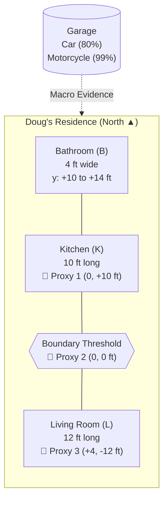
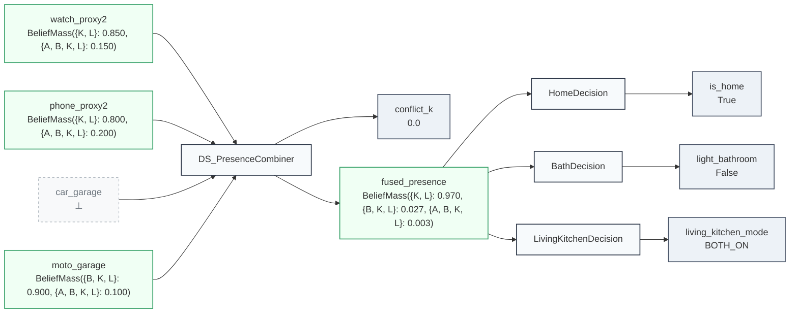

# Example: Dempster-Shafer Evidential Reasoning & Spatial Presence

Classical Bayesian fusion requires distributing probabilities across mutually exclusive singletons ($P(\text{Kitchen}) + P(\text{LivingRoom}) = 1.0$). When a sensor detects presence near a doorway or boundary, Bayesian models are forced to make premature commitments even under complete ambiguity.

In the **Dempster-Shafer theory of evidence**, belief masses are assigned to **arbitrary subsets** of the frame of discernment:

$$\Theta = \{\text{Bathroom (B)}, \text{Kitchen (K)}, \text{LivingRoom (L)}, \text{Away (A)}\}$$

This allows sensors to naturally express partial ignorance—such as asserting belief in $\{\text{Kitchen}, \text{LivingRoom}\}$ without guessing which specific room.

---

## 1. Spatial Layout & Sensor Topology

### Explicit Coordinate Model

To capture the geometry unambiguously for computational reasoning and neural attention layers, the home is modeled as structured 2D coordinate bounding zones (with Proxy 2 at $(0, 0\text{ ft})$ as the origin):

| Zone | $x$-Range | $y$-Range | Dimensions ($W \times L$) | Proxies Contained |
| :--- | :--- | :--- | :--- | :--- |
| **Bathroom (B)** | $[-2.0, +2.0]\text{ ft}$ | $[+10.0, +14.0]\text{ ft}$ | $4\text{ ft} \times 4\text{ ft}$ | Adjacent to North Kitchen |
| **Kitchen (K)** | $[-6.0, +6.0]\text{ ft}$ | $[0.0, +10.0]\text{ ft}$ | $12\text{ ft} \times 10\text{ ft}$ | **Proxy 1** at $(0, +10\text{ ft})$ |
| **Boundary Threshold** | $[-6.0, +6.0]\text{ ft}$ | $[-0.5, +0.5]\text{ ft}$ | $12\text{ ft} \times 1\text{ ft}$ | **Proxy 2** at $(0, 0\text{ ft})$ |
| **Living Room (L)** | $[-6.0, +6.0]\text{ ft}$ | $[-12.0, 0.0]\text{ ft}$ | $12\text{ ft} \times 12\text{ ft}$ | **Proxy 3** at $(+4\text{ ft}, -12\text{ ft})$ |

### Topological Graph



---

## 2. Evidence Architecture & Rules

### Vehicle Macro-Evidence
1. **Motorcycle in Garage**: Doug rides 99% of the time (1% dealer service).
   - If Motorcycle is absent: $m(\{\text{Away}\}) = 0.99, \quad m(\Theta) = 0.01$.
   - If Motorcycle is present: $m(\{\text{Home}\}) = 0.90, \quad m(\Theta) = 0.10$.
2. **Family Car in Garage**: Doug drives ~80% of the time.
   - If Car is absent: $m(\{\text{Away}\}) = 0.80, \quad m(\Theta) = 0.20$.

### Bluetooth Micro-Evidence (Watch & Phone)
- **Proxy 1 (North Kitchen)**: Near Bathroom/Kitchen transition ($d < 4\text{ ft} \implies \{\text{B}, \text{K}\}$).
- **Proxy 2 (Boundary)**: Detects proximity to threshold ($d < 4\text{ ft} \implies \{\text{K}, \text{L}\}$).
- **Proxy 3 (South Living Room)**: Far Living Room coverage ($d < 8\text{ ft} \implies \{\text{L}\}$).

### Lighting Decision Criteria
- **Bathroom Light**: Turn ON if Doug *may* be in the bathroom ($\text{Pl}(\text{B}) \ge 0.35$).
- **Kitchen & Living Room Lights**:
  - If evidence indicates presence in either room and boundary is ambiguous ($\text{Pl}(\text{K}) \ge 0.35$ and $\text{Pl}(\text{L}) \ge 0.35$): turn ON **both** lights.
  - If Living Room is clearly favored ($\text{Pl}(\text{L}) > \text{Pl}(\text{K})$): turn ON **Living Room only**.
  - If Kitchen is favored: turn ON **Kitchen only**.
  - If strongly believed Away ($\text{Bel}(\text{Away}) \ge 0.80$): turn OFF all lights.

---

## 3. Complete Executable Implementation

```python
from lattice_propagator import (
    BeliefMassValue,
    DempsterShaferPropagator,
    FlatValue,
    PropagatorNetwork,
    SpatialZone,
    lift_propagator,
)

# 1. Define the Frame of Discernment: Θ = {Bathroom, Kitchen, LivingRoom, Away}
FRAME = {"B", "K", "L", "A"}

# 2. Declarative Spatial Zones
zones = {
    "Bathroom": SpatialZone("Bathroom", x_min=-2.0, x_max=2.0, y_min=10.0, y_max=14.0),
    "Kitchen": SpatialZone("Kitchen", x_min=-6.0, x_max=6.0, y_min=0.0, y_max=10.0),
    "LivingRoom": SpatialZone("LivingRoom", x_min=-6.0, x_max=6.0, y_min=-12.0, y_max=0.0),
}

# 3. Build Propagator Network
net = PropagatorNetwork("SpatialPresence")

# Sensor evidence cells
cell_watch_p2 = net.add_cell("watch_proxy2")
cell_phone_p2 = net.add_cell("phone_proxy2")
cell_car = net.add_cell("car_garage")
cell_moto = net.add_cell("moto_garage")

# Fused belief distribution and conflict tracking
cell_fused = net.add_cell("fused_presence")
cell_conflict = net.add_cell("conflict_k")

# Connect Dempster-Shafer evidential fusion
ds_prop = DempsterShaferPropagator(
    name="DS_PresenceCombiner",
    inputs=[cell_watch_p2, cell_phone_p2, cell_car, cell_moto],
    output=cell_fused,
    conflict_cell=cell_conflict,
)
net.add_propagator(ds_prop)

# Actuator decision cells
cell_is_home = net.add_cell("is_home")
cell_light_bath = net.add_cell("light_bathroom")
cell_light_mode = net.add_cell("living_kitchen_mode")


# 4. Declarative Decision Functions
def evaluate_home_status(mass: BeliefMassValue) -> FlatValue:
    """Determine whether Doug is home based on belief and plausibility."""
    bel_away = mass.belief("A")
    pl_home = mass.plausibility({"B", "K", "L"})
    return FlatValue(pl_home > 0.50 and bel_away < 0.80)


def evaluate_bathroom_light(mass: BeliefMassValue) -> FlatValue:
    """Turn on bathroom light if Doug may be in the bathroom."""
    return FlatValue(mass.plausibility("B") >= 0.35)


def evaluate_living_kitchen_mode(mass: BeliefMassValue) -> FlatValue:
    """Select lighting mode for Kitchen and Living Room."""
    if mass.belief("A") >= 0.80:
        return FlatValue("ALL_OFF")

    pl_k = mass.plausibility("K")
    pl_l = mass.plausibility("L")

    # Ambiguous boundary: plausible in both rooms -> turn both on
    if pl_k >= 0.35 and pl_l >= 0.35:
        return FlatValue("BOTH_ON")
    if pl_l > pl_k:
        return FlatValue("LIVING_ONLY")
    return FlatValue("KITCHEN_ONLY")


net.add_propagator(
    lift_propagator("HomeDecision", evaluate_home_status, [cell_fused], cell_is_home)
)
net.add_propagator(
    lift_propagator("BathDecision", evaluate_bathroom_light, [cell_fused], cell_light_bath)
)
net.add_propagator(
    lift_propagator(
        "LivingKitchenDecision",
        evaluate_living_kitchen_mode,
        [cell_fused],
        cell_light_mode,
    )
)

# --- Scenario 1: Doug is at the Kitchen/Living Room boundary ---
# Motorcycle in garage indicates Doug is home (90% belief in {B, K, L})
cell_moto.set_value(BeliefMassValue.simple({"B", "K", "L"}, 0.90, FRAME))

# Both Watch and Phone detect proximity to Proxy 2 (boundary threshold)
cell_watch_p2.set_value(BeliefMassValue.simple({"K", "L"}, 0.85, FRAME))
cell_phone_p2.set_value(BeliefMassValue.simple({"K", "L"}, 0.80, FRAME))
net.run()

print(f"Is Home: {cell_is_home.value}")
# Flat(True)
print(f"Bathroom Light: {cell_light_bath.value}")
# Flat(False)
print(f"Living/Kitchen Mode: {cell_light_mode.value}")
# Flat('BOTH_ON')
# --- Scenario 2: Normal Departure (Doug rides motorcycle, devices disconnect) ---
# When Doug leaves on his motorcycle, his watch and phone disconnect from Proxy 2 (reverting to ignorance):
cell_watch_p2.set_value(BeliefMassValue.ignorance(FRAME), overwrite=True)
cell_phone_p2.set_value(BeliefMassValue.ignorance(FRAME), overwrite=True)
cell_moto.set_value(
    BeliefMassValue.simple({"A"}, 0.99, FRAME),
    source="moto_sensor",
    overwrite=True,
)
net.run()

print(f"Is Home (after departure): {cell_is_home.value}")
# Flat(False)
print(f"Living/Kitchen Mode: {cell_light_mode.value}")
# Flat('ALL_OFF')
print(f"Departure Conflict K: {cell_conflict.value}")
# Flat(0.0)

# --- Scenario 3: Device Left Behind (Conflict Detection) ---
# Suppose Doug rode away on his motorcycle, but left his phone on the charger in Proxy 2 range:
cell_phone_p2.set_value(BeliefMassValue.simple({"K", "L"}, 0.80, FRAME), overwrite=True)
net.run()

print(f"Conflict Metric K (stale device): {cell_conflict.value}")
# Flat(0.792)

# Export and persist network diagrams
from pathlib import Path

assets_dir = Path("docs/assets")
if assets_dir.is_dir():
    (assets_dir / "evidence_presence_network.mmd").write_text(
        net.generate_mermaid(), encoding="utf-8"
    )
    (assets_dir / "evidence_presence_network.dot").write_text(net.generate_dot(), encoding="utf-8")
```

---

## 4. Evidential Network Topology & Live Visualization

The network continuously fuses spatial evidence across Bluetooth beacons and vehicle micro-sensors. The diagram generated by `net.generate_mermaid()` reflects the active belief mass assignments and downstream decision cells:



### Downloadable Diagram Assets
- [Mermaid Diagram Source (`evidence_presence_network.mmd`)](../assets/evidence_presence_network.mmd)
- [Graphviz DOT Specification (`evidence_presence_network.dot`)](../assets/evidence_presence_network.dot)

### Truth Maintenance & Anomaly Resolution

In Scenario 3, the orthogonal conflict metric ($K = 0.792$) immediately alerts the Truth Maintenance System:
- **Ground Truth vs. Defeasible Beacon**: The motorcycle absence (99% confidence) is heavily weighted, while the static beacon indicates an abandoned device rather than Doug's physical presence.
- **TMS Provenance**: Downstream lighting automations can query `cell_conflict` to suppress false-positive activations when personal devices are left charging unattended.
