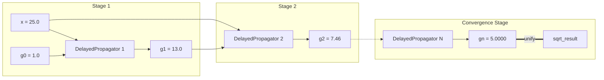

# Heron's Method: Dynamic Network Unrolling

Demonstrating deferred propagator construction, iterative fixed points, and dynamic retraction without graph pollution.

---

## 1. Theoretical Background

In classic procedural programming, iterative algorithms like Newton-Raphson or Heron of Alexandria's square root method are implemented with `while` loops. In a static constraint network, however, the number of required iterations depends on the input values and convergence tolerance, which are unknown at network construction time.

As described by **Gerald Jay Sussman and Alexey Radul** in *"The Art of the Propagator"* (Section 4: Dynamic Construction), we can solve this by letting the network dynamically construct itself:
- A `DelayedPropagator` monitors cells and stays dormant while they contain partial information ($\bot$).
- Once the radicand $x$ and current guess $g$ are refined, it spawns an arithmetic subnetwork computing the next approximation:

$$g_{next} = \frac{1}{2}\left(g + \frac{x}{g}\right)$$

- If the approximation is within tolerance $\epsilon$, it binds the final stage to the answer cell.
- Otherwise, it unrolls another delayed stage dynamically.
- When an assumption or input is retracted, the Truth Maintenance System (TMS) deconstructs unneeded stages cleanly.

---

## 2. Interactive Python Example

The following code runs dynamically with full multi-step unrolling:

```python
from lattice_propagator import (
    Cell,
    FlatValue,
    PropagatorNetwork,
    delay_propagator,
)

net = PropagatorNetwork("HeronSquareRoot")
x = net.add_cell("x", FlatValue(25.0))
g0 = net.add_cell("g0", FlatValue(1.0))  # Initial seed guess
sqrt_result = net.add_cell("sqrt_result")

epsilon = 1e-5


def wire_heron_stage(
    stage_net: PropagatorNetwork,
    radicand_cell: Cell,
    guess_cell: Cell,
    stage_num: int,
) -> None:
    val_x = getattr(radicand_cell.value, "val", None)
    val_g = getattr(guess_cell.value, "val", None)
    if val_x is None or val_g is None or val_g <= 0.0:
        return

    # Compute next approximation: g_next = 0.5 * (g + x / g)
    g_next_val = 0.5 * (val_g + val_x / val_g)
    g_next_cell = stage_net.add_cell(f"g_{stage_num}", FlatValue(g_next_val))

    # Check convergence: |g_next^2 - x| < epsilon
    if abs(g_next_val * g_next_val - val_x) < epsilon or stage_num >= 10:
        # Converged! Unify with target answer cell
        stage_net.unify_cells(g_next_cell, sqrt_result)
    else:
        # Dynamically spawn the next iteration stage
        delay_propagator(
            f"delay_stage_{stage_num}",
            [radicand_cell, g_next_cell],
            builder=lambda net_sub, rx, rg: wire_heron_stage(net_sub, rx, rg, stage_num + 1),
        )


# Attach initial delayed stage
delay_propagator(
    "delay_stage_1",
    [x, g0],
    builder=lambda net_sub, rx, rg: wire_heron_stage(net_sub, rx, rg, 1),
)

# Run worklist to fixed-point convergence
net.run()

ans = getattr(sqrt_result.value, "val", None)
print(f"√25.0 ≈ {ans:.6f}")
assert abs(ans - 5.0) < epsilon
```

---

## 3. Dynamic Unrolling Architecture

Each stage unrolls on demand until the convergence criterion is satisfied:



---

## 4. Key Takeaways

1. **Lazy Graph Expansion:** Propagators do not need to exist up-front. They are synthesized dynamically when data arrives.
2. **Deterministic Convergence:** The worklist engine treats dynamically spawned propagators identically to statically defined ones, executing them until fixed-point quiescence.
3. **Zero Graph Pollution:** With `retract_on_unmet=True`, retracting or updating premises deactivates and unhooks obsolete intermediate stages cleanly.
