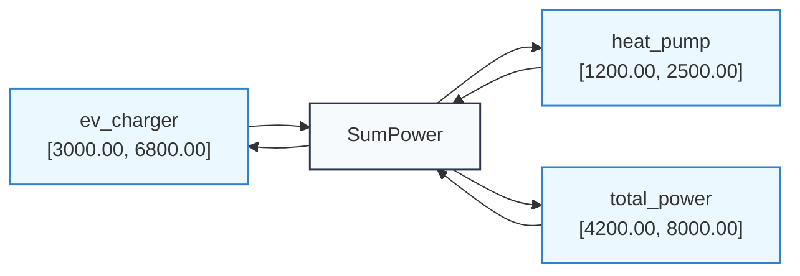

# Example: Interval Envelopes & Bounds

Interval arithmetic bounds uncertainty within guarantees $[x_{\min}, x_{\max}]$. When multiple constraints or safety margins apply, propagator networks narrow interval envelopes monotonically.

---

## 1. Safety Tolerances & Envelopes

Consider calculating allowable power consumption bounds in a home energy system:

```python
from lattice_propagator import (
    PropagatorNetwork,
    IntervalValue,
    AdderPropagator,
)

net = PropagatorNetwork("EnergyEnvelope")

heat_pump = net.add_cell("heat_pump", IntervalValue(1200.0, 2500.0))  # 1.2 kW – 2.5 kW
ev_charger = net.add_cell("ev_charger", IntervalValue(3000.0, 7200.0))  # 3.0 kW – 7.2 kW
total_power = net.add_cell("total_power")

# Total power = Heat Pump + EV Charger
net.add_propagator(AdderPropagator("SumPower", heat_pump, ev_charger, total_power))
net.run()

print(f"Total Power Envelope: {total_power.value}")
# IntervalValue(4200.0, 9700.0)

# Suppose the main breaker limits total power to at most 8000W:
total_power.set_value(IntervalValue(0.0, 8000.0))
net.run()

print(f"Constrained Total: {total_power.value}")  # IntervalValue(4200.0, 8000.0)
print(f"EV Charger Max Allowed: {ev_charger.value}")  # IntervalValue(3000.0, 6800.0)

# Export and persist network diagrams
from pathlib import Path

assets_dir = Path("docs/assets")
if assets_dir.is_dir():
    (assets_dir / "intervals_energy_envelope.mmd").write_text(
        net.generate_mermaid(), encoding="utf-8"
    )
    (assets_dir / "intervals_energy_envelope.dot").write_text(net.generate_dot(), encoding="utf-8")
```

The network automatically deduced that the EV charger cannot exceed 6,800 Watts without violating the total service capacity.

### Energy Envelope Network Topology & Bounds

The multi-directional adder continuously propagates the service breaker restriction backward into the individual circuit allocations:



#### Downloadable Diagram Assets
- [Mermaid Diagram Source (`intervals_energy_envelope.mmd`)](../assets/intervals_energy_envelope.mmd)
- [Graphviz DOT Specification (`intervals_energy_envelope.dot`)](../assets/intervals_energy_envelope.dot)

---

## 2. Detecting Contradictions

If constraints become mutually unsatisfiable (for instance, if minimum demand exceeds maximum breaker limit), the merge operation yields `Contradiction`:

```python
from lattice_propagator import IntervalValue

safe_range = IntervalValue(10.0, 20.0)
required_power = IntervalValue(30.0, 50.0)

result = safe_range.merge(required_power)
print(result)  # ⊤(Contradiction: Disjoint intervals: [10.0, 20.0] and [30.0, 50.0])
```
