# Example: Kinematic Reachability Envelopes

In robotics, autonomous driving, and industrial automation, safety guarantees require verifying that an actuator can reach a safe state or stop before reaching an obstacle boundary.

Using partial-information lattices:
- Unknown or uncertain physical quantities are bounded by [`IntervalValue`](file:///home/doug/code/lattice-propagator/docs/api/lattice.md) $[x_{min}, x_{max}]$.
- Dynamic tracking is handled by [`RatePropagator`](file:///home/doug/code/lattice-propagator/docs/api/primitives.md), which computes rate of change $\dot{x}$ and Estimated Time of Arrival (ETA) intervals to a safety threshold.
- Kinematic stopping distances $\Delta x_{stop} = \frac{v^2}{2a}$ provide guaranteed bounds over partial knowledge.

---

## 1. Timeline & Reachability Corridor (Human View)

```mermaid
gantt
    title Kinematic Braking Corridor & Safety Envelopes
    dateFormat X
    axisFormat %s s

    section Radar Tracking
    Sensor Detection (100 m)  :active, 0, 1
    Velocity Estimation (-20 m/s) :crit, 1, 1

    section Stopping Envelope
    Reaction Interval (0.5 - 0.8s) : 1, 2
    Deceleration to Stop (3.4 - 4.8s) : 2, 5
```



---

## 2. Executable Propagator Implementation

```python
from lattice_propagator import (
    GaussianValue,
    IntervalValue,
    PropagatorNetwork,
    RatePropagator,
)

net = PropagatorNetwork("KinematicRadarTracking")

# Radar distance to approaching obstacle (meters)
dist = net.add_cell("dist", unit="m")

# Estimated approach velocity (m/s) and time to impact threshold (0.0 m)
velocity = net.add_cell("velocity", unit="m/s")
eta_collision = net.add_cell("eta_collision", unit="s")

# Register RatePropagator watching distance to zero-distance threshold
tracker = RatePropagator(
    "RadarTracker",
    input_cell=dist,
    output_rate_cell=velocity,
    output_eta_cell=eta_collision,
    threshold=0.0,
)
net.add_propagator(tracker)

# Observation 1: at t = 0.0 s, distance is measured at 100.0 m
tracker.update_observation(current_val=100.0, current_time=0.0, network=net)

# Observation 2: at t = 1.0 s, distance is measured at 80.0 m
tracker.update_observation(current_val=80.0, current_time=1.0, network=net)
net.run()

# Text output for LLMs & inspection
print(f"Computed approach velocity: {velocity.value}")
print(f"Collision ETA interval: {eta_collision.value}")

assert isinstance(velocity.value, GaussianValue)
assert abs(velocity.value.mean - (-20.0)) < 1e-4

assert isinstance(eta_collision.value, IntervalValue)
# For approaching velocity rate=-20 m/s from 80 m, baseline ETA = 4.0 s
# Spread envelope covers [3.4 s, 4.8 s]
print(f"Safe braking margin: minimum {eta_collision.value.min_val:.2f} s remaining.")
assert 3.0 <= eta_collision.value.min_val <= 3.5
assert 4.5 <= eta_collision.value.max_val <= 5.0
```
