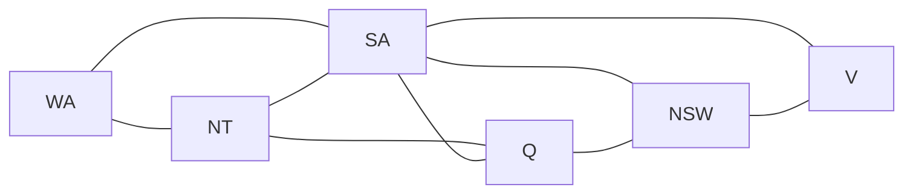

# Example: Map Colouring (Constraint Propagation + Labeling)

Map colouring is one of the simplest problems where **constraint propagation alone is not enough** and must be paired with **labeling (search)**:

- Each region is a variable with a finite domain of colours $\{1, 2, 3\}$ (`Red`, `Green`, `Blue`).
- Each shared border posts an inequality constraint $R_i \neq R_j$ (`#\=` in Prolog CLP(Z)).
- Before any region is assigned a colour, `#\=` cannot prune any candidates on its own—every region remains $\{1, 2, 3\}$.
- Once [`ChoiceEngine`](file:///home/doug/code/lattice-propagator/docs/api/primitives.md) speculatively labels one region (analogous to Prolog's `label/1` / `labeling([ff], Vars)`), `#\=` propagation cascades across adjacent borders and backtracks automatically on any conflict.

---

## 1. Prolog CLP(Z) vs. Lattice Propagator

In Prolog (*The Power of Prolog*, `library(clpz)`), colouring mainland Australia with 3 colours looks like:

```prolog
:- use_module(library(clpz)).

australia(Vars) :-
    Vars = [WA, NT, SA, Q, NSW, V],
    Vars ins 1..3,
    WA #\= NT, WA #\= SA,
    NT #\= SA, NT #\= Q,
    SA #\= Q,  SA #\= NSW, SA #\= V,
    Q  #\= NSW,
    NSW #\= V,
    labeling([ff], Vars).
```

In `lattice-propagator`, [`int_cells`](file:///home/doug/code/lattice-propagator/docs/api/clpz.md) creates the bounded [`IntegerDomain`](file:///home/doug/code/lattice-propagator/docs/api/lattice.md) cells, [`add_int_rel`](file:///home/doug/code/lattice-propagator/docs/api/clpz.md) wires the `#\=` constraints, and [`ChoiceEngine`](file:///home/doug/code/lattice-propagator/docs/api/primitives.md) performs First-Fail (MRV) labeling interleaved with fixed-point propagation.

---

## 2. Adjacency Topology



---

## 3. Executable Propagator Implementation

```python
from lattice_propagator import (
    ChoiceEngine,
    PropagatorNetwork,
    add_int_rel,
    int_cells,
)

PALETTE = {1: "Red", 2: "Green", 3: "Blue"}
REGIONS = ["WA", "NT", "SA", "Q", "NSW", "V"]
BORDERS = [
    ("WA", "NT"),
    ("WA", "SA"),
    ("NT", "SA"),
    ("NT", "Q"),
    ("SA", "Q"),
    ("SA", "NSW"),
    ("SA", "V"),
    ("Q", "NSW"),
    ("NSW", "V"),
]


def build_map_network(num_colours: int = 3) -> tuple[PropagatorNetwork, dict[str, object]]:
    net = PropagatorNetwork("AustraliaMapColouring")
    region = dict(zip(REGIONS, int_cells(net, REGIONS, lo=1, hi=num_colours)))

    for a, b in BORDERS:
        add_int_rel(net, region[a], "#\\=", region[b])

    return net, region


def solve_map_colouring(num_colours: int = 3) -> dict[str, int] | None:
    net, region = build_map_network(num_colours)

    # 1. Pure propagation reaches quiescence without assigning any region
    net.run()
    engine = ChoiceEngine(net, variables=list(region.values()))
    assert not engine.is_solved(), "Symmetry keeps all domains unfixed before labeling"

    # 2. Labeling (MRV search + #\\= propagation) finds the first valid colouring
    if not engine.first_solution():
        return None
    return {name: cell.value.value for name, cell in region.items()}


solution = solve_map_colouring(num_colours=3)
assert solution is not None

print("--- First 3-Colouring Solution ---")
for name, colour_id in solution.items():
    print(f"  {name:>3} → {PALETTE[colour_id]}")

# Verify every border has distinct colours
assert all(solution[a] != solution[b] for a, b in BORDERS)

# 3. Enumerate all valid 3-colourings via lazy backtracking (3 × 2 = 6 permutations)
net_all, region_all = build_map_network(num_colours=3)
all_colourings = ChoiceEngine(net_all, variables=list(region_all.values())).all_solutions()
print(f"Total valid 3-colourings: {len(all_colourings)}")
assert len(all_colourings) == 6

# Prove 2 colours are impossible (WA, NT, SA form a 3-clique)
assert solve_map_colouring(num_colours=2) is None
print("Verified: 2-colouring is unsatisfiable (K₃ clique).")
```

