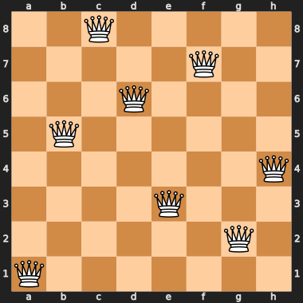
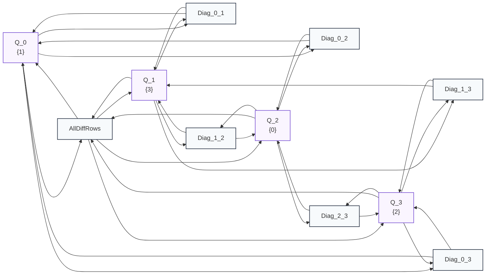

# Example: $N$-Queens Constraint Satisfaction

The $N$-Queens problem requires placing $N$ non-attacking queens on an $N \times N$ chessboard such that no two queens share the same row, column, or diagonal.

Using the lattice propagator framework:
- Each queen on file $i \in \{0, \dots, N-1\}$ is modeled as a [`Cell`](file:///home/doug/code/lattice-propagator/docs/api/primitives.md) holding a [`DiscreteDomain`](file:///home/doug/code/lattice-propagator/docs/api/lattice.md) of allowable ranks $\{0, \dots, N-1\}$.
- Row uniqueness is maintained globally via [`AllDistinctPropagator`](file:///home/doug/code/lattice-propagator/docs/api/primitives.md) (Régin's Generalized Arc Consistency via bipartite matching).
- Diagonal non-attack conditions are maintained via pairwise diagonal distance propagators.
- Search is coordinated by [`ChoiceEngine`](file:///home/doug/code/lattice-propagator/docs/api/primitives.md) with First-Fail / MRV (Minimum Remaining Values) branching.

---

## 1. Visual Solution (Human View)



---

## 2. Executable Propagator Implementation

```python
from lattice_propagator import (
    AllDifferentPropagator,
    AllDistinctPropagator,
    Cell,
    ChoiceEngine,
    Contradiction,
    DiscreteDomain,
    Propagator,
    PropagatorNetwork,
)


class DiagonalConstraintPropagator(Propagator):
    """Enforces that two queens on distinct files i and j cannot share a diagonal (|ri - rj| != |i - j|)."""

    def __init__(self, name: str, qi: Cell, qj: Cell, file_distance: int) -> None:
        super().__init__(name, [qi, qj], [qi, qj])
        self.qi = qi
        self.qj = qj
        self.file_distance = file_distance

    def alert(self, network: PropagatorNetwork) -> None:
        vi, vj = self.qi.value, self.qj.value
        if not (isinstance(vi, DiscreteDomain) and isinstance(vj, DiscreteDomain)):
            return

        valid_i = set()
        valid_j = set()
        for ri in vi.candidates:
            for rj in vj.candidates:
                if abs(ri - rj) != self.file_distance:
                    valid_i.add(ri)
                    valid_j.add(rj)

        if not valid_i or not valid_j:
            self.qi.set_value(
                Contradiction(f"Diagonal attack between {self.qi.cell_id} and {self.qj.cell_id}"),
                source=self.name,
            )
            return

        if valid_i != vi.candidates:
            self.qi.set_value(DiscreteDomain(valid_i), source=self.name)
        if valid_j != vj.candidates:
            self.qj.set_value(DiscreteDomain(valid_j), source=self.name)


def solve_n_queens(n: int = 8) -> list[int]:
    net = PropagatorNetwork(f"{n}Queens")
    queens = [net.add_cell(f"Q_{i}", DiscreteDomain.range(0, n)) for i in range(n)]

    # 1. Global Row Uniqueness (Generalized Arc Consistency via bipartite matching)
    net.add_propagator(AllDistinctPropagator("AllDistinctRows", queens))

    # 2. Pairwise Diagonal Constraints
    for i in range(n):
        for j in range(i + 1, n):
            dist = j - i
            net.add_propagator(
                DiagonalConstraintPropagator(f"Diag_{i}_{j}", queens[i], queens[j], dist)
            )

    # 3. Interleaved propagation & MRV search
    engine = ChoiceEngine(net, variables=queens)
    solved = engine.solve()
    assert solved, "No solution found!"

    # Export and persist network diagrams
    from pathlib import Path

    assets_dir = Path("docs/assets")
    if assets_dir.is_dir():
        (assets_dir / "n_queens_network.mmd").write_text(net.generate_mermaid(), encoding="utf-8")
        (assets_dir / "n_queens_network.dot").write_text(net.generate_dot(), encoding="utf-8")

    return [queens[i].value.value for i in range(n)]


solution = solve_n_queens(8)
print(f"Solved 8-Queens rank placement: {solution}")

# Text / Unicode Board Output for LLMs & terminals:
print("--- Text / Unicode Chessboard ---")
for r in range(7, -1, -1):
    row_str = f"{r + 1} "
    for f in range(8):
        row_str += "♛ " if solution[f] == r else "· "
    print(row_str)
print("  a b c d e f g h")
```

---

## 3. Constraint Network Visualization (4-Queens Topology)

The $N$-Queens constraint network models files as discrete domain cells interconnected by a global row uniqueness constraint (`AllDifferentPropagator`) and pairwise diagonal non-attack propagators:



### Downloadable 8-Queens Network Assets
- [Mermaid Diagram Source (`n_queens_network.mmd`)](../assets/n_queens_network.mmd)
- [Graphviz DOT Specification (`n_queens_network.dot`)](../assets/n_queens_network.dot)
