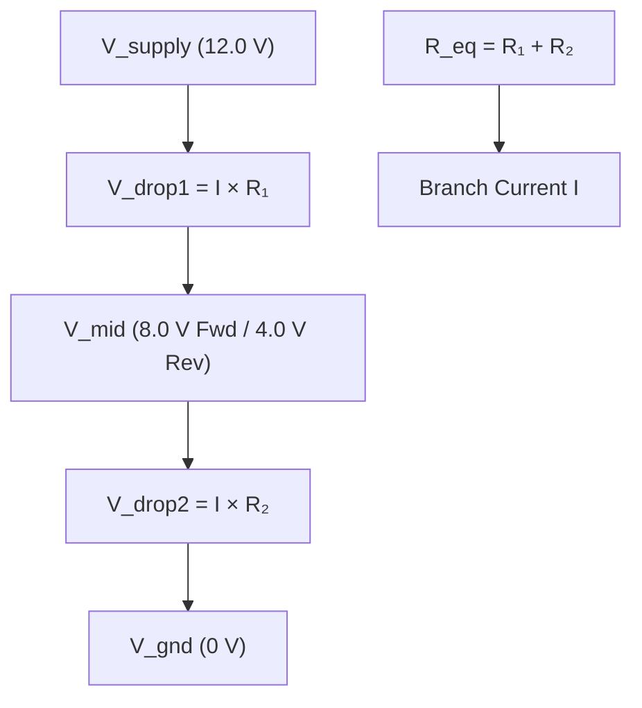
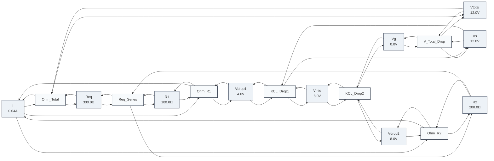
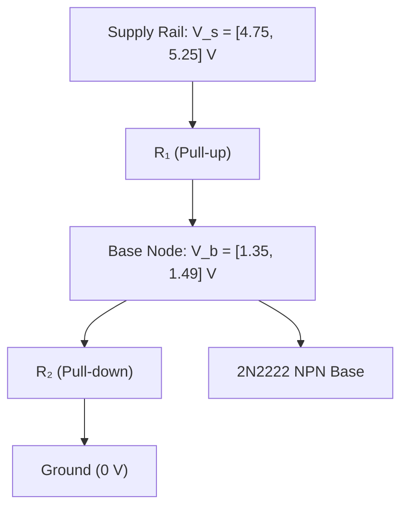

# Example: Electrical Resistor Networks & Circuit Sizing

In electrical engineering, circuit equations (Kirchhoff's Voltage Law, Kirchhoff's Current Law, and Ohm's Law $V = I \times R$) are traditionally solved either by hand or by constructing conductance matrices for numerical inversion.

In a propagator network:
- Relationships are inherently **multi-directional**: [`AdderPropagator`](file:///home/doug/code/lattice-propagator/docs/api/primitives.md) and [`MultiplierPropagator`](file:///home/doug/code/lattice-propagator/docs/api/primitives.md) push information in whichever direction inputs become known.
- Partial information envelopes: combining continuous [`IntervalValue`](file:///home/doug/code/lattice-propagator/docs/api/lattice.md) with discrete candidate domains allows automated component selection under real-world manufacturing tolerances and fluctuating power supplies.

---

## Problem 1: Bidirectional Voltage Divider (Forward & Reverse Inference)

### 1.1 Schematic Diagram (Human View)




### 1.2 Executable Propagator Implementation

```python
from lattice_propagator import (
    AdderPropagator,
    FlatValue,
    MultiplierPropagator,
    PropagatorNetwork,
)

# ==========================================
# Phase 1: Forward Inference (Given R1, R2, Vs -> compute I, Vmid)
# ==========================================
net_fwd = PropagatorNetwork("ForwardDivider")

Vs = net_fwd.add_cell("Vs", FlatValue(12.0), unit="V")
Vg = net_fwd.add_cell("Vg", FlatValue(0.0), unit="V")
Vmid = net_fwd.add_cell("Vmid", unit="V")

R1 = net_fwd.add_cell("R1", FlatValue(100.0), unit="Ω")
R2 = net_fwd.add_cell("R2", FlatValue(200.0), unit="Ω")
Req = net_fwd.add_cell("Req", unit="Ω")

Vtotal = net_fwd.add_cell("Vtotal", unit="V")
Vdrop1 = net_fwd.add_cell("Vdrop1", unit="V")
Vdrop2 = net_fwd.add_cell("Vdrop2", unit="V")
I = net_fwd.add_cell("I", unit="A")

# Series resistance and total branch current:
# R_eq = R1 + R2
net_fwd.add_propagator(AdderPropagator("Req_Series", R1, R2, Req))
# V_total = Vs - Vg  <=>  Vg + V_total = Vs
net_fwd.add_propagator(AdderPropagator("V_Total_Drop", Vg, Vtotal, Vs))
# V_total = I * R_eq
net_fwd.add_propagator(MultiplierPropagator("Ohm_Total", I, Req, Vtotal))

# Local potential drops:
net_fwd.add_propagator(MultiplierPropagator("Ohm_R1", I, R1, Vdrop1))
net_fwd.add_propagator(MultiplierPropagator("Ohm_R2", I, R2, Vdrop2))
net_fwd.add_propagator(AdderPropagator("KCL_Drop1", Vmid, Vdrop1, Vs))
net_fwd.add_propagator(AdderPropagator("KCL_Drop2", Vg, Vdrop2, Vmid))

net_fwd.run()

print(f"Forward Solution: I = {I.value.val * 1000:.1f} mA, V_mid = {Vmid.value.val:.2f} V")
assert abs(I.value.val - 0.040) < 1e-4
assert abs(Vmid.value.val - 8.00) < 1e-4

# Export and persist forward network diagrams
from pathlib import Path

assets_dir = Path("docs/assets")
if assets_dir.is_dir():
    (assets_dir / "resistor_network_forward.mmd").write_text(
        net_fwd.generate_mermaid(), encoding="utf-8"
    )
    (assets_dir / "resistor_network_forward.dot").write_text(
        net_fwd.generate_dot(), encoding="utf-8"
    )

# Export and persist forward network diagrams
from pathlib import Path

assets_dir = Path("docs/assets")
if assets_dir.is_dir():
    (assets_dir / "resistor_network_forward.mmd").write_text(
        net_fwd.generate_mermaid(), encoding="utf-8"
    )
    (assets_dir / "resistor_network_forward.dot").write_text(
        net_fwd.generate_dot(), encoding="utf-8"
    )

# ==========================================
# Phase 2: Reverse Inference (Given Vmid=4.0V, R1=100Ω -> deduce unknown R2 and I)
# ==========================================
net_rev = PropagatorNetwork("ReverseDivider")

Vs_rev = net_rev.add_cell("Vs", FlatValue(12.0), unit="V")
Vg_rev = net_rev.add_cell("Vg", FlatValue(0.0), unit="V")
Vmid_rev = net_rev.add_cell("Vmid", FlatValue(4.0), unit="V")  # Clamped by observation!

R1_rev = net_rev.add_cell("R1", FlatValue(100.0), unit="Ω")
R2_rev = net_rev.add_cell("R2", unit="Ω")  # Unknown target!

Vdrop1_rev = net_rev.add_cell("Vdrop1", unit="V")
Vdrop2_rev = net_rev.add_cell("Vdrop2", unit="V")
I_rev = net_rev.add_cell("I", unit="A")

# Connect identical local Ohm and KCL propagators:
net_rev.add_propagator(AdderPropagator("KCL_Drop1", Vmid_rev, Vdrop1_rev, Vs_rev))
net_rev.add_propagator(AdderPropagator("KCL_Drop2", Vg_rev, Vdrop2_rev, Vmid_rev))
net_rev.add_propagator(MultiplierPropagator("Ohm_R1", I_rev, R1_rev, Vdrop1_rev))
net_rev.add_propagator(MultiplierPropagator("Ohm_R2", I_rev, R2_rev, Vdrop2_rev))

net_rev.run()

print(
    f"Reverse Solution: Deduced R2 = {R2_rev.value.val:.1f} Ω, Current I = {I_rev.value.val * 1000:.1f} mA"
)
assert abs(R2_rev.value.val - 50.0) < 1e-4
assert abs(I_rev.value.val - 0.080) < 1e-4
```

### 1.3 Forward Divider Network Topology & Live Visualization

The network couples local Ohm's Law and Kirchhoff potential drop constraints across all branch nodes:



#### Downloadable Diagram Assets
- [Mermaid Diagram Source (`resistor_network_forward.mmd`)](../assets/resistor_network_forward.mmd)
- [Graphviz DOT Specification (`resistor_network_forward.dot`)](../assets/resistor_network_forward.dot)

---

## Problem 2: 2N2222 Transistor Base Biasing under Supply Variations

### 2.1 Problem Specification & Engineering Constraints

In discrete analog circuit design with a 2N2222 NPN BJT:
1. **Target Base Bias Window:** To bias the transistor into the active linear region with an emitter degeneration resistor ($V_e \approx 0.7\text{ V}, V_{be} \approx 0.7\text{ V}$), the base voltage $V_b$ must be held in the corridor:
   $$V_b \in [1.20, 1.60]\text{ V}$$
2. **Supply Voltage Fluctuation:** The power supply $V_s$ has a total variation of $0.5\text{ V}$ ($5.0\text{ V} \pm 0.25\text{ V}$):
   $$V_s \in [4.75, 5.25]\text{ V}$$
3. **Standard Component Sizing (E12 Series):** Resistors $R_1$ and $R_2$ must be selected from the standard EIA **E12 series** decade values:
   $$\{10, 12, 15, 18, 22, 27, 33, 39, 47, 56, 68, 82\}\,\text{k}\Omega$$
4. **Current Minimization:** The quiescent bleeder current through the divider $I_q = \frac{V_s}{R_1 + R_2}$ should be kept as small as possible to minimize power dissipation, while remaining sufficiently large ($I_q \ge 10 \times I_{base} \approx 50\,\mu\text{A}$) to prevent base loading distortion.

### 2.2 Schematic Diagram (Human View)




### 2.3 Executable Propagator Implementation

```python
from lattice_propagator import (
    AdderPropagator,
    IntervalValue,
    MultiplierPropagator,
    PropagatorNetwork,
)

# Standard E12 decade series in kΩ (10 kΩ to 82 kΩ)
E12_K = [10.0, 12.0, 15.0, 18.0, 22.0, 27.0, 33.0, 39.0, 47.0, 56.0, 68.0, 82.0]

# Candidate evaluation list: (R1_k, R2_k, Vb_interval, Quiescent_Current_uA)
compliant_solutions = []

for r1_k in E12_K:
    for r2_k in E12_K:
        r1 = r1_k * 1000.0
        r2 = r2_k * 1000.0
        r_tot = r1 + r2

        # Filter dividers for low quiescent current (50 μA <= Iq <= 250 μA)
        i_nom = 5.0 / r_tot
        if not (50e-6 <= i_nom <= 250e-6):
            continue

        # Build interval propagator network using operator overloading:
        # I = Vs / (R1 + R2), Vb = I * R2
        net_bias = PropagatorNetwork(f"Bias_{int(r1_k)}k_{int(r2_k)}k")
        vs_cell = net_bias.add_cell("Vs", IntervalValue(4.75, 5.25), unit="V")
        r1_cell = net_bias.add_cell("R1", IntervalValue(r1, r1), unit="Ω")
        r2_cell = net_bias.add_cell("R2", IntervalValue(r2, r2), unit="Ω")

        rtot_cell = r1_cell + r2_cell
        i_cell = vs_cell / rtot_cell
        vb_cell = i_cell * r2_cell

        net_bias.run()

        vb_res = vb_cell.value
        assert isinstance(vb_res, IntervalValue)

        # Verify that the entire envelope fits inside the 2N2222 corridor [1.20, 1.60] V
        if vb_res.min_val >= 1.20 and vb_res.max_val <= 1.60:
            compliant_solutions.append((r1_k, r2_k, vb_res, i_nom * 1e6))

# Sort by lowest current consumption (maximum efficiency)
compliant_solutions.sort(key=lambda s: s[3])

# Text / LLM inspection table
print(f"Found {len(compliant_solutions)} compliant standard E12 resistor pairs:")
for r1_k, r2_k, vb_int, i_ua in compliant_solutions:
    print(
        f"  R1 = {r1_k:4.1f} kΩ, R2 = {r2_k:4.1f} kΩ | "
        f"Vb = [{vb_int.min_val:.3f}, {vb_int.max_val:.3f}] V | "
        f"I_q = {i_ua:5.1f} μA"
    )

best_r1, best_r2, best_vb, best_iq = compliant_solutions[0]
print(
    f"Optimal Solution: R1 = {best_r1:.1f} kΩ, R2 = {best_r2:.1f} kΩ "
    f"(Quiescent Current = {best_iq:.1f} μA, Vb = [{best_vb.min_val:.3f}, {best_vb.max_val:.3f}] V)"
)

# Assertions verifying optimal selection
assert best_r1 == 68.0
assert best_r2 == 27.0
assert best_vb.min_val >= 1.20 and best_vb.max_val <= 1.60
assert best_iq < 60.0  # Under 60 μA quiescent current
```

---

## Problem 3: Multi-Resistor Series Ladder & Balanced Tree Summation (`tree_sum`)

When calculating equivalent series resistance $R_{eq} = \sum_{i=1}^N R_i$ across large resistor chains or multi-stage filter ladders, chaining linear `AdderPropagator`s produces an $O(N)$ depth graph that suffers from worklist queue churn and backward deduction latency.

[`tree_sum`](file:///home/doug/code/lattice-propagator/docs/api/primitives.md) builds a balanced binary reduction tree with $O(\log N)$ propagation depth, preserving bidirectional deduction across all intermediate taps:

```python
from lattice_propagator import (
    Cell,
    FlatValue,
    PropagatorNetwork,
    tree_sum,
)

net_ladder = PropagatorNetwork("ResistorLadder")

# 8 resistors in series: 100 Ω each
resistors = [net_ladder.add_cell(f"R{i + 1}", FlatValue(100.0), unit="Ω") for i in range(8)]

# Balanced O(log N) binary reduction tree:
r_eq = tree_sum(resistors, net_ladder)
net_ladder.run()

print(f"Equivalent Series Resistance: {r_eq.value.val:.1f} Ω")
assert r_eq.value.val == 800.0

# Backward deduction: if an unconstrained trim resistor is added and the total chain
# is constrained to 1000 Ω, tree_sum deduces the required trim resistance backward:
r_trim = net_ladder.add_cell("R_trim", unit="Ω")
r_total = tree_sum([r_eq, r_trim], net_ladder)
r_total.set_value(FlatValue(1000.0))
net_ladder.run()

print(f"Trim Resistor Deduced: {r_trim.value.val:.1f} Ω")
assert r_trim.value.val == 200.0
```
