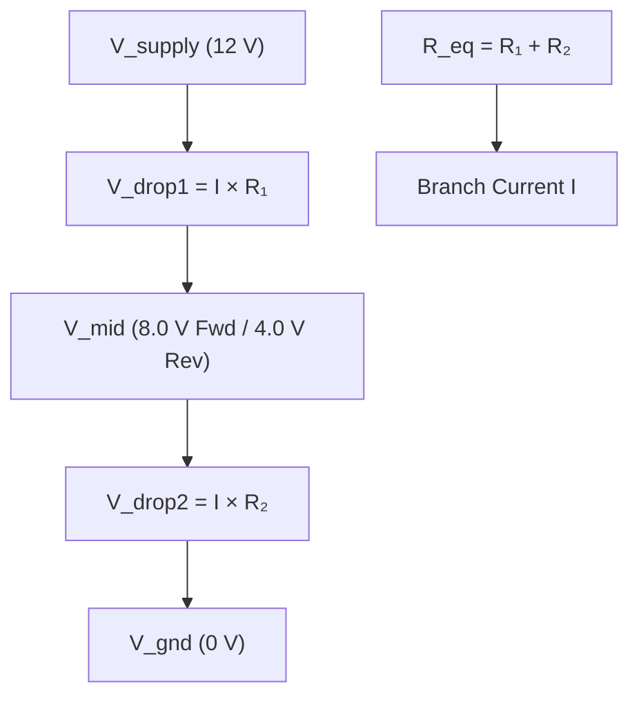

# Example: Bidirectional Resistor Networks

In electrical engineering, circuit equations (Kirchhoff's Voltage Law, Kirchhoff's Current Law, and Ohm's Law $V = I \times R$) are traditionally solved either by hand or by constructing conductance matrices for numerical inversion.

In a propagator network:
- Relationships are inherently **multi-directional**.
- [`AdderPropagator`](file:///home/doug/code/lattice-propagator/docs/api/primitives.md) and [`MultiplierPropagator`](file:///home/doug/code/lattice-propagator/docs/api/primitives.md) push information in whichever direction inputs become known.
- Clamping a mid-point voltage allows the network to deduce unknown resistances or currents in reverse without altering any equations or writing symbolic solvers!

---

## 1. Schematic Diagram (Human View)




---

## 2. Executable Propagator Implementation

```python
from lattice_propagator import (
    AdderPropagator,
    FlatValue,
    MultiplierPropagator,
    PropagatorNetwork,
)

# ==========================================
# Phase 1: Forward Inference (Given R1, R2, Vs -> compute I, Vmid)
# ==========================================
net_fwd = PropagatorNetwork("ForwardDivider")

Vs = net_fwd.add_cell("Vs", FlatValue(12.0), unit="V")
Vg = net_fwd.add_cell("Vg", FlatValue(0.0), unit="V")
Vmid = net_fwd.add_cell("Vmid", unit="V")

R1 = net_fwd.add_cell("R1", FlatValue(100.0), unit="Ω")
R2 = net_fwd.add_cell("R2", FlatValue(200.0), unit="Ω")
Req = net_fwd.add_cell("Req", unit="Ω")

Vtotal = net_fwd.add_cell("Vtotal", unit="V")
Vdrop1 = net_fwd.add_cell("Vdrop1", unit="V")
Vdrop2 = net_fwd.add_cell("Vdrop2", unit="V")
I = net_fwd.add_cell("I", unit="A")

# Series resistance and total branch current:
# R_eq = R1 + R2
net_fwd.add_propagator(AdderPropagator("Req_Series", R1, R2, Req))
# V_total = Vs - Vg  <=>  Vg + V_total = Vs
net_fwd.add_propagator(AdderPropagator("V_Total_Drop", Vg, Vtotal, Vs))
# V_total = I * R_eq
net_fwd.add_propagator(MultiplierPropagator("Ohm_Total", I, Req, Vtotal))

# Local potential drops:
net_fwd.add_propagator(MultiplierPropagator("Ohm_R1", I, R1, Vdrop1))
net_fwd.add_propagator(MultiplierPropagator("Ohm_R2", I, R2, Vdrop2))
net_fwd.add_propagator(AdderPropagator("KCL_Drop1", Vmid, Vdrop1, Vs))
net_fwd.add_propagator(AdderPropagator("KCL_Drop2", Vg, Vdrop2, Vmid))

net_fwd.run()

print(f"Forward Solution: I = {I.value.val * 1000:.1f} mA, V_mid = {Vmid.value.val:.2f} V")
assert abs(I.value.val - 0.040) < 1e-4
assert abs(Vmid.value.val - 8.00) < 1e-4

# ==========================================
# Phase 2: Reverse Inference (Given Vmid=4.0V, R1=100Ω -> deduce unknown R2 and I)
# ==========================================
net_rev = PropagatorNetwork("ReverseDivider")

Vs_rev = net_rev.add_cell("Vs", FlatValue(12.0), unit="V")
Vg_rev = net_rev.add_cell("Vg", FlatValue(0.0), unit="V")
Vmid_rev = net_rev.add_cell("Vmid", FlatValue(4.0), unit="V")  # Clamped by observation!

R1_rev = net_rev.add_cell("R1", FlatValue(100.0), unit="Ω")
R2_rev = net_rev.add_cell("R2", unit="Ω")  # Unknown target!

Vdrop1_rev = net_rev.add_cell("Vdrop1", unit="V")
Vdrop2_rev = net_rev.add_cell("Vdrop2", unit="V")
I_rev = net_rev.add_cell("I", unit="A")

# Connect identical local Ohm and KCL propagators:
net_rev.add_propagator(AdderPropagator("KCL_Drop1", Vmid_rev, Vdrop1_rev, Vs_rev))
net_rev.add_propagator(AdderPropagator("KCL_Drop2", Vg_rev, Vdrop2_rev, Vmid_rev))
net_rev.add_propagator(MultiplierPropagator("Ohm_R1", I_rev, R1_rev, Vdrop1_rev))
net_rev.add_propagator(MultiplierPropagator("Ohm_R2", I_rev, R2_rev, Vdrop2_rev))

net_rev.run()

print(
    f"Reverse Solution: Deduced R2 = {R2_rev.value.val:.1f} Ω, Current I = {I_rev.value.val * 1000:.1f} mA"
)
assert abs(R2_rev.value.val - 50.0) < 1e-4
assert abs(I_rev.value.val - 0.080) < 1e-4
```
