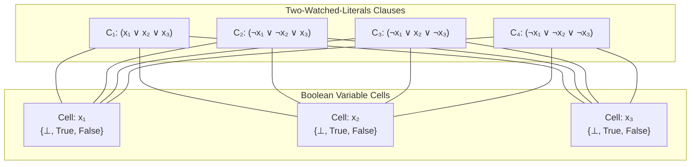

# Example: CDCL SAT Solver via Two-Watched-Literals

In his influential talks on propagators (*YOW! 2016*, *Boston Haskell*), **Edward Kmett** demonstrated that modern Conflict-Driven Clause Learning (CDCL) SAT solvers are fundamentally **propagator networks operating over a three-valued boolean lattice** ($\bot, \text{True}, \text{False}, \top$) with an integrated Truth Maintenance System (TMS).

This example implements CDCL boolean satisfiability using:
- **`Literal`**: Boolean literal binding a reactive `Cell` to positive or negative polarity ($x$ or $\neg x$).
- **`ClausePropagator`**: Two-Watched-Literals disjunctive clause constraint enforcing $(l_1 \lor l_2 \lor \dots \lor l_k)$.
- **`NetworkTMS`**: Dependency-Directed Backtracking (DDB) and nogood clause learning upon contradiction.
- **`ChoiceEngine`**: Speculative variable branching with non-chronological conflict recovery.

---

## 1. Network Topology



---

## 2. Executable Propagator Implementation

```python
from lattice_propagator import (
    Bottom,
    ClausePropagator,
    Contradiction,
    FlatValue,
    Literal,
    NetworkTMS,
    PropagatorNetwork,
    add_clause,
)

# 1. Initialize Network and TMS
net = PropagatorNetwork("CDCL_SAT")
tms = NetworkTMS(net)

# 2. Allocate boolean decision variables
x1 = net.add_cell("x1")
x2 = net.add_cell("x2")
x3 = net.add_cell("x3")

# 3. Add clauses in Conjunctive Normal Form (CNF):
#    C1: (x1 ∨ x2 ∨ x3)
#    C2: (¬x1 ∨ ¬x2 ∨ x3)
#    C3: (¬x1 ∨ x2 ∨ ¬x3)
#    C4: (¬x1 ∨ ¬x2 ∨ ¬x3)
add_clause(net, [Literal(x1, True), Literal(x2, True), Literal(x3, True)], name="C1")
add_clause(net, [Literal(x1, False), Literal(x2, False), Literal(x3, True)], name="C2")
add_clause(net, [Literal(x1, False), Literal(x2, True), Literal(x3, False)], name="C3")
add_clause(net, [Literal(x1, False), Literal(x2, False), Literal(x3, False)], name="C4")

# 4. Make speculative decision branch 1: Assume x1 = True (priority 1.0)
tms.assume("x1", "branch_x1_true", FlatValue(True), confidence=1.0)
net.run()

# 5. Make speculative decision branch 2: Assume x2 = True (priority 0.5)
tms.assume("x2", "branch_x2_true", FlatValue(True), confidence=0.5)
net.run()

# 6. Check for conflict:
# Under x1=True and x2=True:
# - C2 requires x3 = True via unit propagation.
# - C4 requires ¬x3 = True (x3 = False) via unit propagation.
# Contradiction detected!
conflict_cells = [c for c in net.cells.values() if isinstance(c.value, Contradiction)]
print(f"Contradiction detected: {len(conflict_cells) > 0}")

# 7. Non-chronological Conflict-Driven Clause Learning (CDCL):
# TMS resolves conflict, learns nogood {branch_x1_true, branch_x2_true}, and retracts weakest branch
culprit = tms.resolve_contradiction(conflict_cells[0].tms.active_sources)
print(f"Retracted branch: {culprit}")
print(f"Learned Nogoods: {[set(ng) for ng in tms.nogoods]}")

# 8. Re-propagate network after backtracking:
net.run()

# 9. Branch on alternative decision: x2 = False
tms.assume("x2", "branch_x2_false", FlatValue(False), confidence=0.5)
net.run()

print("Satisfying Assignment:")
print(f"  x1 = {x1.value.val}")
print(f"  x2 = {x2.value.val}")
print(f"  x3 = {x3.value.val}")
```
