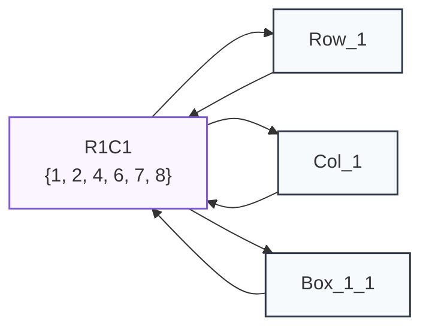
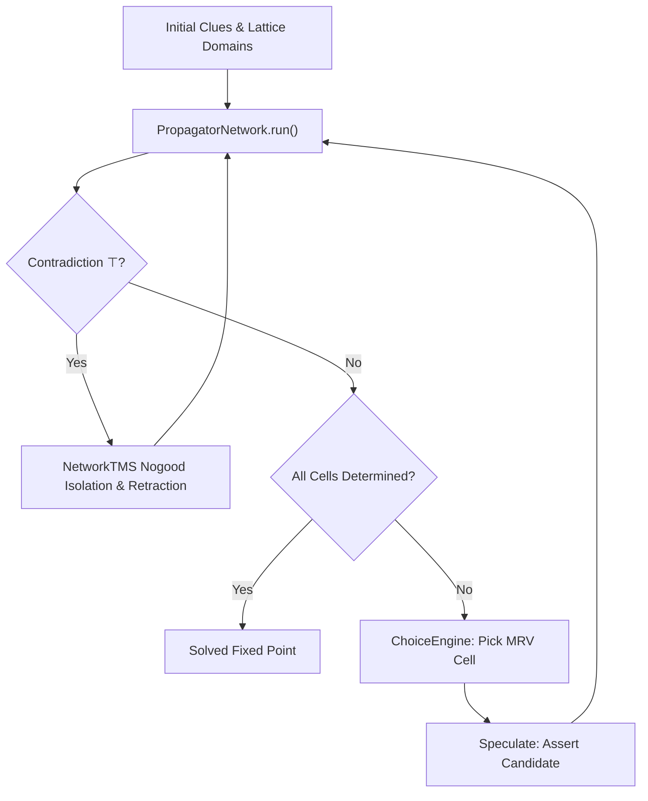

# Example: Sudoku & Constraint Search

Sudoku is a classic finite-domain constraint satisfaction problem:
- 81 cells, each initialized with a domain of digits $\{1, \dots, 9\}$.
- 27 [`AllDifferentPropagator`](file:///home/doug/code/lattice-propagator/docs/api/primitives.md) constraints: 9 rows, 9 columns, and 9 $3 \times 3$ boxes.

Because [`AllDifferentPropagator`](file:///home/doug/code/lattice-propagator/docs/api/primitives.md) continuously performs **pairwise exclusion** and **hidden single elimination**, easy-to-medium puzzles are solved purely monotonically without any backtracking search!

For difficult or diabolical puzzles where monotonic propagation reaches quiescence with undetermined candidates remaining, the lattice propagator framework supports **two complementary backtracking mechanisms**:
1. **Chronological MRV Search ([`ChoiceEngine`](file:///home/doug/code/lattice-propagator/docs/api/primitives.md)):** Interleaves fixed-point propagation with Minimum Remaining Values (First-Fail) branching, saving cell states and restoring upon contradiction ($\top$).
2. **Dependency-Directed Backtracking ([`NetworkTMS`](file:///home/doug/code/lattice-propagator/docs/api/tms.md)):** Hypotheses are asserted as defeasible `Assumption`s. When a contradiction is flagged, the TMS isolates the conflicting premises into a **nogood set**, retracts the weakest hypothesis, and permanently avoids re-exploring inconsistent subtrees.

---

## 1. Mechanism 1: Chronological MRV Search (`ChoiceEngine`)

When a puzzle cannot be resolved purely by monotonic forward pruning, [`ChoiceEngine`](file:///home/doug/code/lattice-propagator/docs/api/primitives.md) selects the undetermined cell with the fewest candidates (First-Fail / MRV), speculatively branches, runs propagation to fixed point, and backtracks upon encountering a `Contradiction`.

```python
from lattice_propagator import (
    AllDifferentPropagator,
    Cell,
    ChoiceEngine,
    DiscreteDomain,
    PropagatorNetwork,
)


def build_sudoku_network(name: str = "Sudoku") -> tuple[PropagatorNetwork, list[list[Cell]]]:
    net = PropagatorNetwork(name)
    grid = [[net.add_cell(f"R{r + 1}C{c + 1}") for c in range(9)] for r in range(9)]

    # 9 Row Constraints
    for r in range(9):
        net.add_propagator(AllDifferentPropagator(f"Row_{r + 1}", grid[r]))

    # 9 Column Constraints
    for c in range(9):
        net.add_propagator(AllDifferentPropagator(f"Col_{c + 1}", [grid[r][c] for r in range(9)]))

    # 9 3×3 Box Constraints
    for br in range(3):
        for bc in range(3):
            box_cells = [grid[br * 3 + r][bc * 3 + c] for r in range(3) for c in range(3)]
            net.add_propagator(AllDifferentPropagator(f"Box_{br + 1}_{bc + 1}", box_cells))

    return net, grid


def load_puzzle(grid: list[list[Cell]], puzzle_str: str) -> None:
    for i, ch in enumerate(puzzle_str):
        r, c = divmod(i, 9)
        val = int(ch)
        initial_domain = DiscreteDomain.single(val) if val != 0 else DiscreteDomain.range(1, 10)
        grid[r][c].set_value(initial_domain, overwrite=True)


def render_unicode_grid(grid: list[list[Cell]]) -> str:
    lines = ["╔═══════╦═══════╦═══════╗"]
    for r in range(9):
        row_str = "║ "
        for c in range(9):
            val = grid[r][c].value
            char = (
                str(val.value) if (isinstance(val, DiscreteDomain) and val.is_determined) else "·"
            )
            row_str += char + " "
            if c in (2, 5):
                row_str += "║ "
        row_str += "║"
        lines.append(row_str)
        if r in (2, 5):
            lines.append("╠═══════╬═══════╬═══════╣")
    lines.append("╚═══════╩═══════╩═══════╝")
    return "\n".join(lines)


# Hard puzzle: Arto Inkala's benchmark challenge
hard_puzzle = "000000000000003085001020000000507000004000100090000000500000073002010000000040009"

net, grid = build_sudoku_network("SudokuMRV")
load_puzzle(grid, hard_puzzle)

# 1. Monotonic pass: reaches quiescence without guessing
net.run()
engine = ChoiceEngine(net)
print(f"Monotonic solve complete? {engine.is_solved()}")

# 2. Interleaved search & backtracking
solved = engine.solve()
print(f"ChoiceEngine solved? {solved}")
print(render_unicode_grid(grid))
assert solved
assert engine.is_solved()
```

---

## 2. Mechanism 2: Dependency-Directed Backtracking (`NetworkTMS`)

In Gerald Jay Sussman and Alexey Radul's propagator formulation, backtracking is dependency-directed. Rather than blindly reverting a stack chronologically, hypotheses are asserted as defeasible `Assumption`s into the network's Truth Maintenance System:

```python
from lattice_propagator import (
    AllDifferentPropagator,
    Cell,
    Contradiction,
    DiscreteDomain,
    PropagatorNetwork,
)
from lattice_propagator.tms import NetworkTMS

net_ddb = PropagatorNetwork("SudokuDDB")
grid_ddb = [[net_ddb.add_cell(f"R{r + 1}C{c + 1}") for c in range(9)] for r in range(9)]

for r in range(9):
    net_ddb.add_propagator(AllDifferentPropagator(f"Row_{r + 1}", grid_ddb[r]))
for c in range(9):
    net_ddb.add_propagator(
        AllDifferentPropagator(f"Col_{c + 1}", [grid_ddb[r][c] for r in range(9)])
    )
for br in range(3):
    for bc in range(3):
        box_cells = [grid_ddb[br * 3 + r][bc * 3 + c] for r in range(3) for c in range(3)]
        net_ddb.add_propagator(AllDifferentPropagator(f"Box_{br + 1}_{bc + 1}", box_cells))

easy_puzzle = "003020600900305001001806400008102900700000008006708200002609500800203009005010300"
for i, ch in enumerate(easy_puzzle):
    r, c = divmod(i, 9)
    val = int(ch)
    initial_domain = DiscreteDomain.single(val) if val != 0 else DiscreteDomain.range(1, 10)
    grid_ddb[r][c].set_value(initial_domain, overwrite=True)

tms = NetworkTMS(net_ddb)

# Suppose we hypothesize an invalid value into R1C1: 5 (which conflicts with column 1)
tms.assume("R1C1", "hyp_R1C1_5", DiscreteDomain.single(5), confidence=0.75)
net_ddb.run()

# Detect contradictions across the network
conflicted_cells = [c.cell_id for c in net_ddb.cells.values() if isinstance(c.value, Contradiction)]
print(f"Contradiction detected on cells: {conflicted_cells}")
assert len(conflicted_cells) > 0

# DDB identifies the conflicting premises, extracts a nogood, and retracts the weakest assumption:
culprit = tms.resolve_contradiction(["hyp_R1C1_5"])
print(f"DDB retracted assumption: {culprit}")
print(f"Learned nogood: {tms.nogoods}")
assert culprit == "hyp_R1C1_5"
assert frozenset({"hyp_R1C1_5"}) in tms.nogoods

# Export and persist full network diagrams
from pathlib import Path

assets_dir = Path("docs/assets")
if assets_dir.is_dir():
    (assets_dir / "sudoku_network.mmd").write_text(net_ddb.generate_mermaid(), encoding="utf-8")
    (assets_dir / "sudoku_network.dot").write_text(net_ddb.generate_dot(), encoding="utf-8")
```

---

## 3. Constraint Network Visualization & Neighborhood Slicing

A full $9 \times 9$ Sudoku network contains 81 discrete domain cells and 27 `AllDifferentPropagator` constraints (Rows, Columns, and $3 \times 3$ Boxes).

### Constraint Neighborhood of Hypothesized Cell `R1C1`

Using [`NetworkGraph.from_slice`](../api/graph.md), we extract the immediate constraint neighborhood for `R1C1` ($Row_1, Col_1, Box_{1,1}$):



### Downloadable Full Network Assets (81 Cells, 27 Propagators)
- [Mermaid Diagram Source (`sudoku_network.mmd`)](../assets/sudoku_network.mmd)
- [Graphviz DOT Specification (`sudoku_network.dot`)](../assets/sudoku_network.dot)

---

## 4. Architecture Diagram (Human View)


