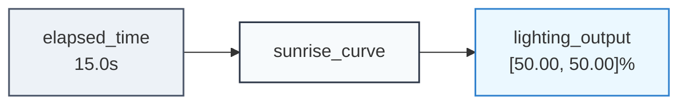

# Example: Signal Trajectories & Curve Generation

Continuous physical processes—such as gradual sunrise lighting, thermal ramp-and-soak profiles, or variable actuator throttling—cannot be modeled accurately as frozen scalar values. Instead, they require **time-varying trajectory envelopes** $[y_{\min}(t), y_{\max}(t)]$.

The `TrajectoryEnvelopePropagator` evaluates piecewise trajectories parameterized by elapsed duration $\Delta t$, supporting continuous interval bounds, normalized easing transitions, dynamic activation gating, and arbitrary custom mathematical functions.

---

## 1. Multi-Stage Trajectory with Squishing Curves

Consider an automated lighting curve that ramps up from $0\%$ to $100\%$ over $30\text{ seconds}$ using an S-curve sigmoid transition, holds steady for $60\text{ seconds}$, and then decays back down:

```python
from lattice_propagator import (
    Cell,
    FlatValue,
    IntervalValue,
    PropagatorNetwork,
    TrajectoryEnvelopePropagator,
    TrajectorySegment,
)

net = PropagatorNetwork("LightingTrajectory")

# Cells for elapsed time and the resulting bounded signal envelope
t_cell = net.add_cell("elapsed_time")
signal_cell = net.add_cell("lighting_output")

# Define segments: ramp (to 100 with sigmoid easing) and hold (at 100)
segments = [
    TrajectorySegment(
        name="ramp_up",
        duration=30.0,
        bounds=IntervalValue(100.0, 100.0),
        transition="sigmoid",
    ),
    TrajectorySegment(
        name="hold_steady",
        duration=60.0,
        bounds=IntervalValue(100.0, 100.0),
        transition="linear",
    ),
]

traj_prop = TrajectoryEnvelopePropagator(
    "sunrise_curve",
    time_cell=t_cell,
    output_cell=signal_cell,
    segments=segments,
    initial_bounds=IntervalValue(0.0, 0.0),
)
net.add_propagator(traj_prop)

# At t = 0s (start): output is 0.0
t_cell.set_value(FlatValue(0.0), overwrite=True)
net.run()
assert signal_cell.value == IntervalValue(0.0, 0.0)

# At t = 15s (midpoint): sigmoid curve passes through 50%
t_cell.set_value(FlatValue(15.0), overwrite=True)
net.run()
assert isinstance(signal_cell.value, IntervalValue)
assert abs(signal_cell.value.min_val - 50.0) < 1.0

# At t = 30s (end of ramp): target value 100.0 reached
t_cell.set_value(FlatValue(30.0), overwrite=True)
net.run()
assert signal_cell.value == IntervalValue(100.0, 100.0)

# Export and persist network diagrams
from pathlib import Path

assets_dir = Path("docs/assets")
if assets_dir.is_dir():
    (assets_dir / "trajectories_lighting_curve.mmd").write_text(
        net.generate_mermaid(), encoding="utf-8"
    )
    (assets_dir / "trajectories_lighting_curve.dot").write_text(
        net.generate_dot(), encoding="utf-8"
    )
```

### Trajectory Generator Network Topology & Live Visualization

The `TrajectoryEnvelopePropagator` translates continuous elapsed duration into bounded signal output envelopes:



#### Downloadable Diagram Assets
- [Mermaid Diagram Source (`trajectories_lighting_curve.mmd`)](../assets/trajectories_lighting_curve.mmd)
- [Graphviz DOT Specification (`trajectories_lighting_curve.dot`)](../assets/trajectories_lighting_curve.dot)

### Supported Transition Easing Profiles

Built-in normalized easing functions $p(u) \in [0, 1]$ where $u = \frac{\Delta t}{\text{duration}}$:

| Profile | Mathematical Definition | Character |
| :--- | :--- | :--- |
| **`"linear"`** | $p(u) = u$ | Constant velocity ramp |
| **`"smoothstep"`** | $p(u) = \frac{1 - \cos(\pi u)}{2}$ | Smooth start and arrival (cosine S-curve) |
| **`"sigmoid"`** | $p(u) = \frac{\sigma(10(u - 0.5)) - \sigma(-5)}{\sigma(5) - \sigma(-5)}$ | Center-weighted logistic acceleration |
| **`"tanh"`** | $p(u) = \frac{\tanh(3(u - 0.5)) - \tanh(-1.5)}{\tanh(1.5) - \tanh(-1.5)}$ | Punchy, hyperbolic S-curve |
| **`"exponential"`**| $p(u) = \frac{1 - e^{-4u}}{1 - e^{-4}}$ | Rapid initial surge asymptotically approaching target |

---

## 2. Custom Mathematical Evaluation Hooks

For specialized mathematical functions (e.g. sinusoidal breathing oscillations, psychrometric curves, or template-driven equations), `TrajectorySegment` accepts a `custom_eval` callable $f(u) \to \text{float}$ mapping normalized progress $u \in [0, 1]$ to an easing fraction:

```python
import math
from lattice_propagator import (
    Cell,
    FlatValue,
    IntervalValue,
    PropagatorNetwork,
    TrajectoryEnvelopePropagator,
    TrajectorySegment,
)

net = PropagatorNetwork("BreathingLight")
t_cell = net.add_cell("t")
out_cell = net.add_cell("out")


# Quadratic ease-in: p(u) = u²
def quadratic_ease_in(u: float) -> float:
    return u * u


segment = TrajectorySegment(
    name="eased_ramp",
    duration=10.0,
    bounds=IntervalValue(100.0, 100.0),
    custom_eval=quadratic_ease_in,
)

net.add_propagator(
    TrajectoryEnvelopePropagator(
        "pulse_prop",
        time_cell=t_cell,
        output_cell=out_cell,
        segments=[segment],
        initial_bounds=IntervalValue(0.0, 0.0),
    )
)

# At t = 5.0s (u = 0.5): output is 0.0 + 0.5² * (100.0 - 0.0) = 25.0
t_cell.set_value(FlatValue(5.0), overwrite=True)
net.run()
assert isinstance(out_cell.value, IntervalValue)
assert abs(out_cell.value.min_val - 25.0) < 1e-4
```

---

## 3. Composing with Downstream Propagators

Because `TrajectoryEnvelopePropagator` outputs a standard `IntervalValue` on its output cell, it seamlessly composes with other propagators in the network—such as an `AdderPropagator` adding an environmental bias or an `ElasticModulatorPropagator`:

```python
from lattice_propagator import (
    AdderPropagator,
    Cell,
    FlatValue,
    IntervalValue,
    PropagatorNetwork,
    TrajectoryEnvelopePropagator,
    TrajectorySegment,
)

net = PropagatorNetwork("BiasedRamp")
t_cell = net.add_cell("t")
base_curve = net.add_cell("base_curve")
bias_cell = net.add_cell("ambient_bias")
final_output = net.add_cell("final_output")

# Base linear ramp from 10 to 50 over 20s
segment = TrajectorySegment(
    name="ramp",
    duration=20.0,
    bounds=IntervalValue(50.0, 50.0),
    transition="linear",
)

net.add_propagator(
    TrajectoryEnvelopePropagator(
        "trajectory_generator",
        time_cell=t_cell,
        output_cell=base_curve,
        segments=[segment],
        initial_bounds=IntervalValue(10.0, 10.0),
    )
)

# Compose with an Adder: final_output = base_curve + ambient_bias
net.add_propagator(AdderPropagator("bias_adder", base_curve, bias_cell, final_output))

# At t = 10s (midpoint base = 30.0) with an external bias of +5.0
t_cell.set_value(FlatValue(10.0), overwrite=True)
bias_cell.set_value(FlatValue(5.0), overwrite=True)
net.run()

# Effective output = 30.0 + 5.0 = 35.0
assert final_output.value == IntervalValue(35.0, 35.0)
```
