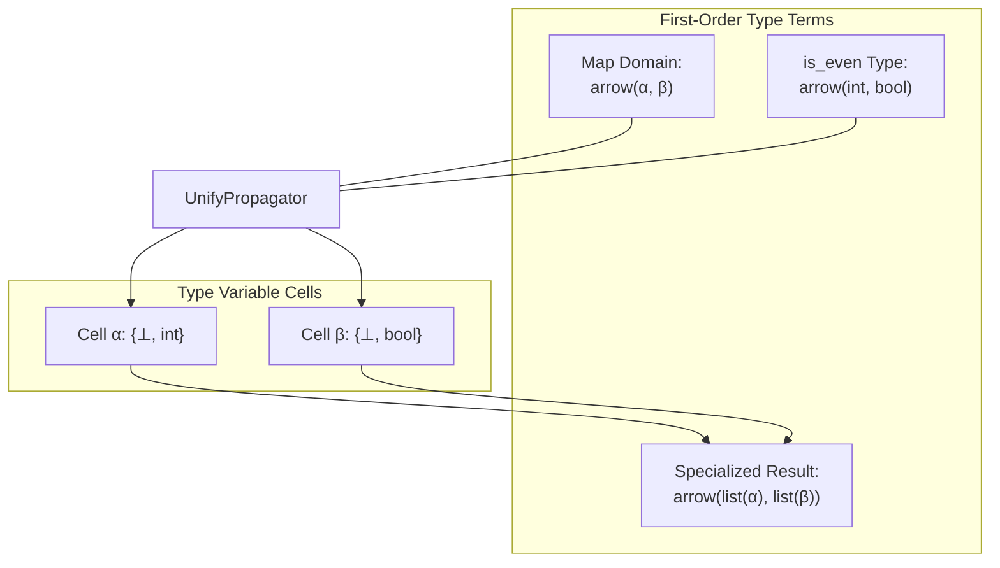

# Example: Hindley-Milner Type Inference via Term Unification

In Robin Milner's formulation of Algorithm W and Alexey Radul & Gerald Jay Sussman's *The Art of the Propagator*, polymorphic type inference is fundamentally a **monotonic constraint satisfaction problem over first-order terms** on the Herbrand universe ($\bot \sqsubseteq \text{Term} \sqsubseteq \top$).

Instead of sequential substitutions or destructive Robinson unification, type constraints are modeled as autonomous propagators:
- **`Term`**: First-order symbolic expression `functor(arg₁, arg₂, ...)` representing composite type structures like functions ($T₁ \to T₂$) or parameterized containers (`list(T)`).
- **`TermValue`**: Join-semilattice element wrapping a `Term`. If two incompatible functors or arities merge (e.g., $\text{int} \sqcup \text{bool}$), the lattice monotonically refines to $\top$ (`Contradiction`).
- **`UnifyPropagator`**: Multi-directional unification constraint propagating structure, instantiating type variables, and synchronizing sub-terms bidirectionally.
- **`PairPropagator`**: Structural pair deconstruction constraint decomposing composite pairs into `head` and `tail`.

---

## 1. Type Architecture & Constraint Graph

Consider inferring the type of applying the higher-order function `map` to a predicate `is_even`:

$$\text{map} : (\alpha \to \beta) \to (\text{list}(\alpha) \to \text{list}(\beta))$$
$$\text{is\_even} : \text{int} \to \text{bool}$$

When `map` is applied to `is_even`, the argument type of `map` must unify with the type of `is_even`:

$$(\alpha \to \beta) \cong (\text{int} \to \text{bool}) \implies \alpha = \text{int},\; \beta = \text{bool}$$



---

## 2. Executable Type Inference Implementation

```python
from lattice_propagator import (
    Bottom,
    PropagatorNetwork,
    Term,
    TermValue,
    add_unify_constraint,
)

# 1. Initialize Network
net = PropagatorNetwork("Hindley_Milner_Inference")

# 2. Allocate Type Variable Cells (initially unassigned: ⊥)
alpha = net.add_cell("α")
beta = net.add_cell("β")

assert isinstance(alpha.value, Bottom)
assert isinstance(beta.value, Bottom)

# 3. Define Type Terms:
#    is_even: int → bool
type_is_even = Term("arrow", Term("int"), Term("bool"))
c_is_even = net.add_cell("type_is_even", TermValue(type_is_even))

#    map domain requirement: α → β
#    Notice that we pass reactive Cells alpha and beta as arguments to Term!
map_domain_term = Term("arrow", alpha, beta)
c_map_domain = net.add_cell("map_domain", TermValue(map_domain_term))

# 4. Attach First-Order Unification Constraint:
#    map_domain ≡ type_is_even
add_unify_constraint(net, c_map_domain, c_is_even, name="unify_map_arg")

# 5. Run the network to propagate and solve type equations
net.run()

# 6. Verify that type variables α and β are inferred monotonically:
print(f"Inferred α: {alpha.value}")
print(f"Inferred β: {beta.value}")

assert alpha.value == TermValue(Term("int"))
assert beta.value == TermValue(Term("bool"))

# 7. Construct Specialized Return Type: list(α) → list(β)
specialized_result_term = Term(
    "arrow",
    Term("list", alpha.value.term),
    Term("list", beta.value.term),
)
print(f"Specialized map signature: {specialized_result_term}")
assert repr(specialized_result_term) == "arrow(list(int), list(bool))"
```

---

## 3. Detecting Type Errors (Herbrand Clash to $\top$)

When ill-typed expressions occur (such as passing a `bool → bool` negation function where `int → bool` is expected), the unification propagator detects the Herbrand functor clash and monotonically flags a `Contradiction` ($\top$):

```python
from lattice_propagator import (
    Contradiction,
    PropagatorNetwork,
    Term,
    TermValue,
    add_unify_constraint,
)

net_conflict = PropagatorNetwork("Type_Clash")

# Target signature expecting int -> bool
c_target = net_conflict.add_cell("target", TermValue(Term("arrow", Term("int"), Term("bool"))))

# Incompatible passed function: bool -> bool
c_bad_fn = net_conflict.add_cell("bad_fn", TermValue(Term("arrow", Term("bool"), Term("bool"))))

# Attempting to unify target with bad_fn
add_unify_constraint(net_conflict, c_target, c_bad_fn, name="unify_conflict")
net_conflict.run()

# The network detects the sub-term clash: int vs bool
assert isinstance(c_target.value, Contradiction)
print(f"Type error detected: {c_target.value.reason}")
```

---

## 4. Bidirectional Pair Deconstruction

`PairPropagator` operates bidirectionally across product types: decomposing a composite pair `(head, tail)` into its components or reconstructing the pair when `head` and `tail` are supplied:

```python
from lattice_propagator import (
    FlatValue,
    PropagatorNetwork,
    add_pair_constraint,
)

net_pair = PropagatorNetwork("Pair_Deconstruction")

pair_cell = net_pair.add_cell("pair_cell")
head_cell, tail_cell, _ = add_pair_constraint(net_pair, pair_cell)

# Propagate forward: Supply the pair (42, "status")
pair_cell.set_value(FlatValue((42, "status")))
net_pair.run()

assert head_cell.value == FlatValue(42)
assert tail_cell.value == FlatValue("status")
print(f"Deconstructed Head: {head_cell.value.val}, Tail: {tail_cell.value.val}")

# Bidirectional reconstruction in a new network:
net_recon = PropagatorNetwork("Pair_Reconstruction")
p_cell = net_recon.add_cell("p")
h_cell, t_cell, _ = add_pair_constraint(net_recon, p_cell)

h_cell.set_value(FlatValue("x"))
t_cell.set_value(FlatValue("y"))
net_recon.run()

assert p_cell.value == FlatValue(("x", "y"))
print(f"Reconstructed Pair: {p_cell.value.val}")
```
