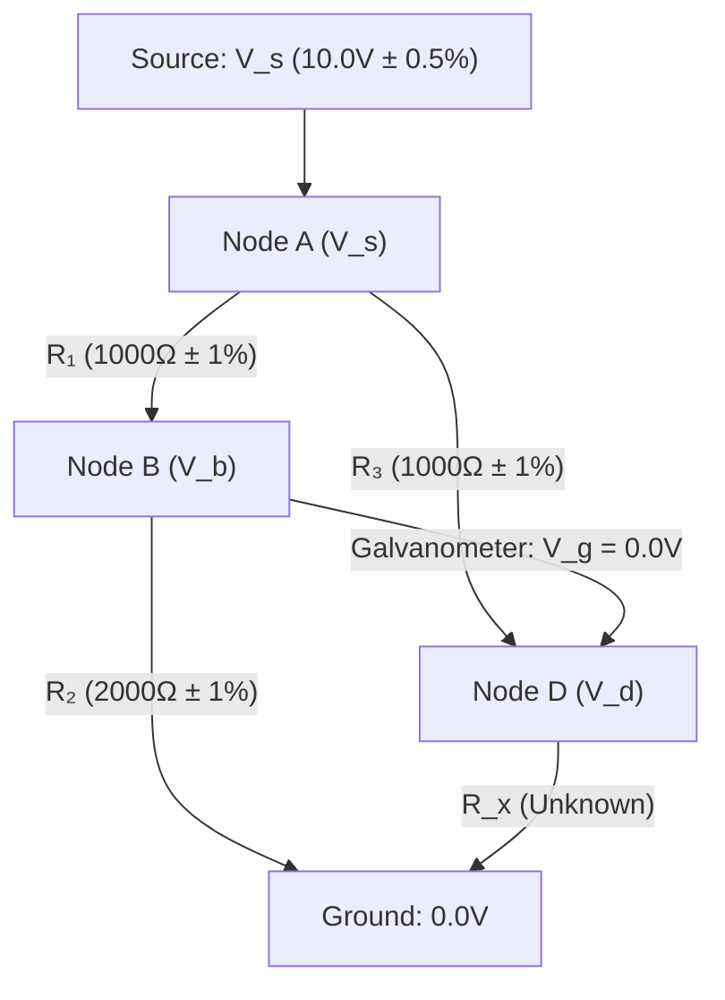

# Example: Wheatstone Bridge & Non-Linear Electrical Circuits

A classic demonstration of constraint propagation (Sussman & Steele, 1980; Hanson & Sussman, 2021) is **electrical circuit analysis**:
- Ohm's law ($V = I \times R$), series resistance ($R_{eq} = R_1 + R_2$), and Joule power dissipation ($P = I^2 \times R$) are modeled as multi-directional constraint boxes.
- A **Wheatstone Bridge** measures an unknown resistance $R_x$ by balancing two parallel divider legs against a galvanometer detector.
- At null balance ($V_g = 0\text{ V}$), the fundamental bridge relation holds:
  $$R_1 \times R_x = R_2 \times R_3 \iff R_x = \frac{R_2 \times R_3}{R_1}$$
- With **`lattice-propagator`**, the circuit is defined once declaratively with non-linear power constraints (`PowerPropagator` via `I ** 2`). When component tolerances ($R_1, R_2, R_3$) and supply voltages ($V_s$) are asserted as continuous intervals, the network automatically computes interval envelopes for $R_x$, branch currents, and power dissipation.

---

## 1. Schematic Diagram (Electrical View)




---

## 2. Executable Propagator Implementation

```python
from lattice_propagator import (
    IntervalValue,
    PropagatorNetwork,
    PowerPropagator,
)

net = PropagatorNetwork("WheatstoneBridge")

# 1. Component Resistance Cells:
r1 = net.add_cell("R1")
r2 = net.add_cell("R2")
r3 = net.add_cell("R3")
rx = net.add_cell("Rx")  # Unknown sensor resistance to deduce

# 2. Fundamental Null-Balance Constraint: R1 * Rx = R2 * R3
prod1 = r1 * rx
prod2 = r2 * r3
prod1.unify(prod2)

# 3. Supply Voltage & Power Dissipation in R1:
# Equivalent resistance of leg 1: Req1 = R1 + R2
# Current through leg 1: I1 = V_source / Req1
# Non-linear Joule power: P1 = I1² * R1 (using PowerPropagator via I1 ** 2)
v_source = net.add_cell("V_source")
req1 = r1 + r2
i1 = v_source / req1
i1_sq = i1**2
p1 = i1_sq * r1

# 4. Assert circuit measurements:
# Supply: 10.0V ± 0.5% [9.95, 10.05]
v_source.set_value(IntervalValue(9.95, 10.05))

# Precision bridge resistors (1000Ω and 2000Ω with ±1% tolerance):
r1.set_value(IntervalValue(990.0, 1010.0))
r2.set_value(IntervalValue(1980.0, 2020.0))
r3.set_value(IntervalValue(990.0, 1010.0))

# 5. Relax network to fixed-point equilibrium:
net.run()

print(f"Deduced Rx Interval: [{rx.value.min_val:.1f}, {rx.value.max_val:.1f}] Ω")
print(f"Leg 1 Current:       [{i1.value.min_val * 1000:.2f}, {i1.value.max_val * 1000:.2f}] mA")
print(f"R1 Power Dissipated: [{p1.value.min_val * 1000:.2f}, {p1.value.max_val * 1000:.2f}] mW")
```
