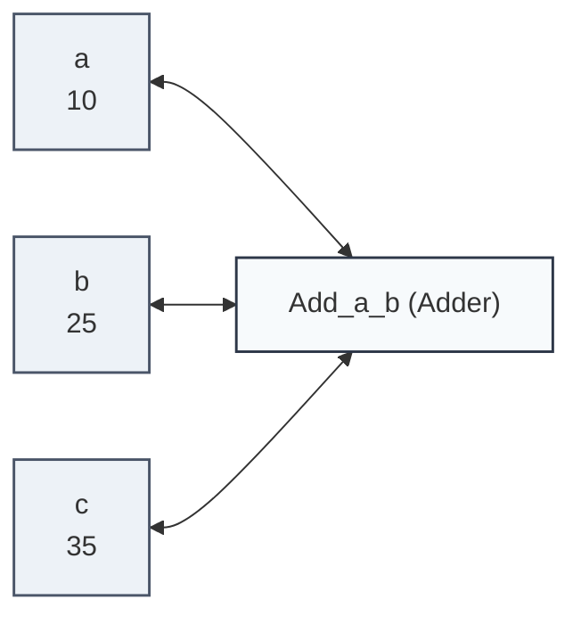

# Getting Started

This guide walks through installing `lattice-propagator` and building your first reactive constraint network.

---

## Installation

`lattice-propagator` requires **Python 3.11+** and has zero mandatory runtime dependencies.

=== "Using uv (Recommended)"

    ```bash
    uv add lattice-propagator
    ```

=== "Using pip"

    ```bash
    pip install lattice-propagator
    ```

=== "From Source for Local Development"

    ```bash
    git clone https://github.com/dougransom/lattice-propagator.git
    cd lattice-propagator
    uv pip install -e ".[all]"
    ```

---

## Core Building Blocks

Every propagator system consists of three concepts:

1. **Information Lattice**: The type of information stored. Starts at ignorance (`Bottom`), and monotonically refines as information arrives.
2. **Cell**: A container holding a lattice value. Cells maintain their current content and notify connected propagators whenever merged information strictly refines what was already known.
3. **Propagator**: An autonomous operator observing one or more input cells and pushing deductions into target cells.

---

## Your First Propagator Network

Let's build a simple multi-directional adder:

$$a + b = c$$

```python
from lattice_propagator import PropagatorNetwork

# 1. Instantiate the propagation network
net = PropagatorNetwork("AdderExample")

# 2. Wire the multi-directional constraint: c = a + b
net.c = net.a + net.b

# 3. Add information to 'a' and 'b' (automatically coerced to FlatValue)
net.a = 10
net.b = 25

# 4. Run the network to reach a fixed point
net.run()

print(net.c.val)  # 35
assert net.c.val == 35
```

#### Visualizing Network State

You can inspect the network graph and cell values programmatically at any time via `network.generate_mermaid()` or `network.generate_dot()`:



---

## Multi-Directional Deduction

Unlike standard imperative programming where `c = a + b` only computes forward, propagators are **multi-directional**. If you provide the sum $c$ and summand $b$, the network automatically deduces $a = c - b$:

```python
from lattice_propagator import PropagatorNetwork

net = PropagatorNetwork("ReverseAdder")
net.c = net.a + net.b

# Provide total and one summand:
net.c = 100
net.b = 40

net.run()

print(net.a.val)  # 60 — Deduced automatically!
assert net.a.val == 60
```

---

## Accumulating Partial Information

Unlike conventional functions that require all inputs upfront, propagators continuously operate over **partial information**:

Consider a boolean conjunction constraint:

$$c = a \land b$$

```python
from lattice_propagator import PropagatorNetwork

net = PropagatorNetwork("PartialInfoDemo")
net.c = net.a & net.b

# 1. State at total ignorance (Bottom ⊥):
net.run()
print(f"1. Initial:      a={net.a.val}, b={net.b.val}, c={net.c.val}")
assert net.a.val is None and net.b.val is None and net.c.val is None

# 2. Accumulate partial information: a = True
# Knowing only 'a = True' is not enough to determine 'c' or 'b':
net.a = True
net.run()
print(f"2. After a=True: a={net.a.val}, b={net.b.val}, c={net.c.val}")
assert net.a.val is True and net.b.val is None and net.c.val is None

# 3. An observation arrives: c = True
# Since c is True, an AND gate automatically deduces that b must be True!
net.c = True
net.run()
print(f"3. After c=True: a={net.a.val}, b={net.b.val}, c={net.c.val}")
assert net.a.val is True and net.b.val is True and net.c.val is True
```

> [!NOTE] Asymmetric Information Short-Circuiting
> If instead $a = \text{False}$ had arrived in step 2, the constraint would have immediately deduced $c = \text{False}$ forward, even while $b$ remained completely unknown ($\bot$). Propagators extract whatever conclusions are logically warranted from whatever partial information is currently known.

---

## Declarative Components & Scoped Assumptions (`PropagatorModel`)

For complex systems, reusable circuits and domains can be declared as structured classes using `PropagatorModel` and `CellDescriptor`. The `with model.assume(...)` context manager allows exploring counterfactual hypotheses that are automatically retracted upon exit:

```python
from lattice_propagator import CellDescriptor, PropagatorModel


class MultiplierBlock(PropagatorModel):
    factor = CellDescriptor(default=2)
    input_val = CellDescriptor()
    output_val = CellDescriptor()

    def setup(self) -> None:
        self.output_val << (self.factor * self.input_val)


block = MultiplierBlock("Block1")
block.input_val = 21
block.run()

print(f"Scaled: {block.output_val.val}")
assert block.output_val.val == 42

# Explore a counterfactual assumption:
with block.assume("overdrive", cell=block.factor, value=10):
    block.run()
    assert block.output_val.val == 210

# Outside the block, original state is restored automatically:
assert block.factor.val == 2
assert block.output_val.val == 42
```

---

## Under the Hood: Explicit Construction

The concise syntax shown above desugars into explicit, autonomous propagator objects operating over reactive cell containers and monotonic join-semilattices:

| Ergonomic Syntax | Explicit Underlying Call | Description |
| :--- | :--- | :--- |
| `net.a` | `net.add_cell("a")` | Creates or retrieves a reactive `Cell` container. |
| `net.a = 10` | `a.set_value(FlatValue(10))` | Coerces Python literal into a `FlatValue` lattice element. |
| `net.c = net.a + net.b` | `net.add_propagator(AdderPropagator("add", a, b, c))` | Instantiates an autonomous multi-directional propagator. |
| `net.c.val` | `c.value.val` | Unwraps the underlying value from the lattice container. |

Here is the exact same adder network constructed using the explicit Sussman-Radul primitives:

```python
from lattice_propagator import (
    AdderPropagator,
    FlatValue,
    PropagatorNetwork,
)

# 1. Instantiate the propagation network
network = PropagatorNetwork("ExplicitAdder")

# 2. Create reactive cells
a = network.add_cell("a")
b = network.add_cell("b")
c = network.add_cell("c")

# 3. Attach an AdderPropagator constraint (a + b = c)
network.add_propagator(AdderPropagator("Add_a_b_c", a, b, c))

# 4. Add information to 'a' and 'b' using explicit FlatValue wrappers
a.set_value(FlatValue(10))
b.set_value(FlatValue(25))

# 5. Run the network to reach a fixed point
network.run()

print(c.value)  # Flat(35)
assert c.value == FlatValue(35)
```

### When to Drop Down to the Explicit API

Use the explicit API when your domain requires:
- **Custom Truth Maintenance:** Tagging specific evidence sources (`a.set_value(..., source="sensor_1")`) or assigning custom confidence levels.
- **Custom Lattice Types:** Merging continuous probability densities (`GaussianValue`), bounding corridors (`IntervalValue`), or spatial sets (`SetLattice`).
- **Domain-Specific Operators:** Authoring your own multi-directional constraint operators by subclassing `Propagator` or using `@net.relation`.

---

## Next Steps

- Explore [The Information Semilattice](concepts/lattices.md) to understand intervals, Gaussian distributions, and sets.
- Check out the [Examples & Tutorials](examples/arithmetic.md) for temperature conversion, sensor fusion, and solving puzzles.
- Inspect the [API Reference](api/primitives.md) for detailed signatures.
