# Requirements & Verification Specification: Lattice Propagator Engine (`li`)

**Document Status**: Canonical Architecture & Requirements Specification  
**Target Package**: `lattice-propagator` (`li`)  
**Theoretical Foundations**: Gerald Jay Sussman & Alexey Radul (*The Art of the Propagator*, MIT CSAIL 2009); Chris Hanson & Gerald Jay Sussman (*Software Design for Flexibility*, MIT Press 2021).  
**Related Downstream Work**: [`ha-new-integration`](file:///home/doug/code/ha-new-integration) (`hni`), [`fuzzy_system`](file:///home/doug/code/fuzzy_system).

---

## 1. System Vision & Scope Boundary

The `lattice-propagator` library (`li`) is an autonomous, pure-Python computational substrate based on the Radul & Sussman propagator model. It models computation as a reactive network of autonomous multidirectional constraint units communicating strictly by monotonically refining partial information held in shared memory cells.

### Scope Boundary & Zero-Duplication Architectural Contract

```mermaid
graph LR
    subgraph LI["lattice-propagator (li) — Core Substrate"]
        direction TB
        Lattice["Partial-Information<br/>Join-Semilattices (⊔)"]
        Cells["Reactive Cells &<br/>Union-Find Unification"]
        Scheduler["Fixed-Point Worklist<br/>Quiescence Loop"]
        TMS["Truth Maintenance System<br/>(DDB & Nogoods)"]
        Search["ChoiceEngine &<br/>Constraint Solvers"]
    end

    subgraph HNI["ha-new-integration (hni) — Domain Adapter"]
        direction TB
        Coord["DataUpdateCoordinator<br/>(Event Ingestion)"]
        Entities["HA Entity Platforms<br/>(sensor.*, scene.*)"]
        STL["Dynamic STL Scenes<br/>& Trajectories"]
        Blueprints["Automations & Lovelace Cards"]
    end

    LI -->|Imported as pure dependency| HNI
```



To prevent conceptual duplication and maintenance drift between `li` and downstream consumers like `hni` (`ha-new-integration`):
1. **`li` owns all mathematical and algorithmic invariants:** semilattice axioms, partial information value types, cell unification, propagation scheduling, truth maintenance provenance, dependency-directed backtracking, and constraint search.
2. **`hni` owns all Home Assistant platform concerns:** event bus subscription, entity state lifecycle, config flows, dynamic scene trajectories (STL envelopes), Lovelace frontend cards, translation pipelines, and HACS packaging.
3. `hni` delegates all core constraint and inference requirements to this specification by reference.

---

## 2. Mathematical Axioms & Semilattice Invariants

Every value exchanged across a propagator network belongs to a join-semilattice $(L, \sqcup, \sqsubseteq, \bot, \top)$ satisfying five algebraic laws:

```yaml
type: mathematical_axiom
id: semilattice_laws
algebraic_structure: bounded_join_semilattice
properties:
  - commutativity: "x ⊔ y = y ⊔ x"
  - associativity: "(x ⊔ y) ⊔ z = x ⊔ (y ⊔ z)"
  - idempotence: "x ⊔ x = x"
  - monotonic_refinement: "x ⊑ (x ⊔ y)"
  - boundedness: "∀x ∈ L: ⊥ ⊑ x ⊑ ⊤"
```

1. **Commutativity ($x \sqcup y = y \sqcup x$):** The order in which independent propagators or sensors push information into a cell must not affect the final settled value.
2. **Associativity ($(x \sqcup y) \sqcup z = x \sqcup (y \sqcup z)$):** Grouping of intermediate evaluation stages is invariant.
3. **Idempotence ($x \sqcup x = x$):** Repeated arrival of identical information produces no state mutation and triggers no redundant wakeups.
4. **Monotonic Refinement ($x \sqsubseteq x \sqcup y$):** Information can only accumulate or narrow uncertainty. Cells never silently retract or overwrite values without explicit Truth Maintenance System (TMS) intervention.
5. **Boundedness ($\bot \sqsubseteq x \sqsubseteq \top$):** Computation begins at complete ignorance ($\bot$) and terminates either at settled knowledge or isolated contradiction ($\top$).

---

## 3. Functional Requirements (FR)

### 3.1 Partial-Information Value Types (`REQ-LAT`)

```yaml
type: requirement_group
id: REQ-LAT
title: Partial-Information Lattice Representations
```

- **REQ-LAT-1 (`Bottom` $\bot$):** The system shall provide an explicit `Bottom` sentinel representing complete absence of information. Any value $x \sqcup \bot = x$.
- **REQ-LAT-2 (`Contradiction` $\top$):** The system shall provide a `Contradiction` value representing mutually exclusive information. Any value $x \sqcup \top = \top$. Contradictions must carry causal diagnostic metadata identifying the conflicting premises.
- **REQ-LAT-3 (`FlatValue`):** The system shall support discrete scalar values where distinct constants join to $\top$:
  $$a \sqcup b = a \text{ if } a = b \text{ else } \top$$
- **REQ-LAT-4 (`IntervalValue`):** The system shall support closed numeric intervals $[a, b] \subset \mathbb{R}$ with $a \le b$. The join operation shall be set intersection:
  $$[a_1, b_1] \sqcup [a_2, b_2] = [\max(a_1, a_2), \min(b_1, b_2)]$$
  If $\max(a_1, a_2) > \min(b_1, b_2)$, the join must yield $\top$.
- **REQ-LAT-5 (`GaussianValue`):** The system shall support Gaussian distributions $\mathcal{N}(\mu, \sigma^2)$ fused via precision-weighted Bayesian combination:
  $$\frac{1}{\sigma_{fused}^2} = \frac{1}{\sigma_1^2} + \frac{1}{\sigma_2^2}, \quad \mu_{fused} = \sigma_{fused}^2 \left(\frac{\mu_1}{\sigma_1^2} + \frac{\mu_2}{\sigma_2^2}\right)$$
- **REQ-LAT-6 (`CircularInterval`):** The system shall support directed intervals on the periodic 1-sphere circle $S^1 / (P \times \mathbb{Z})$ with configurable modulus $P$ (e.g. $24.0\text{ hours}$ for time-of-day), correctly fusing windows that sweep across the boundary seam (e.g. $[23.0, 7.0] \pmod{24}$).
- **REQ-LAT-7 (`DiscreteDomain`):** The system shall support finite discrete candidate sets $\{c_1, \dots, c_k\}$ joining via set intersection.
- **REQ-LAT-8 (`SetLattice` & `MapLattice`):** The system shall support composite lattices for monotonic set union and key-wise recursive semilattice merges.
- **REQ-LAT-9 (`BeliefMassValue`):** The system shall support Dempster-Shafer evidential mass functions over power sets $2^\Theta$ combining via Dempster's rule of combination with conflict metric $K$.

---

### 3.2 Reactive Cells & Equification (`REQ-CELL`)

```yaml
type: requirement_group
id: REQ-CELL
title: Cell Architecture & Reactive Unification
```

- **REQ-CELL-1 (Cell Storage & Monotonic Assignment):** A `Cell` must hold an immutable lattice value. Calling `cell.set_value(val)` must compute `new_val = old_val ⊔ val`. If `new_val == old_val`, mutation is suppressed.
- **REQ-CELL-2 (Subscriber Wakeup):** When a cell's value monotonically refines, all attached observer propagators must be scheduled in the network worklist.
- **REQ-CELL-3 (Equivalence Unification via Union-Find):** The system shall support `cell_a.unify(cell_b)`, merging two cells into a single equivalence class using disjoint-set Union-Find with path compression. Any value in `cell_a` and `cell_b` must immediately join, and all future updates must propagate to all unified references.

---

### 3.3 Propagator Primitives & Network Scheduler (`REQ-PROP`)

```yaml
type: requirement_group
id: REQ-PROP
title: Propagator Primitives & Fixed-Point Scheduling
```

- **REQ-PROP-1 (Fixed-Point Worklist Engine):** `PropagatorNetwork.run(max_iterations)` must execute a FIFO worklist queue of alerted propagators until quiescence ($\Delta = \emptyset$).
- **REQ-PROP-2 (Cycle & Divergence Guard):** The scheduler must accept a `max_iterations` bound (default 100) and raise a descriptive error if infinite feedback loops prevent quiescence.
- **REQ-PROP-3 (Multidirectional Arithmetic):**
  - `AdderPropagator(a, b, c)` must enforce $a + b = c$ bidirectionally: refining $c$ from $(a, b)$, $b$ from $(c, a)$, and $a$ from $(c, b)$.
  - `MultiplierPropagator(a, b, c)` must enforce $a \times b = c$ bidirectionally with zero-divisor guards: refining $c$ from $(a, b)$, $b$ from $(c, a)$ when $a \ne 0$, and $a$ from $(c, b)$ when $b \ne 0$.
- **REQ-PROP-4 (Conditioning & Gating):**
  - `ConditionalPropagator` must implement non-strict conditionals: if condition is $\bot$, but both true and false branches agree on a value $v \ne \bot$, $v$ must propagate to output immediately (Sussman's optimization).
  - `SwitchPropagator` must route scalar or interval values when a boolean control cell resolves to `True`.
- **REQ-PROP-5 (Continuous Dynamics & Kalman Filtering):**
  - `RatePropagator` must compute numerical derivatives $\frac{\Delta x}{\Delta t}$ and estimate time-to-threshold intervals $[t_{min}, t_{max}]$.
  - `KalmanEstimatorPropagator` must maintain state and rate estimates under Gaussian process and measurement noise.
- **REQ-PROP-6 (Constraint Satisfaction & Elimination):**
  - `AllDifferentPropagator` must perform forward elimination (naked singles) across groups of discrete cells.

---

### 3.4 Truth Maintenance & Backtracking Search (`REQ-TMS`)

```yaml
type: requirement_group
id: REQ-TMS
title: Truth Maintenance & Search Paradigms
```

- **REQ-TMS-1 (Causal Provenance Tracking):** Every non-bottom value asserted into a cell must record its causal justification (rule name, antecedent cells, premise/assumption dependencies, and timestamp).
- **REQ-TMS-2 (Human-Readable Explanations):** The system shall provide `cell.explain()` generating structured explanation trees and human-readable causal sentences for end-user inspection.
- **REQ-TMS-3 (Dependency-Directed Backtracking - DDB):**
  - `NetworkTMS` must support defeasible assumptions alongside ground premises.
  - When a contradiction occurs, the system must trace the dependency graph, identify the conflicting assumption set (nogood), record the nogood to prevent re-exploration, and retract the minimum-confidence assumption.
- **REQ-TMS-4 (Chronological Search Choice Engine):**
  - `ChoiceEngine` must support chronological exploration with state restoration and Minimum Remaining Values (MRV) variable ordering heuristics.

---

## 4. Non-Functional Requirements (NFR)

```yaml
type: requirement_group
id: REQ-NFR
title: Quality Attributes & Architectural Constraints
```

- **REQ-NFR-1 (Zero Runtime Dependencies Policy):** The package must maintain `dependencies = []` in `pyproject.toml`. The entire core engine must be implemented strictly using the Python 3.11+ standard library.
- **REQ-NFR-2 (Developer Extras Isolation):** Visualization tools (`schemdraw`, `chess`) must be quarantined exclusively under `[project.optional-dependencies.visualize]`. The core package must install and test cleanly without them.
- **REQ-NFR-3 (Execution Latency):** Headless network convergence for networks of up to 100 cells and 200 propagators must complete in under $5\text{ ms}$ on standard consumer hardware.
- **REQ-NFR-4 (Value Immutability):** All lattice values (`IntervalValue`, `GaussianValue`, `CircularInterval`, `DiscreteDomain`) must be immutable data structures (`frozen=True` or tuples/frozensets) to ensure hashability and prevent side-channel mutations.
- **REQ-NFR-5 (Rich Mathematical Typography):** In accordance with project standards, all documentation, docstrings, and log outputs must utilize rich mathematical Unicode characters ($c^2$, $\times$, $\div$, $-$, $\pm$, $\sqrt{\ }$, $\le$, $\ge$, $\ne$, $\approx$, $\in$, $\sqcup$, $\sqcap$, $\bot$, $\top$, $\sqsubseteq$, $\to$, $\mu$, $\sigma$, $\Omega$).

---

## 5. Verification Gate & Quality Invariants

Every code change in `li` is gated by the unified verification command `./scripts/dev.sh check`:

```yaml
type: verification_gate
id: quality_gate
stages:
  - stage: metadata_parity
    tool: "./scripts/dev.sh metadata"
    rule: "Sync pyproject.toml -> codemeta.json and CITATION.cff"
  - stage: formatting_and_lint
    tool: "ruff check && ruff format --check"
    rule: "Zero linter warnings, zero formatting violations (including markdown code blocks)"
  - stage: test_suite
    tool: "pytest"
    rule: "100% unit test pass rate AND execution of all 20+ markdown documentation snippets"
  - stage: docs_parity
    tool: "tests/test_docs_parity.py"
    rule: "Zero undocumented symbols in __all__; zero orphan markdown files"
  - stage: documentation_build
    tool: "mkdocs build --strict"
    rule: "Zero broken links, zero missing navigation entries, zero syntax warnings"
```
